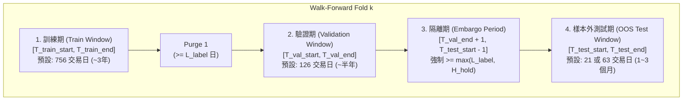

# 第三階段 C-1：台股歷史回測方法論與績效評估規範（BACKTEST_METHODOLOGY.md）

> **文件狀態**：第三階段 C-1 回測科學方法論與 17 項指標正式規範  
> **版本**：v1.0.0  
> **核心目標**：建立嚴謹的滾動樣本外驗證（Walk-Forward Validation）、杜絕標籤重疊與前視洩漏（Purge & Embargo）、制定統一無歧義的 17 項量化績效指標數學定義，以及公平的台股基準指數（Benchmark）對照規範。

---

## 目錄

1. [Walk-Forward 滾動樣本外驗證與隔離期（Embargo）設計](#一walk-forward-滾動樣本外驗證與隔離期embargo設計)
2. [防前視偏差與防倖存者偏差之強制協定](#二防前視偏差與防倖存者偏差之強制協定)
3. [現階段模型可用性之誠實界定與替代驗證方案](#三現階段模型可用性之誠實界定與替代驗證方案)
4. [17 項核心回測績效指標之數學定義與邊界處理](#四17-項核心回測績效指標之數學定義與邊界處理)
5. [基準指數（Benchmark）對照與超額報酬評估方法](#五基準指數benchmark對照與超額報酬評估方法)

---

## 一、Walk-Forward 滾動樣本外驗證與隔離期（Embargo）設計

在機器學習量化交易中，傳統隨機交叉驗證（K-Fold CV）或無隔離期的簡單時序切分，會因為預測標籤（Label）跨越切分邊界而產生嚴重的樣本內資訊洩漏（Label Overlap Leakage）。本系統強制採用 **具備 Purge 與 Embargo 隔離期的滾動 Walk-Forward 驗證框架**。

### 1.1 時間視窗結構圖

對於第 $k$ 個滾動驗證折（Fold $k$），時間軸嚴格切分為以下四個互不重疊的區間：

### 1.2 七大 Walk-Forward 設計規範

#### 1. 訓練期間（Train Window, $[T_{\text{train\_start}}, T_{\text{train\_end}}]$）
- **用途**：擬合模型參數（如 LightGBM 分裂節點）並計算特徵標準化統計量（Mean / Std / Median / MAD）。
- **預設長度**：`756` 個台股交易日（約 3 個日曆年），支援滾動視窗（Rolling Window，固定長度向前平移）或擴張視窗（Expanding Window，起點固定、終點向前延伸）。
- **標籤截止約束**：若模型的預測目標標籤為「未來 $L_{\text{label}}$ 個交易日報酬率」（例如 `qlib-tw-trader` 使用 $\frac{P_{t+3}}{P_{t+1}} - 1$，其標籤跨度為 $L_{\text{label}} = 3$ 個交易日），則訓練集最後一筆樣本的特徵日期 $t$ 必須滿足：
  $$t + L_{\text{label}} \le T_{\text{train\_end}}$$
  否則該筆樣本的標籤已經使用了 $T_{\text{train\_end}}$ 之後的未來價格，必須予以剔除（Purging）。

#### 2. 驗證期間（Validation Window, $[T_{\text{val\_start}}, T_{\text{val\_end}}]$）
- **用途**：用於 Early Stopping（提前停止訓練以防過擬合）與超參數選擇。
- **預設長度**：`126` 個台股交易日（約半年）。
- **邊界約束**：$T_{\text{val\_start}}$ 與訓練集最後一筆樣本日期之間必須間隔至少 $L_{\text{label}}$ 個交易日（`Purge 1`）。同樣地，驗證集最後一筆樣本的標籤實現日不得晚於 $T_{\text{val\_end}}$。

#### 3. 隔離期間（Embargo Period, $N_{\text{embargo}}$ 個交易日）
- **用途**：徹底阻斷驗證集末端與樣本外測試集開端之間的「標籤自相關（Serial Correlation）」與「持倉跨期污染」。
- **強制數學下限**：
  $$N_{\text{embargo}} \ge \max\left(L_{\text{label}}, \, H_{\text{max\_hold}}\right)$$
  - 其中 $L_{\text{label}}$ 為模型預測標籤的前瞻交易日數（如 5 日報酬則 $L_{\text{label}}=5$），$H_{\text{max\_hold}}$ 為策略設定之最大持有交易日數（`StrategyConfig.max_holding_days`，預設為 `10`）。
  - **預設值**：當 `max_holding_days = 10` 時，$N_{\text{embargo}}$ 強制設為至少 **`10` 個交易日**（即 $T_{\text{test\_start}}$ 必須比 $T_{\text{val\_end}}$ 晚至少 11 個交易日）。
- **攔截機制**：`PredictionProvider` 在載入任何 `PredictionBatch` 時，若發現 `metadata.model_trained_until`（含驗證期）距離當前決策日不足 $N_{\text{embargo}}$ 個交易日，立即拋出 `LookaheadViolationError`。

#### 4. 樣本外測試期間（Out-of-Sample Test Window, $[T_{\text{test\_start}}, T_{\text{test\_end}}]$）
- **用途**：唯一計入最終回測淨值曲線（NAV Curve）與績效指標的區間。
- **預設長度**：每次向前滾動 `21` 個交易日（約 1 個月）或 `63` 個交易日（約 1 季）。
- **無縫拼接原則**：Fold $k$ 的測試期結束日 $T_{\text{test\_end}}^{(k)}$ 之收盤帳務狀態（現金、持倉 `PositionLot`、應收股利、風控高點 `rolling_peak_nav`）直接延續至 Fold $k+1$ 的測試期第一天 $T_{\text{test\_start}}^{(k+1)}$（即 $\text{ShiftStep} = \text{Length}(\text{Test Window})$），各測試區間在時間軸上緊密相接、不重疊且不重置帳本。

#### 5. 模型重訓頻率與版本血統記錄（Model Lineage & Versioning）
- 每一個 Walk-Forward Fold 對應一個獨立的模型版本 ID（`model_version`）與訓練元資料：
  - `fold_index: int`
  - `train_start_date: date`, `train_end_date: date`
  - `val_start_date: date`, `val_end_date: date`
  - `embargo_trading_days: int`
  - `oos_test_start_date: date`, `oos_test_end_date: date`
  - `feature_set_hash: str`（特徵定義與計算公式之 SHA-256 雜湊）
  - `dataset_snapshot_id: str`（輸入資料集快照編號）

#### 6. 特徵標準化與缺失值處理規範（Feature Normalization & Imputation）
- **橫截面標準化（Cross-Sectional Z-Score / Rank）**：若在每日 $T$ 對當日候選股票池進行橫截面標準化（如 `CSZScoreNorm` 或 `CSRankNorm`），僅能使用**當日 $T$ 屬於當時點股票池（PIT Universe）之股票在當日 $T$（或之前）的特徵值**。
- **時序標準化（Time-Series Normalization）**：若使用跨日均值與標準差，統計量**只能由該 Fold 的訓練期 $[T_{\text{train\_start}}, T_{\text{train\_end}}]$ 計算並固定（Freeze）**，套用至驗證期與測試期；**嚴禁使用全歷史期間（Full-Sample）計算均值與標準差**。
- **缺失值處理**：**嚴禁對原始特徵直接執行 `df.fillna(0)`**（如 `BACKTEST_DATA_AUDIT.md` 揭露之 `qlib-tw-trader` 缺陷 5）。必須在橫截面標準化後補橫截面中位數（`0.0` 僅限於已完成標準常態化 Z-Score 之後），或將特徵缺失過多之標的在選股前明確剔除。

#### 7. 股票池選擇時點（Point-in-Time Universe Selection）
- 在交易日 $T$ 進行模型推論與 `StrategyEngine` 選股時，候選股票池 $\mathcal{U}_T$ **僅能根據截至交易日 $T$ 收盤已知的歷史資訊決定**：
  1. 該股票在日 $T$ 已正式上市櫃（`listed_date <= T`）且尚未終止上市（`delisted_date is None or delisted_date > T`）。
  2. 若以市值篩選（例如前 100 大或前 300 大），必須使用 **日 $T$（或 $T-1$）當下的歷史收盤價 $\times$ 當時點已發行股數** 計算當時市值；**絕對禁止使用回測結束日（未來）的市值排名回推過去股票池**。

---

## 二、防前視偏差與防倖存者偏差之強制協定

為確保回測引擎在程式碼層級強制執行上述方法論，`src/tw_quant/backtest/` 內建以下 5 道硬性攔截檢查（Hard Guards）：

| 協定編號 | 防護目標 | 觸發條件 | 系統強制處置 |
| :---: | :--- | :--- | :--- |
| **PG-01** | **禁止同日收盤決策、同日成交** | 當委託單之來源訊號 `signal.timestamp.date() >= current_trading_day` 時嘗試在當日 `09:00` 或 `13:30` 撮合。 | 立即拋出 `LookaheadViolationError`，拒絕撮合。 |
| **PG-02** | **禁止未來特徵進入決策** | `PredictionBatch.metadata.latest_feature_timestamp > decision_time` 或 `generated_at > decision_time`。 | `StrategyEngine` 與 `PredictionProvider` 雙重拋出異常。 |
| **PG-03** | **禁止訓練期入侵測試期（In-Sample Leakage）** | `TradingCalendar.trading_days_between(train_or_val_end_date, decision_date) <= embargo_days`。 | `PredictionProvider` 拋出 `LookaheadViolationError`。 |
| **PG-04** | **禁止前復權價格進入撮合器** | 若傳入 `HistoricalExecutionSimulator` 的 `MarketBar.price_basis != "RAW_UNADJUSTED"`。 | 立即拋出 `DataIntegrityError`，拒絕以還原價撮合。 |
| **PG-05** | **靜態股票池倖存者偏差強制警告** | 若 `HistoricalDataProvider` 的股票池未提供每日動態歷史成分或未標記 `is_pit_verified=True`。 | `BacktestReport.survivorship_bias_free` 強制設為 `False`，並在報告首頁印出顯眼警告橫幅。 |

---

## 三、現階段模型可用性之誠實界定與替代驗證方案

依據第一階段至第三階段 C-1 的實地查核，我們必須對目前專案中 AI 模型的真實狀態做出最誠實的界定：

### 3.1 目前「已可測試與驗證」的部分
1. **事件驅動回測閉環與時間軸正確性**：從 `PredictionBatch` 輸入 $\to$ `StrategyEngine` 選股與等權重配置 $\to$ `TradingGateway` / `RiskEngine` 12 道風控審核 $\to$ $T+1$ 日 `HistoricalExecutionSimulator` 開盤/限價/量能受限撮合 $\to$ `TaiwanPaperBroker` 交割 $\to$ `BacktestLotLedger` FIFO 批次與進場日管理 $\to$ `CorporateActionProcessor` 除權息應收股利會計 $\to$ `PortfolioValuator` 每日 NAV 結算 $\to$ `PerformanceAnalyzer` 17 項指標計算。
2. **交易摩擦與台股微結構影響量化**：0.1425% 手續費（含 20 元低消）、0.3% 證交稅、6 級 Tick Size 滑價、$\pm 10\%$ 漲跌停鎖死買不進/賣不出、處置股量能減半對策略淨值的真實侵蝕程度。
3. **風控與出場保護機制有效性**：8% 個股停損、10 個交易日到期出場（配合 FIFO `entry_date`）、2% 單日虧損熔斷與 10% 最大回撤熔斷在極端行情下的保護效果。

### 3.2 目前「尚不可驗證」的部分
1. **Qlib LightGBM 模型在台股真實歷史市場的真實預測能力（Alpha）**：
   - 如 `BACKTEST_DATA_AUDIT.md` 所述，`qlib-tw-trader/data/` 目前為空（0 Bytes），本地尚無真實歷史行情資料庫與已訓練之 `.pkl` 模型。
   - 因此，在未完成無偏差歷史資料下載與 Walk-Forward 重新訓練前，**任何使用合成資料或 `MockTestPredictor` 跑出的回測報酬率、夏普比率與勝率，僅能證明「回測引擎軟體邏輯與會計計算正確」，絕對不能宣稱代表 AI 選股模型在真實台股市場具備獲利能力**。

### 3.3 第三階段 C 的三層替代驗證方案（Verification Tiers）

為了在本地尚無完整 Qlib 歷史重訓模型的情況下，依然能徹底驗證回測引擎並支援未來的真實模型接入，我們設計三層標準化的 `PredictionProvider` 實作：

| 驗證層級 | Provider 名稱 | 適用階段 | 運作方式與防偽標記 |
| :---: | :--- | :--- | :--- |
| **Tier 1** | `SyntheticDeterministicPredictionProvider` | **第三階段 C-2 單元與整合測試** | 載入由測試案例精確構造的 `PredictionBatch` 序列（用於驗證 BT-01 至 BT-17 所有極端邊界條件）。報告強制標記 `model_authenticity = "SYNTHETIC_FIXTURE"`。 |
| **Tier 2** | `RuleBasedBaselinePredictionProvider` | **基準策略對照（Baseline Benchmark）** | 不依賴 Qlib/LightGBM，僅使用純標準庫根據截至 $T$ 日之原始價格與成交量計算簡單因果動量/反轉基準分數（例如過去 20 日報酬率排名），作為未來檢驗 AI 模型是否真正產生超額價值的「零成本規則對照組（Zero-ML Baseline）」。報告標記 `model_authenticity = "RULE_BASED_BASELINE"`。 |
| **Tier 3** | `ArchivedWalkForwardPredictionProvider` | **正式 AI 模型離線回測驗收** | 讀取由外部 Qlib 訓練環境依本文第一節 Walk-Forward + Embargo 規範預先訓練並匯出封存的歷史 `PredictionBatch` JSONL/CSV 檔案庫，在載入時強制執行 `PG-02`（防偽）與 `PG-03`（Embargo 邊界）驗證。報告標記 `model_authenticity = "VERIFIED_WALK_FORWARD_MODEL"`。 |

---

## 四、17 項核心回測績效指標之數學定義與邊界處理

設回測樣本外測試期包含 $N$ 個台股交易日 $t \in \{1, 2, \dots, N\}$，初始投入資金為 $V_0 > 0$，第 $t$ 日收盤總資產淨值（含可用現金、預留現金、持倉市值與應收股利）為 $V_t$。
定義第 $t$ 日之單日簡單報酬率為：
$$r_t = \frac{V_t}{V_{t-1}} - 1 \quad (t = 1, \dots, N)$$
每年台股標準交易日數常數定義為 $A = 252$。

### 指標 1：累積報酬率（Total Return, $R_{\text{total}}$）
- **公式**：
  $$R_{\text{total}} = \frac{V_N - V_0}{V_0} = \prod_{t=1}^{N} (1 + r_t) - 1$$
- **時間尺度**：全回測測試期間（無單位比率，展示時以百分比 $\%$ 表示）。
- **邊界處理**：若 $N = 0$（無交易日），回傳 `Decimal("0.0")`。

### 指標 2：年化報酬率（Compound Annual Growth Rate, $\text{CAGR}$）
- **公式**：以實際經過之台股交易日數 $N$ 按年化基數 $A=252$ 折算：
  $$\text{CAGR} = \left( \frac{V_N}{V_0} \right)^{\frac{252}{N}} - 1$$
- **時間尺度**：年化比率。
- **邊界處理**：若 $N = 0$ 或 $V_N \le 0$，回傳 `0.0`（或當 $V_N \le 0$ 時回傳 `-1.0`）；若回測天數 $N < 21$（不足一個月），報告同時標註 `cagr_extrapolated_from_short_window = True` 提醒使用者年化外推風險。

### 指標 3：年化波動率（Annualized Volatility, $\sigma_{\text{ann}}$）
- **公式**：採用日報酬率之樣本標準差（自由度 $N-1$）：
  $$\bar{r} = \frac{1}{N} \sum_{t=1}^{N} r_t, \quad s_r = \sqrt{\frac{1}{N - 1} \sum_{t=1}^{N} (r_t - \bar{r})^2}, \quad \sigma_{\text{ann}} = s_r \times \sqrt{252}$$
- **時間尺度**：年化標準差。
- **邊界處理**：若 $N < 2$ 或所有 $r_t$ 完全相等（如全期間空手未交易），回傳 `0.0`。

### 指標 4：夏普比率（Sharpe Ratio）
- **無風險利率假設（$R_f$）**：預設採用台灣央行重貼現率 / 台灣一年期定存利率近似值 **年化 $R_f = 1.5\%$（`0.015`）**（可於 `AnalyzerConfig.risk_free_rate_annual` 配置，亦可設為 `0.0` 計算零無風險利率基準）。
- **每日無風險報酬率**：$r_f = (1 + R_f)^{\frac{1}{252}} - 1 \approx \frac{R_f}{252}$。
- **公式**：定義每日超額報酬 $e_t = r_t - r_f$：
  $$\text{Sharpe} = \frac{\bar{e}}{s_e} \times \sqrt{252}$$
- **時間尺度**：年化無因次比率。
- **邊界處理**：若 $N < 2$ 或分母 $s_e = 0$，回傳 `None`（於報告中顯示為 `N/A (Zero Volatility)`，絕不除以零或回傳無限大）。

### 指標 5：索提諾比率（Sortino Ratio）
- **公式**：以每日目標報酬率 $r_{\text{target}} = r_f$ 計算下行半方差（Downside Deviation，$\text{DD}_{\text{ann}}$）：
  $$\text{DD}_{\text{daily}} = \sqrt{\frac{1}{N} \sum_{t=1}^{N} \min\left(0, \, r_t - r_f\right)^2}, \quad \text{DD}_{\text{ann}} = \text{DD}_{\text{daily}} \times \sqrt{252}$$
  $$\text{Sortino} = \frac{\bar{e} \times 252}{\text{DD}_{\text{ann}}}$$
- **時間尺度**：年化無因次比率。
- **邊界處理**：若全期間無任何一日報酬低於 $r_f$（即 $\text{DD}_{\text{ann}} = 0$），回傳 `None`（標註 `N/A (Zero Downside Deviation)`）。

### 指標 6：最大回撤（Maximum Drawdown, $\text{MDD}$）
- **公式**：定義截至第 $t$ 日之歷史最高淨值水位（High-Water Mark）為 $M_t = \max_{k \in \{0, 1, \dots, t\}} V_k$，第 $t$ 日之回撤幅度（正值表示下跌比例）為：
  $$d_t = \frac{M_t - V_t}{M_t} \ge 0$$
  $$\text{MDD} = \max_{t \in \{0, 1, \dots, N\}} d_t$$
- **時間尺度**：全期間最大回撤比例（介於 `0.0` 至 `1.0` 之間）。
- **邊界處理**：若淨值單調上升從未下跌，$\text{MDD} = 0.0$。

### 指標 7：最長回撤期間（Maximum Drawdown Duration, $\text{MDD}_{\text{duration}}$）
- **公式**：計算淨值從任一歷史高點 $M_t$ 下跌後，直到再次創下新高（$V_{t'} \ge M_t$）或直到回測結束日 $N$ 所經歷之**連續台股交易日數**的最大值：
  $$\text{ let } \tau_t = \begin{cases} 0, & \text{if } V_t = M_t \\ \tau_{t-1} + 1, & \text{if } V_t < M_t \end{cases}, \quad \text{MDD}_{\text{duration}} = \max_{t \in \{1, \dots, N\}} \tau_t$$
- **時間尺度**：整數（台股交易日數）。同時在報告中附註該回撤是否於回測結束前已恢復（`is_recovered: bool`）。

### 指標 8：卡瑪比率（Calmar Ratio）
- **公式**：
  $$\text{Calmar} = \frac{\text{CAGR}}{\text{MDD}}$$
- **時間尺度**：年化無因次比率。
- **邊界處理**：若 $\text{MDD} = 0$，回傳 `None`（標註 `N/A (Zero Drawdown)`）。

### 指標 9：勝率（Win Rate）
- **主指標定義（已平倉批次交易勝率，Closed-Lot Trade Win Rate）**：
  設回測期間所有已完成平倉（含部分平倉結轉）之 `ClosedLotTrade` 集合為 $\mathcal{C}$，總筆數為 $K = |\mathcal{C}|$。其中扣除買賣雙邊手續費與賣出證交稅後之淨已實現損益 `realized_pnl > 0` 的筆數為 $K_{\text{win}}$：
  $$\text{WinRate}_{\text{trade}} = \frac{K_{\text{win}}}{K}$$
- **輔助指標定義（日報酬勝率，Daily Win Rate）**：有持倉或有交易之交易日中，$r_t > 0$ 之比例。
- **邊界處理**：若 $K = 0$（全期間無任何已平倉交易），回傳 `None`（標註 `N/A (0 Closed Trades)`）。

### 指標 10：平均獲利 / 平均虧損比（Payoff Ratio / Profit-Loss Ratio）
- **公式**：設獲利交易集合 $\mathcal{C}^+ = \{c \in \mathcal{C} \mid c.\text{realized\_pnl} > 0\}$，虧損交易集合 $\mathcal{C}^- = \{c \in \mathcal{C} \mid c.\text{realized\_pnl} < 0\}$：
  $$\text{AvgWin} = \frac{1}{|\mathcal{C}^+|} \sum_{c \in \mathcal{C}^+} c.\text{realized\_pnl}, \quad \text{AvgLoss} = \frac{1}{|\mathcal{C}^-|} \sum_{c \in \mathcal{C}^-} |c.\text{realized\_pnl}|$$
  $$\text{PayoffRatio} = \frac{\text{AvgWin}}{\text{AvgLoss}}$$
- **邊界處理**：若 $|\mathcal{C}^+| = 0$ 或 $|\mathcal{C}^-| = 0$，回傳 `None`。

### 指標 11：獲利因子（Profit Factor）
- **公式**：總毛獲利除以總毛虧損絕對值（均已含交易稅費）：
  $$\text{ProfitFactor} = \frac{\sum_{c \in \mathcal{C}^+} c.\text{realized\_pnl}}{\sum_{c \in \mathcal{C}^-} |c.\text{realized\_pnl}|}$$
- **邊界處理**：若分母為 `0`（無任何虧損交易），回傳 `None`。

### 指標 12：平均持有天數（Average Holding Period）
- **公式**：以每一筆已平倉批次 `ClosedLotTrade` 實際跨越之**台股交易日數** $h_c = \text{TradingCalendar.trading\_days\_between}(c.\text{entry\_date}, c.\text{exit\_date})$ 計算股數加權平均與簡單筆數平均：
  $$\text{AvgHoldingDays}_{\text{simple}} = \frac{1}{K} \sum_{c \in \mathcal{C}} h_c, \quad \text{AvgHoldingDays}_{\text{weighted}} = \frac{\sum_{c \in \mathcal{C}} c.\text{quantity} \cdot h_c}{\sum_{c \in \mathcal{C}} c.\text{quantity}}$$
- **時間尺度**：台股交易日數（Trading Days）。
- **邊界處理**：若 $K = 0$，回傳 `None`。針對回測結束日仍未平倉之活躍批次（`OpenLots`），另行統計 `avg_open_lot_age_days` 供參考，不混入已平倉平均持有天數。

### 指標 13：週轉率（Portfolio Turnover）
- **公式**：定義第 $t$ 日買進成交總金額為 $B_t$，賣出成交總金額為 $S_t$：
  - **期間單邊平均週轉率（Single-Sided Daily Turnover）**：$\text{Turnover}_{\text{daily}} = \frac{1}{N} \sum_{t=1}^{N} \frac{B_t + S_t}{2 \cdot V_t}$
  - **年化週轉率（Annualized Turnover）**：$\text{Turnover}_{\text{ann}} = \text{Turnover}_{\text{daily}} \times 252$
- **時間尺度**：年化倍數（例如 `6.0` 代表一年換手 6 次，即 600%）。

### 指標 14：總手續費與總證交稅佔比（Commission & Tax Cost Drag）
- **公式**：設全期間累計買賣手續費總額為 $C_{\text{comm}}$，累計賣出證券交易稅總額為 $C_{\text{tax}}$，總直接交易稅費 $C_{\text{total}} = C_{\text{comm}} + C_{\text{tax}}$：
  1. **佔初始資金比例**：$\text{CostDrag}_{\text{capital}} = \frac{C_{\text{total}}}{V_0}$
  2. **年化稅費拖累率**：$\text{CostDrag}_{\text{annual}} = \frac{C_{\text{total}}}{\bar{V}} \times \frac{252}{N}$（其中 $\bar{V}$ 為期間平均每日 NAV）
  3. **佔總成交金額比例（有效單邊費率）**：$\text{EffectiveFeeRate} = \frac{C_{\text{total}}}{\sum_{t=1}^N (B_t + S_t)}$

### 指標 15：滑價成本佔比（Slippage Cost Drag）
- **公式**：對於每一筆成交 `FillRecord` $f$，定義無滑價基準價為 $P_{f, \text{ref}}$（例如開盤價 `bar.open`），實際成交價為 $P_{f, \text{exec}}$，成交股數為 $Q_f$。單筆滑價金額為：
  $$\text{SlippageCost}_f = \begin{cases} (P_{f, \text{exec}} - P_{f, \text{ref}}) \times Q_f, & \text{if BUY} \\ (P_{f, \text{ref}} - P_{f, \text{exec}}) \times Q_f, & \text{if SELL / CLOSE} \end{cases}$$
  - **滑價佔初始資金比例**：$\text{SlippageDrag}_{\text{capital}} = \frac{\sum_f \text{SlippageCost}_f}{V_0}$

### 指標 16：未成交委託比例（Unfilled / Expired Order Ratio）
- **公式**：設全期間經風控核准並送入 `TaiwanPaperBroker` 之總委託單數為 $O_{\text{submitted}}$，其中完全成交（`FILLED`）筆數為 $O_{\text{filled}}$，部分成交（`PARTIALLY_FILLED`）筆數為 $O_{\text{partial}}$，完全未成交到期（`EXPIRED` with `filled_qty == 0`）筆數為 $O_{\text{unfilled}}$：
  1. **委託筆數未成交率**：$\text{UnfilledOrderRatio} = \frac{O_{\text{unfilled}}}{O_{\text{submitted}}}$
  2. **委託金額/股數未達成率（Volume Shortfall Ratio）**：$\text{ShortfallRatio} = 1 - \frac{\sum_{o} o.\text{filled\_quantity}}{\sum_{o} o.\text{order\_quantity}}$
  3. **未成交原因分類統計**：按 `LOCKED_LIMIT_UP`（漲停買不到）、`LOCKED_LIMIT_DOWN`（跌停賣不出）、`VOLUME_CAP_EXCEEDED`（量能受限）、`LIMIT_PRICE_NOT_REACHED`（限價未觸及）、`HALTED`（停牌）分別統計筆數與佔比。

### 指標 17：風控攔截比例與原因統計（Risk Rejection Ratio & Breakdown）
- **公式**：設 `StrategyEngine` 產出並送入 `TradingGateway` 之總訊號數為 $S_{\text{total}}$，其中被 `RiskEngine` 拒絕之訊號數為 $S_{\text{rejected}}$：
  $$\text{RiskRejectionRatio} = \frac{S_{\text{rejected}}}{S_{\text{total}}}$$
- **結構化原因拆解**：依 `RiskDecision.failed_checks`（例如 `circuit_breaker`、`daily_loss_limit`、`max_drawdown`、`max_position_concentration`、`max_gross_exposure`、`disposition_stock` 等 12 項規則）統計各規則觸發攔截之次數與百分比。

---

## 五、基準指數（Benchmark）對照與超額報酬評估方法

### 5.1 基準指數選擇與「含息總報酬」公平對照原則

台股市場具備高殖利率特性（加權指數年平均現金殖利率約 $3\% \sim 4.5\%$）。每年 6 至 8 月除權息旺季，發行量加權股價指數（`^TWII`）會因成分股除息而自然蒸發數百點。
- **常見方法論錯誤**：若策略本身在帳本中計入了現金股利與配股（屬**總報酬 Total Return**），卻拿不含息的「加權股價指數（Price Index, `^TWII`）」作為 Benchmark 計算超額報酬（Alpha），策略每年會平白無故多出 $3\% \sim 4.5\%$ 的虛假超額報酬！
- **本系統強制對照規範**：
  1. **主比較基準（Primary Total Return Benchmark）**：
     - 優先採用 **台灣加權股價報酬指數（TWSE Total Return Index, 代號 `IR0001`）** 或 **元大台灣 50 ETF（`0050.TW`）含息總報酬序列**。
     - 與本系統含除權息帳務之策略 `Total NAV` 進行 **同基準（Total Return vs. Total Return）** 比較。
  2. **次要參考基準（Secondary Price Benchmark）**：
     - 台灣發行量加權股價指數（`^TWII`），僅供對照不含息價格波動，並在報告中明確標註 `benchmark_includes_dividends: False`。
  3. **內部無模型基準（Equal-Weight Universe Buy-and-Hold Baseline）**：
     - 於回測首日等權重買進當時點候選股票池並持有至期末，用於分離「股票池本身的 Beta 表現」與「AI 排名選股 + 動態換倉的真實 Alpha」。

### 5.2 日期對齊與交易成本處理規則

1. **交易日曆嚴格對齊（Calendar Alignment）**：
   - Benchmark 序列必須與策略之 `DailyNAVRecord` 按相同的台股交易日 $t \in \{1, \dots, N\}$ 進行一對一對齊：
     $$r_t^{\text{bench}} = \frac{I_t}{I_{t-1}} - 1$$
   - 若某交易日 $t$ 基準指數缺值，嚴禁將隔日兩天報酬壓縮為一天，必須拋出 `BenchmarkAlignmentError` 或標記缺漏。
2. **Benchmark 交易成本處理**：
   - 對於指數型基準（`IR0001` / `^TWII`），視為理論市場組合（無手續費），同時提供扣除 ETF 買進單邊成本（0.1425% 手續費）之「可投資基準淨值曲線（Investable Benchmark NAV）」。
3. **相對績效指標計算公式**：
   - **年化超額報酬（Annualized Active Return / Alpha）**：$\alpha_{\text{ann}} = \text{CAGR}_{\text{strategy}} - \text{CAGR}_{\text{bench}}$
   - **追蹤誤差（Annualized Tracking Error, $\text{TE}$）**：設每日主動報酬 $a_t = r_t - r_t^{\text{bench}}$，則 $\text{TE} = s_a \times \sqrt{252}$
   - **資訊比率（Information Ratio, $\text{IR}$）**：
     $$\text{IR} = \frac{\bar{a}}{s_a} \times \sqrt{252}$$
   - **Beta 係數（$\beta$）**：$\beta = \frac{\text{Cov}(r_t, r_t^{\text{bench}})}{\text{Var}(r_t^{\text{bench}})}$
