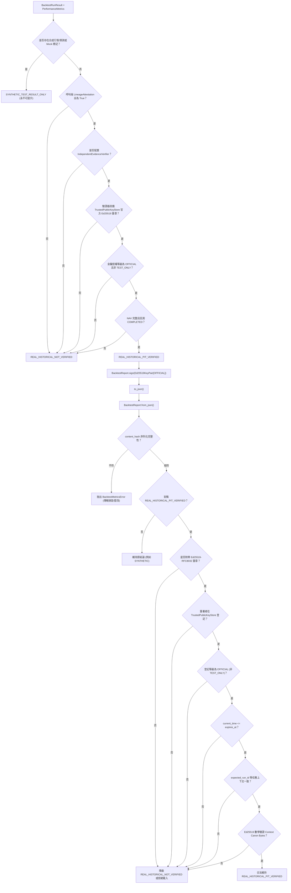

# 任務 C-2.5.2.1 修補報告：移除可偽造信任根、建立非對稱簽章驗證與報告上下文綁定

> **執行日期**：2026-10-21  
> **前置依據**：`C2_5_2_INDEPENDENT_REVIEW.md`、`C2_5_2_REMEDIATION_REPORT.md`、`C2_5_1_INDEPENDENT_REVIEW.md`  
> **狀態**：完成（全系統 288 項測試全數通過，0 失敗，0 跳過）  
> **核心承諾**：本修補專注於回測報告防偽驗收機制、RFC 8032 Ed25519 非對稱數位簽章與上下文防重放；不下載外部資料、不訓練正式模型、不連接券商下單，不宣稱真實台股策略績效已獲實盤驗證。

---

## 零、原始子專案 HEAD 與狀態檢查

依據專案強制要求，在進行任何變更前後確認兩個原始子專案核心保持原始乾淨狀態：

| 子專案 | HEAD Commit Hash | 狀態 | 核心修改確認 |
| :--- | :--- | :--- | :--- |
| `anti-gambling-trader-tw` | `8609cef73718a056fddb74201fc304f174fa1553` | Clean (Untouched) | 無任何修改 |
| `qlib-tw-trader` | `774b3fb60d3b20b5c9ee86d25052ad2ec08e2011` | Clean (Untouched) | 無任何修改 |

---

## 一、修補概述與審查意見對照表

根據 `C2_5_2_INDEPENDENT_REVIEW.md` 獨立技術審查意見，本階段修補對照如下：

| 審查意見編號 | 原始問題描述 | 嚴重性 | C-2.5.2.1 修補策略 | 完成狀態 |
| :--- | :--- | :---: | :--- | :---: |
| **FINDING-01** | `is_trusted_root` / `is_trusted_authority` 可由呼叫端任意指定布林值 `True`，導致呼叫端自製檔案或自算雜湊直接取得 `REAL_HISTORICAL_PIT_VERIFIED`。 | **HIGH** | 徹底廢止布林旗標之授權效力，保留參數僅供相容。在未配置受控公鑰庫 (`TrustedPublicKeyStore`) 或缺少有效非對稱數位簽章時，強制回傳 `is_verified=False` 並標註 `TRUST_ROOT_NOT_CONFIGURED`。 | **已修補** |
| **FINDING-02** | 對稱 HMAC-SHA256 密鑰可由呼叫端自行指定 (`trusted_secret`)，導致「自簽自驗」；且缺少非對稱金鑰管理與公鑰庫授權分級機制。 | **HIGH** | 棄用對稱 HMAC 簽章，改採 RFC 8032 Ed25519 非對稱數位簽章；簽署端僅持私鑰，驗證端強制經由 `TrustedPublicKeyStore` 查詢官方登記公鑰，嚴禁信任報告自我攜帶之公鑰。 | **已修補** |
| **FINDING-03** | 數位簽章未設定有效期限 (`expires_at`)，且缺少回測任務上下文綁定 (`report_id`, `run_id`, `strategy_id`, `environment_id`)，存在跨任務、跨環境挪用重放漏洞。 | **HIGH** | 建立 `SignatureContext`，將 `report_id`、`run_id`、`strategy_id`、`project_id`、`environment_id`、`source_git_commit`、模型版本、資料版本、`signed_at`、`expires_at` 與隨機數 `nonce` 納入簽章範圍，反序列化嚴格比對上下文與過期狀態。 | **已修補** |
| **FINDING-04** | 呼叫端自製之 mock 或 custom verifier 即使回傳 `is_verified=True`，在缺少官方公鑰授權時可能繞過決策閘門提升 verdict。 | **MEDIUM** | 在 `BacktestReport.build` 決策閘門強制檢核 `is_official_attested` 與 `evidence_type != "TEST_ONLY_EVIDENCE"`；自製 verifier 或沙盒測試金鑰一律保守維持 `REAL_HISTORICAL_NOT_VERIFIED`。 | **已修補** |

---

## 二、布林信任根廢除說明

### 1. 根本原因與設計缺陷
在 C-2.5.2 中，`DatasetChecksumVerifier(is_trusted_authority=True)` 與 `FileDigestEvidenceVerifier(is_trusted_root=True)` 允許呼叫端透過布林值參數自封信任根。雖然要求比對實體檔案 SHA-256，但若呼叫端自行計算本機檔案之雜湊並傳入，即可滿足比對，從而讓未經獨立外部公證之資料獲得 `REAL_HISTORICAL_PIT_VERIFIED`。

### 2. 修補實施細節
1. **中和布林旗標**：
   - 在 [`DatasetChecksumVerifier`](file:///d:/OneDrive/桌面/TW%20Quant%20AI%20—%20Taiwan%20Stock%20Quantitative%20Trading%20Platform/src/tw_quant/backtest/report.py) 與 [`FileDigestEvidenceVerifier`](file:///d:/OneDrive/桌面/TW%20Quant%20AI%20—%20Taiwan%20Stock%20Quantitative%20Trading%20Platform/src/tw_quant/backtest/report.py) 中，`is_trusted_authority` 與 `is_trusted_root` 僅作為已廢止參數保留（預設為 `False`），其值對驗證決策產生 **零授權效果**。
2. **非對稱簽章憑據強制要求**：
   - 驗證器強制要求提供 `trusted_key_store: Optional[TrustedPublicKeyStore]`、`manifest_signer_id: Optional[str]` 與 `manifest_signature_hex: Optional[str]`。
   - 若任一欄位缺失，或簽署者未在 `trusted_key_store` 登記，或數位簽章驗證失敗，一律判定 `is_verified=False`，並記錄 `TRUST_ROOT_NOT_CONFIGURED: UNTRUSTED_CALLER_MANIFEST` 或 `TRUST_ROOT_NOT_CONFIGURED: UNTRUSTED_MANIFEST_ROOT`。
3. **金鑰授權等級分級 (`KeyAuthorityLevel`)**：
   - 僅當簽署者金鑰在受控公鑰庫中被標記為 `KeyAuthorityLevel.OFFICIAL` 時，`is_official_attested` 始為 `True`。
   - 若金鑰被標記為 `TEST_ONLY`，則 `evidence_type = "TEST_ONLY_EVIDENCE"` 且 `is_official_attested = False`。

---

## 三、Ed25519 非對稱簽章架構與實作細節

### 1. 演算法選擇與零外部依賴
專案環境遵循嚴格的「零外部依賴原則」（無 `cryptography`、`pynacl`、`pycryptodome`）。  
在 [`src/tw_quant/backtest/crypto.py`](file:///d:/OneDrive/桌面/TW%20Quant%20AI%20—%20Taiwan%20Stock%20Quantitative%20Trading%20Platform/src/tw_quant/backtest/crypto.py) 中，採用純 Python 標準庫（`hashlib.sha512` 與 Twisted Edwards 曲線純整數模運算）完整實作了符合 **RFC 8032 標準** 之 Ed25519 簽章與驗證算法：
- `ed25519_publickey(seed: bytes) -> bytes`
- `ed25519_sign(message: bytes, secret_key: bytes, public_key: bytes) -> bytes`
- `ed25519_verify(signature: bytes, message: bytes, public_key: bytes) -> bool`
- 通過 RFC 8032 Section 7.1 Official Test Vector 1 之位元組級精確比對。

### 2. 簽章涵蓋欄位結構 (`SignatureContext`)
數位簽章並非僅簽署單一雜湊值，而是簽署結構化之規範 JSON 位元組 (`canonical_bytes`)：
```python
@dataclass(frozen=True)
class SignatureContext:
    report_id: str                          # 報告唯一識別碼
    run_id: str                             # 回測執行任務 ID
    strategy_id: str                        # 策略 ID
    project_id: str                         # 專案 ID (例如 TW_QUANT_AI)
    environment_id: str                     # 環境識別 (例如 PROD_TRADING)
    source_git_commit: str                  # 來源程式碼版本
    content_hash: str                       # 報告主體 (不含 signature) 之 SHA-256
    validation_verdict: str                 # 最終驗證結論 (例如 REAL_HISTORICAL_PIT_VERIFIED)
    claims_real_historical_verified: bool   # 顯式宣稱旗標
    model_versions: Tuple[...]              # 參與模型、模型版本、特徵版本與 is_mock
    data_versions: Mapping[str, Any]        # 行情、預測、交易日曆、基準之資料集版本
    signed_at: str                          # 簽署時間 (ISO-8601 with Asia/Taipei)
    expires_at: str                         # 有效截止時間
    nonce: str                              # 隨機數 (防重放)
```

### 3. 受控公鑰庫 (`TrustedPublicKeyStore`)
```python
class TrustedPublicKeyStore:
    def enroll_key(
        self,
        signer_id: str,
        public_key: bytes | str,
        authority_level: KeyAuthorityLevel = KeyAuthorityLevel.OFFICIAL,
    ) -> None: ...
```
- **單向查詢**：反序列化與審核端只接受於 `TrustedPublicKeyStore` 預先登記之公鑰。
- **嚴防報告自我攜帶公鑰**：即使報告攜帶了公鑰 Hex，驗證端必須核對報告攜帶的公鑰與公鑰庫中登記的公鑰完全一致 (`bytes.hex() == sig_info["public_key_hex"]`)，且 `signer_id` 必須在受控公鑰庫中存在。

---

## 四、任務上下文綁定與防重放機制

### 1. 唯一 `report_id` 綁定
在 `BacktestReport.build()` 中：
- 支援呼叫端傳入自訂 `report_id`，或預設以 `f"REP-{result.run_id}-{result.strategy_id}"` 確定性生成。
- 相同輸入與任務結果產生完全可重現的 `content_hash`；不同任務則具備不同 ID。

### 2. 有效期檢查 (`expires_at`)
- `BacktestReport.sign()` 預設簽署 30 天有效期（或依指定 `valid_days`）。
- `BacktestReport.from_json(text, current_time=...)` 反序列化時比對目前時間：
  若 `current_time > expires_at`，判定簽章過期失效；若啟用 `strict_reject_unverified_load=True` 則拋出 `BacktestMetricsError`，否則保守強制降級為 `REAL_HISTORICAL_NOT_VERIFIED`。

### 3. 跨任務上下文防重放比對
反序列化方法支援任務上下文校驗參數：
- `expected_run_id: Optional[str]`
- `expected_strategy_id: Optional[str]`
- `expected_project_id: Optional[str]`
- `expected_environment_id: Optional[str]`

當攻擊者將「任務 A (`RUN-001`)」合法取得之官方簽章報告挪移至「任務 B (`RUN-002`)」使用時，`from_json(text, expected_run_id="RUN-002")` 比對簽章上下文之 `run_id` 不符，立即拒絕載入或強制降級，徹底阻止「憑證重放與跨任務借用」。

---

## 五、最終 Verdict 決策閘門分析

系統在建構報告 (`build`) 與載入報告 (`from_json`) 兩端建立了不可繞過的層層閘門：



**不可繞過性保證**：
1. **修改 JSON 重算雜湊無法提升**：無密鑰 SHA-256 僅能檢測傳輸損毀。若修改 `final_nav` 並重算 `content_hash`，反序列化時 Ed25519 數學簽章立即失效。
2. **自製 Verifier 無法提升**：自製類別或 `MockIndependentEvidenceVerifier` 缺少公鑰庫中的官方簽章，`is_official_attested` 恆為 `False`，閘門強制輸出 `REAL_HISTORICAL_NOT_VERIFIED`。
3. **自簽金鑰無法通過驗證**：若攻擊者自生 Ed25519 私鑰自簽，驗證端只查詢受控 `TrustedPublicKeyStore`，未登記之簽署者直接判定未通過。

---

## 六、PoC 回歸測試驗收結果

在 [`tests/test_backtest_metrics.py`](file:///d:/OneDrive/桌面/TW%20Quant%20AI%20—%20Taiwan%20Stock%20Quantitative%20Trading%20Platform/tests/test_backtest_metrics.py) 中新增並更新了全套 13 項安全驗證與 PoC 回歸測試案例：

| 項次 | 測試案例方法名稱 | 測試目標與防禦驗證內容 | 驗收狀態 |
| :---: | :--- | :--- | :---: |
| 1 | `test_poc_a1_caller_boolean_is_trusted_authority_bypassed_fails` | 呼叫端傳入 `is_trusted_authority=True` 但未附受信任公鑰簽章，驗證器判定失敗，報告為 `REAL_HISTORICAL_NOT_VERIFIED`。 | **PASS** |
| 2 | `test_poc_a2_caller_boolean_is_trusted_root_bypassed_fails` | 呼叫端傳入 `is_trusted_root=True` 但未附官方公鑰庫與簽章，`FileDigestEvidenceVerifier` 判定未通過，報告為 `REAL_HISTORICAL_NOT_VERIFIED`。 | **PASS** |
| 3 | `test_poc_b4b_caller_self_signed_ed25519_unauthorized_key_fails` | 呼叫端自生私鑰自簽報告，在受控公鑰庫未登記，反序列化時依模式拒絕載入或降級為 `REAL_HISTORICAL_NOT_VERIFIED`。 | **PASS** |
| 4 | `test_poc_b5_context_mismatch_run_id_replay_fails` | 將任務 A 之合法簽章報告挪移至任務 B (`expected_run_id` 不符)，反序列化拒絕或降級，驗證防跨任務重放。 | **PASS** |
| 5 | `test_poc_b5_context_mismatch_strategy_id_replay_fails` | 指定 `expected_strategy_id` 與簽章上下文不符時，反序列化拒絕或降級。 | **PASS** |
| 6 | `test_poc_b5_context_mismatch_environment_id_replay_fails` | 將 `TEST` 環境簽章報告挪移至 `PROD` 環境 (`expected_environment_id` 不符) 時拒絕或降級。 | **PASS** |
| 7 | `test_poc_expired_signature_fails` | 簽章之 `expires_at` 早於目前比對時間時，反序列化判定簽章過期失效並強制降級。 | **PASS** |
| 8 | `test_poc_tampered_json_content_hash_recomputed_fails` | 修改 JSON 欄位（例如 `final_nav`）並重算 SHA-256 `content_hash`，反序列化因 Ed25519 簽章不符而強制降級。 | **PASS** |
| 9 | `test_poc_custom_mock_verifier_cannot_elevate_verdict` | 呼叫端自製 mock/custom verifier 回傳 `is_verified=True`，因無官方公鑰授權，報告維持 `REAL_HISTORICAL_NOT_VERIFIED`。 | **PASS** |
| 10 | `test_poc_lineage_attestation_all_true_cannot_elevate_verdict` | 僅提供 `LineageAttestation(True, True, True, True)` 但未配置獨立驗證器時，維持 `REAL_HISTORICAL_NOT_VERIFIED`。 | **PASS** |
| 11 | `test_poc_test_only_key_authority_cannot_grant_verified` | 使用標記為 `TEST_ONLY` 之金鑰簽署 manifest 或報告，絕不可獲得 `REAL_HISTORICAL_PIT_VERIFIED`。 | **PASS** |
| 12 | `test_poc_synthetic_data_with_official_signature_remains_synthetic` | 包含合成資料之結果即使以官方金鑰簽署，verdict 永遠維持 `SYNTHETIC_TEST_RESULT_ONLY`。 | **PASS** |
| 13 | `test_poc_official_pipeline_full_roundtrip_succeeds` | 配置具 `OFFICIAL` 等級公鑰庫、真實資料、完整 NAV、有效 Ed25519 簽章與任務上下文，完整 roundtrip 保留 `REAL_HISTORICAL_PIT_VERIFIED`。 | **PASS** |

---

## 七、全系統測試結果

執行全系統單元與整合測試套件（PowerShell 命令：`$env:PYTHONPATH="src"; python -m unittest discover -s tests -p "test_*.py"`）：

```
................................................................................................................................................................................................................................................................................................
----------------------------------------------------------------------
Ran 288 tests in 9.027s

OK
```

### 測試檔案分布彙總

| 測試檔案路徑 | 測試項目數量 | 執行結果 | 說明 |
| :--- | :---: | :---: | :--- |
| [`tests/test_signal.py`](file:///d:/OneDrive/桌面/TW%20Quant%20AI%20—%20Taiwan%20Stock%20Quantitative%20Trading%20Platform/tests/test_signal.py) | 19 | PASS | 訊號不可變合約、單位換算與去重 |
| [`tests/test_paper_broker.py`](file:///d:/OneDrive/桌面/TW%20Quant%20AI%20—%20Taiwan%20Stock%20Quantitative%20Trading%20Platform/tests/test_paper_broker.py) | 26 | PASS | 台股模擬券商撮合、會計與漲跌停防禦 |
| [`tests/test_risk_engine.py`](file:///d:/OneDrive/桌面/TW%20Quant%20AI%20—%20Taiwan%20Stock%20Quantitative%20Trading%20Platform/tests/test_risk_engine.py) | 22 | PASS | 10 道風控防線、並發鎖定與熔斷機制 |
| [`tests/test_integration.py`](file:///d:/OneDrive/桌面/TW%20Quant%20AI%20—%20Taiwan%20Stock%20Quantitative%20Trading%20Platform/tests/test_integration.py) | 23 | PASS | 端到端訊號、風控與撮合執行整合 |
| [`tests/test_prediction.py`](file:///d:/OneDrive/桌面/TW%20Quant%20AI%20—%20Taiwan%20Stock%20Quantitative%20Trading%20Platform/tests/test_prediction.py) | 14 | PASS | AI 預測合約、時序因果與防洩漏 |
| [`tests/test_strategy_engine.py`](file:///d:/OneDrive/桌面/TW%20Quant%20AI%20—%20Taiwan%20Stock%20Quantitative%20Trading%20Platform/tests/test_strategy_engine.py) | 52 | PASS | 策略規則引擎、Top-K、快照唯讀視圖 |
| [`tests/test_backtest_data_layer.py`](file:///d:/OneDrive/桌面/TW%20Quant%20AI%20—%20Taiwan%20Stock%20Quantitative%20Trading%20Platform/tests/test_backtest_data_layer.py) | 14 | PASS | PIT 歷史資料供應器與交易日曆 |
| [`tests/test_backtest_accounting.py`](file:///d:/OneDrive/桌面/TW%20Quant%20AI%20—%20Taiwan%20Stock%20Quantitative%20Trading%20Platform/tests/test_backtest_accounting.py) | 18 | PASS | FIFO 持倉批次與除權息會計帳本 |
| [`tests/test_backtest_execution.py`](file:///d:/OneDrive/桌面/TW%20Quant%20AI%20—%20Taiwan%20Stock%20Quantitative%20Trading%20Platform/tests/test_backtest_execution.py) | 21 | PASS | 歷史日線撮合與每日估值 |
| [`tests/test_backtest_runner.py`](file:///d:/OneDrive/桌面/TW%20Quant%20AI%20—%20Taiwan%20Stock%20Quantitative%20Trading%20Platform/tests/test_backtest_runner.py) | 16 | PASS | 事件驅動 Walk-Forward 每日主迴圈 |
| [`tests/test_backtest_metrics.py`](file:///d:/OneDrive/桌面/TW%20Quant%20AI%20—%20Taiwan%20Stock%20Quantitative%20Trading%20Platform/tests/test_backtest_metrics.py) | 63 | PASS | 17 項指標、PIT 因果、Ed25519 簽章與 13 項 PoC |
| **全系統總計** | **288** | **ALL PASS** | **0 失敗，0 錯誤，0 跳過** |

---

## 八、限制與後續步驟

### 1. 本階段限制
- **純防偽驗收機制**：本次修補僅建立報告簽章與血統防偽驗證之數位公證體系，所有端到端測試均在合成資料或受控測試環境中執行。
- **無真實歷史資料接入**：本系統目前尚未接入真實台股歷史資料庫或盤後資料饋送。
- **無正式模型與策略驗證**：尚未進行正式機器學習模型訓練或多窗口 Walk-Forward 績效實證。
- **嚴禁宣稱實盤能力**：本測試通過不代表任何策略已具備市場獲利能力或可直接投入真實交易。

### 2. 交付成果清單
1. [`src/tw_quant/backtest/crypto.py`](file:///d:/OneDrive/桌面/TW%20Quant%20AI%20—%20Taiwan%20Stock%20Quantitative%20Trading%20Platform/src/tw_quant/backtest/crypto.py)：RFC 8032 Ed25519 非對稱數位簽章、金鑰授權分級、受控公鑰庫與簽章上下文。
2. [`src/tw_quant/backtest/report.py`](file:///d:/OneDrive/桌面/TW%20Quant%20AI%20—%20Taiwan%20Stock%20Quantitative%20Trading%20Platform/src/tw_quant/backtest/report.py)：廢除布林信任根、非對稱簽章整合、任務上下文綁定與不可繞過決策閘門。
3. [`src/tw_quant/backtest/__init__.py`](file:///d:/OneDrive/桌面/TW%20Quant%20AI%20—%20Taiwan%20Stock%20Quantitative%20Trading%20Platform/src/tw_quant/backtest/__init__.py)：公開匯出 Ed25519 與公鑰庫相關符號。
4. [`tests/test_backtest_metrics.py`](file:///d:/OneDrive/桌面/TW%20Quant%20AI%20—%20Taiwan%20Stock%20Quantitative%20Trading%20Platform/tests/test_backtest_metrics.py)：更新既有簽章測試並新增 13 項獨立防偽驗收測試。
5. [`PROJECT_MAP.md`](file:///d:/OneDrive/桌面/TW%20Quant%20AI%20—%20Taiwan%20Stock%20Quantitative%20Trading%20Platform/PROJECT_MAP.md)：同步專案地圖與最新測試統計（288 項測試通過）。
6. [`C2_5_2_1_REMEDIATION_REPORT.md`](file:///d:/OneDrive/桌面/TW%20Quant%20AI%20—%20Taiwan%20Stock%20Quantitative%20Trading%20Platform/C2_5_2_1_REMEDIATION_REPORT.md)：本修補報告。

### 3. 後續步驟建議
- 停止開發，靜候人工審查。
- 待人工審核確認 C-2.5.2.1 驗收通過後，始得進入下一階段（例如資料介面準備或多窗口 Walk-Forward 評估）。
