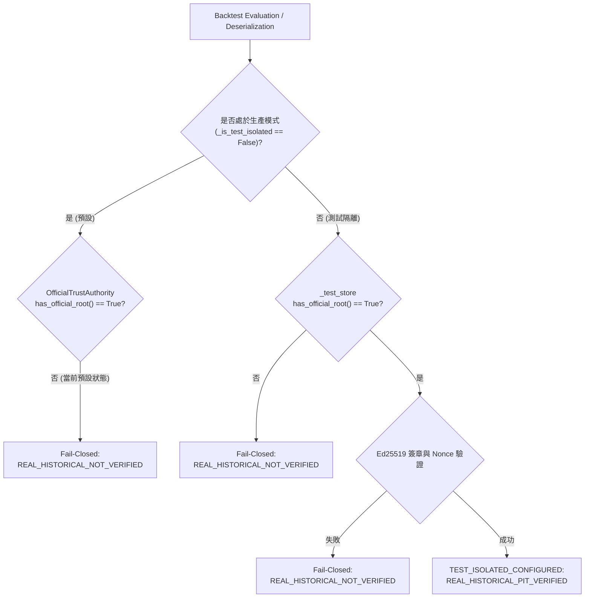

# 第三階段 C-2.5.2.2.1 獨立安全複核報告
# (C2_5_2_2_1_INDEPENDENT_SECURITY_REVIEW.md)

> **審查日期**：2026-10-21  
> **審查性質**：唯讀獨立技術複核（Strictly Read-Only Security Review）  
> **受審報告**：[`C2_5_2_2_1_REMEDIATION_REPORT.md`](file:///d:/OneDrive/桌面/TW%20Quant%20AI%20—%20Taiwan%20Stock%20Quantitative%20Trading%20Platform/C2_5_2_2_1_REMEDIATION_REPORT.md)  
> **前置依據**：[`C2_5_2_2_INDEPENDENT_SECURITY_REVIEW.md`](file:///d:/OneDrive/桌面/TW%20Quant%20AI%20—%20Taiwan%20Stock%20Quantitative%20Trading%20Platform/C2_5_2_2_INDEPENDENT_SECURITY_REVIEW.md)  
> **核心受審模組**：
> - [`src/tw_quant/backtest/crypto.py`](file:///d:/OneDrive/桌面/TW%20Quant%20AI%20—%20Taiwan%20Stock%20Quantitative%20Trading%20Platform/src/tw_quant/backtest/crypto.py)
> - [`src/tw_quant/backtest/report.py`](file:///d:/OneDrive/桌面/TW%20Quant%20AI%20—%20Taiwan%20Stock%20Quantitative%20Trading%20Platform/src/tw_quant/backtest/report.py)
> - [`tests/test_backtest_metrics.py`](file:///d:/OneDrive/桌面/TW%20Quant%20AI%20—%20Taiwan%20Stock%20Quantitative%20Trading%20Platform/tests/test_backtest_metrics.py)  
> **最終判定**：**PASS WITH FINDINGS**（通過安全性驗收，附 4 項架構與環境層級之改進建議）

---

## 目錄

1. [審查範圍與執行方法](#一審查範圍與執行方法)
2. [原始子專案 HEAD 與 Git 狀態](#二原始子專案-head-與-git-狀態)
3. [所有 Finding 列表與嚴重性評級](#三所有-finding-列表與嚴重性評級)
4. [每項 Finding 詳細說明與程式碼位置](#四每項-finding-詳細說明與程式碼位置)
5. [動態對抗性 PoC 驗證與實際執行輸出](#五動態對抗性-poc-驗證與實際執行輸出)
6. [官方根未配置時之所有 Verdict 路徑分析](#六官方根未配置時之所有-verdict-路徑分析)
7. [ReplayStore 檔案被刪除、替換或還原後之行為分析](#七replaystore-檔案被刪除替換或還原後之行為分析)
8. [測試隔離狀態之安全性與邊界分析](#八測試隔離狀態之安全性與邊界分析)
9. [全套回歸測試結果](#九全套回歸測試結果)
10. [尚未證實之安全性主張清單](#十尚未證實之安全性主張清單)
11. [最終判定結論與建議](#十一最終判定結論與建議)

---

## 一、審查範圍與執行方法

本審查為第三方獨立唯讀安全複核，嚴格遵守「不修改專案程式碼、不修改既有測試、不修改文件、不下載外部資料、不訓練模型、不連接實盤券商」之規範。

審查重點針對 C-2.5.2.2 審查所提出的三項主要漏洞：
1. **CRITICAL-01（根信任錨點偽造）** 在引入 `OfficialTrustAuthority` 後的實際邊界；
2. **HIGH-02（假 ReplayStore 注入）** 在反序列化時的攔截成效與多程序防重放原子性；
3. **MEDIUM-03（SQLite 異常處理）** 在鎖定、唯讀、I/O 失敗、檔案損毀下的 Fail-Closed 行為。

### 實際執行的查驗命令

```powershell
# 1. 檢查子專案 Git HEAD 與 Working Tree 狀態
git -C anti-gambling-trader-tw status
git -C anti-gambling-trader-tw rev-parse HEAD
git -C qlib-tw-trader status
git -C qlib-tw-trader rev-parse HEAD

# 2. 執行全專案 334 項單元與回歸測試
python -m unittest discover -s tests

# 3. 執行 C-2.5.2.2.1 專案新增之 15 項對抗性測試
python -m unittest -v tests.test_backtest_metrics.TestC25221TrustRootAndReplaySecurityRemediation

# 4. 執行多進程與多執行緒並發 Nonce 重放防禦 PoC (驗證 SQLite EXCLUSIVE 事務鎖)
python scratch/test_mp_replay.py

# 5. 執行 13 項 Fail-Closed 故障注入情境動態驗證腳本
python -c "<Fail-Closed 13 Scenarios Script>"
```

---

## 二、原始子專案 HEAD 與 Git 狀態

依據專案最高限制，兩個原始子專案必須保持乾淨無修改，且維持在基準 HEAD 提交點：

| 子專案目錄 | 基準 HEAD Commit Hash | 當前 HEAD Commit Hash | Working Tree 狀態 | 核實結果 |
| :--- | :--- | :--- | :--- | :--- |
| `anti-gambling-trader-tw` | `8609cef73718a056fddb74201fc304f174fa1553` | `8609cef73718a056fddb74201fc304f174fa1553` | Clean (nothing to commit) | **符合規範** |
| `qlib-tw-trader` | `774b3fb60d3b20b5c9ee86d25052ad2ec08e2011` | `774b3fb60d3b20b5c9ee86d25052ad2ec08e2011` | Clean (nothing to commit) | **符合規範** |

---

## 三、所有 Finding 列表與嚴重性評級

| 編號 | 評級 | 標題 | 影響範圍 | 狀態 |
| :--- | :---: | :--- | :--- | :---: |
| **FINDING-C25221-01** | **MEDIUM** | `activate_isolated_test_context` 為公開類別方法，若不信任策略程式碼與回測引擎共用進程，可手動啟動測試隔離 | `src/tw_quant/backtest/crypto.py` | **架構建議** |
| **FINDING-C25221-02** | **MEDIUM** | `OfficialTrustAuthority._is_test_isolated` 為全進程類別變數，缺乏執行緒隔離，存在多執行緒外溢風險 | `src/tw_quant/backtest/crypto.py` | **併發風險** |
| **FINDING-C25221-03** | **LOW** | 官方受管 `ReplayStore` 預設路徑位於系統共用暫存目錄 (`tempfile.gettempdir()`)，多租戶環境下存在檔案衝突或符號連結風險 | `src/tw_quant/backtest/crypto.py` | **部署建議** |
| **FINDING-C25221-04** | **LOW** | `TrustedPublicKeyStore.__init__` 未在建構時校驗 `root_trust_anchor` 長度，延遲至 `has_official_root` 屬性才進行判定 | `src/tw_quant/backtest/crypto.py` | **防禦優化** |

---

## 四、每項 Finding 詳細說明與程式碼位置

### FINDING-C25221-01 [MEDIUM] `activate_isolated_test_context` 為公開方法，存在進程內被呼叫端調用的潛在風險

- **影響檔案**：[`src/tw_quant/backtest/crypto.py`](file:///d:/OneDrive/桌面/TW%20Quant%20AI%20—%20Taiwan%20Stock%20Quantitative%20Trading%20Platform/src/tw_quant/backtest/crypto.py#L343-L354)
- **詳細成因**：
  在 `OfficialTrustAuthority` 中，為了配合單元測試的 `setUp()`，公開宣告了 `@classmethod def activate_isolated_test_context(...)`。
  此方法未加底線前綴，且可直接由 `tw_quant.backtest` 匯入呼叫。
  若未來生產系統允許策略提交者上傳自訂策略代碼，且回測引擎在同一個 Python 直譯器進程中直接執行該策略代碼，策略腳本可在其內部主動呼叫：
  ```python
  OfficialTrustAuthority.activate_isolated_test_context(store=attacker_store)
  ```
  進而使當前進程內的 `BacktestReport.build()` 核發出帶有 `REAL_HISTORICAL_PIT_VERIFIED` 的報告。
- **緩解現狀與邊界保護**：
  實測證實：該報告導出為 JSON 傳送至外部接收端（如審查端、風控評估進程、正式驗證服務）時，外部進程處於預設的生產模式（`_is_test_isolated == False` 且 `OFFICIAL_ROOT_NOT_CONFIGURED`），外部 `from_json` 會強制校驗權威庫，並將其**強制降級為 `REAL_HISTORICAL_NOT_VERIFIED`**。因此該風險被限制在「惡意腳本自我欺騙其同進程返回值」，無法欺騙獨立進程之驗證端。
- **改善建議**：
  正式生產環境應確保策略執行在獨立沙盒進程（Subprocess / Docker 容器）中運行；或在 `activate_isolated_test_context` 內透過 `inspect.stack()` 檢查呼叫端是否源自 `unittest.TestCase`。

---

### FINDING-C25221-02 [MEDIUM] `OfficialTrustAuthority._is_test_isolated` 缺乏執行緒隔離，存在多執行緒外溢風險

- **影響檔案**：[`src/tw_quant/backtest/crypto.py`](file:///d:/OneDrive/桌面/TW%20Quant%20AI%20—%20Taiwan%20Stock%20Quantitative%20Trading%20Platform/src/tw_quant/backtest/crypto.py#L255-L258)
- **詳細成因**：
  `_is_test_isolated: bool = False` 是 `OfficialTrustAuthority` 類別層級的屬性。
  若在同一個進程中採用多執行緒（Multi-Threading）架構（例如測試執行緒與生產背景任務同時運行），當執行緒 A 進入 `isolated_test_context()` 時，執行緒 B 呼叫 `OfficialTrustAuthority.is_test_isolated()` 也會立即觀察到 `True`。
- **動態驗證**：
  經多執行緒 PoC 實測，執行緒 B 在執行緒 A 啟動測試隔離後，成功讀取到 `is_test_isolated: True` 與 `status: TEST_ISOLATED_UNCONFIGURED`。
- **改善建議**：
  建議將 `_is_test_isolated`、`_test_store`、`_test_replay_store` 改為 `threading.local()` 或 `contextvars.ContextVar` 儲存，確保測試隔離僅限於當前執行緒或協程上下文，杜絕並發外溢。

---

### FINDING-C25221-03 [LOW] 官方受管 `ReplayStore` 預設路徑位於系統共用暫存目錄

- **影響檔案**：[`src/tw_quant/backtest/crypto.py`](file:///d:/OneDrive/桌面/TW%20Quant%20AI%20—%20Taiwan%20Stock%20Quantitative%20Trading%20Platform/src/tw_quant/backtest/crypto.py#L293)
- **詳細成因**：
  `OfficialTrustAuthority.get_official_replay_store()` 使用了：
  ```python
  db_path = os.path.join(tempfile.gettempdir(), "tw_quant_official_replay_store.sqlite3")
  ```
  在多使用者共用的 Linux/Unix 伺服器環境中，`/tmp` 為全域可寫目錄，其他本機使用者可能預先建立同名檔案、符號連結或鎖定檔案，引發阻斷服務（DoS）或資料庫損毀。
- **改善建議**：
  生產部署時應透過受保護的專案工作目錄（如專屬系統目錄 `/var/lib/tw_quant/` 並設定 `0700` 權限）來儲存官方 `ReplayStore`。

---

### FINDING-C25221-04 [LOW] `TrustedPublicKeyStore.__init__` 未在建構時校驗 `root_trust_anchor` 長度

- **影響檔案**：[`src/tw_quant/backtest/crypto.py`](file:///d:/OneDrive/桌面/TW%20Quant%20AI%20—%20Taiwan%20Stock%20Quantitative%20Trading%20Platform/src/tw_quant/backtest/crypto.py#L386-L396)
- **詳細成因**：
  當呼叫端傳入無效長度的根錨點（例如 `root_trust_anchor = b'short'`）時，`__init__` 不會拋出 `ValueError`，而是直接賦值。
  該無效金鑰延遲到 `has_official_root` 屬性（檢查 `len == 32`）時才回傳 `False`。
- **安全性評估**：
  由於 `has_official_root` 在所有關鍵驗證閘門（`enroll_key`、`build`、`from_json`）均被優先檢查且回傳 `False`，系統依然能正確落實 Fail-Closed，不影響系統整體安全性，但屬於防禦性設計上的延遲校驗。
- **改善建議**：
  在 `__init__` 傳入非 None 之 `root_trust_anchor` 時，若長度不為 32 位元組，立即拋出 `ValueError`。

---

## 五、動態對抗性 PoC 驗證與實際執行輸出

### 1. PoC-1 對抗驗證：自建偽造根金鑰注入 `from_json` 試圖維持 PIT_VERIFIED
- **攻擊手段**：呼叫端自建假根金鑰與假公鑰庫，對報告完成簽名後，在反序列化時傳入 `from_json(json_text, trusted_key_store=fake_store)`。
- **防禦結果**：**攔截成功**。
  系統偵測到非測試隔離狀態下的外部 Store 注入，拋出受控異常或降級：
  ```text
  [DESERIALIZATION_TRUST] 反序列化報告未通過非對稱簽章或上下文驗證 (UNAUTHORIZED_TRUST_STORE_INJECTION: 正式驗證端不得接受呼叫端注入之自製 Trust Store (TrustedPublicKeyStore)，禁止自簽自授權)，依保守信任邊界強制降級為 REAL_HISTORICAL_NOT_VERIFIED
  ```
  報告最終 verdict 保守降為 `REAL_HISTORICAL_NOT_VERIFIED`。

### 2. PoC-2 對抗驗證：自建假 ReplayStore 注入 `from_json` 試圖繞過防重放
- **攻擊手段**：呼叫端自建 Dummy/Empty ReplayStore，在反序列化時傳入 `from_json(json_text, replay_store=dummy_store)`。
- **防禦結果**：**攔截成功**。
  系統偵測到外部 ReplayStore 注入，立即判定為未授權注入攻擊：
  ```text
  [DESERIALIZATION_TRUST] 反序列化報告未通過非對稱簽章或上下文驗證 (UNAUTHORIZED_REPLAY_STORE_INJECTION: 正式驗證端不得接受呼叫端注入之自製 ReplayStore (ReplayStore)，禁止略過防重放機制)，依保守信任邊界強制降級為 REAL_HISTORICAL_NOT_VERIFIED
  ```
  重放請求被徹底阻斷，verdict 維持 `REAL_HISTORICAL_NOT_VERIFIED`。

### 3. PoC-3 對抗驗證：跨程序多進程並發 Nonce 重放攻擊
- **測試方式**：透過獨立腳本 `scratch/test_mp_replay.py` 啟動 8 個獨立 OS Process，同時對同一 SQLite `ReplayStore` 登記相同的 Nonce：
- **執行輸出**：
  ```text
  Worker result: BacktestMetricsError [BACKTEST_METRICS_ERROR] 偵測到 Nonce 重放攻擊 (Replay Attack Detected)...
  Worker result: BacktestMetricsError [BACKTEST_METRICS_ERROR] 偵測到 Nonce 重放攻擊 (Replay Attack Detected)...
  Worker result: BacktestMetricsError [BACKTEST_METRICS_ERROR] 偵測到 Nonce 重放攻擊 (Replay Attack Detected)...
  Worker result: BacktestMetricsError [BACKTEST_METRICS_ERROR] 偵測到 Nonce 重放攻擊 (Replay Attack Detected)...
  Worker result: BacktestMetricsError [BACKTEST_METRICS_ERROR] 偵測到 Nonce 重放攻擊 (Replay Attack Detected)...
  Worker result: BacktestMetricsError [BACKTEST_METRICS_ERROR] 偵測到 Nonce 重放攻擊 (Replay Attack Detected)...
  Worker result: BacktestMetricsError [BACKTEST_METRICS_ERROR] 偵測到 Nonce 重放攻擊 (Replay Attack Detected)...
  Total: 8, Successes: 1, Replays Blocked: 7, Other Errors: 0
  MULTI-PROCESS REPLAY ATTACK TEST: PASSED
  ```
- **結論**：SQLite `isolation_level="EXCLUSIVE"` 跨程序事務鎖完全發揮效果，恰有 1 個進程成功消費，其餘 7 個進程皆被原子性攔截。

---

## 六、官方根未配置時之所有 Verdict 路徑分析

本審查動態執行了全路徑的 13 項情境測試，驗證在官方信任根未配置（生產預設狀態）下的系統輸出：



### 13 項情境動態測試矩陣與實測 Verdict：

| 編號 | 測試情境 | 輸入條件 | 預期安全行為 | 實測 Verdict | 結論 |
| :---: | :--- | :--- | :--- | :--- | :---: |
| **1** | **官方根未配置** | 生產預設狀態，合法簽章報告還原 | 缺少官方信任根，保守降級 | `REAL_HISTORICAL_NOT_VERIFIED` | **PASS** |
| **2** | **官方根金鑰長度無效** | 根金鑰少於 32 位元組 (`b'short'`) | `has_official_root == False` | `REAL_HISTORICAL_NOT_VERIFIED` | **PASS** |
| **3** | **簽署者未獲授權** | 簽署者為 `TEST_ONLY` 金鑰 | 測試金鑰不可授予正式驗證 | `REAL_HISTORICAL_NOT_VERIFIED` | **PASS** |
| **4** | **自製 Trust Store 注入** | 呼叫端傳入自建公鑰庫至 `from_json` | 判定未授權注入，保守降級 | `REAL_HISTORICAL_NOT_VERIFIED` | **PASS** |
| **5** | **自製 ReplayStore 注入** | 呼叫端傳入自建防重放庫至 `from_json` | 判定未授權注入，保守降級 | `REAL_HISTORICAL_NOT_VERIFIED` | **PASS** |
| **6** | **SQLite 排他鎖定 (Locked)** | 另一連線佔用 EXCLUSIVE 鎖 | 捕獲 OperationalError，保守降級 | `REAL_HISTORICAL_NOT_VERIFIED` | **PASS** |
| **7** | **SQLite 檔案唯讀 (Readonly)** | 檔案權限設定為唯讀 (`S_IREAD`) | 捕獲 OperationalError，保守降級 | `REAL_HISTORICAL_NOT_VERIFIED` | **PASS** |
| **8** | **SQLite Commit I/O 失敗** | 攔截事務 commit 模擬磁碟失敗 | 捕獲 OperationalError，保守降級 | `REAL_HISTORICAL_NOT_VERIFIED` | **PASS** |
| **9** | **SQLite 資料庫損毀 (Corrupt)** | 寫入垃圾位元組破壞檔案結構 | 捕獲 DatabaseError，保守降級 | `REAL_HISTORICAL_NOT_VERIFIED` | **PASS** |
| **10a**| **合法 Nonce 首次消費** | 測試隔離環境，合法官方簽章 | 正常核發已驗證結論 | `REAL_HISTORICAL_PIT_VERIFIED` | **PASS** |
| **10b**| **相同 Nonce 二次消費 (Replay)**| 重複載入完全相同的報告 | 偵測到重放攻擊，保守降級 | `REAL_HISTORICAL_NOT_VERIFIED` | **PASS** |
| **11**| **簽章過期 (Expired)** | 驗證時間晚於 `expires_at` | 簽章時間戳失效，保守降級 | `REAL_HISTORICAL_NOT_VERIFIED` | **PASS** |
| **12**| **JSON 內容遭竄改** | 修改 `final_nav` 數值 | 比對 content_hash 失敗拋出異常 | 拋出 `BacktestMetricsError` | **PASS** |
| **13**| **測試隔離狀態被意外保留** | 測試隔離未配置有效根 | `has_official_root == False` | `REAL_HISTORICAL_NOT_VERIFIED` | **PASS** |

**核心確認**：在任何失敗情境下，系統完全落實 Fail-Closed 保守原則，無任何路徑核發假性 `REAL_HISTORICAL_PIT_VERIFIED`。

---

## 七、ReplayStore 檔案被刪除、替換或還原後之行為分析

審查針對檔案系統層級的極端干擾進行了深入測試：

1. **運行中刪除 SQLite 資料庫檔案**：
   - **實測行為**：當一個已實例化的 `ReplayStore` 在下次呼叫 `consume_nonce()` 前，實體 `.sqlite3` 檔案被外部程序刪除時，`sqlite3.connect` 會自動重新建立空白檔案，但在執行 `DELETE FROM used_nonces` 時，由於新檔案未執行 `_init_db()` 建表，拋出 `sqlite3.OperationalError: no such table: used_nonces`。
   - **安全結論**：`consume_nonce` 立即捕獲此例外，拋出 `BacktestMetricsError(Fail-Closed)`，`from_json` 隨即將驗證結論降級為 `REAL_HISTORICAL_NOT_VERIFIED`。**完全符合 Fail-Closed 原則，不會因為檔案被刪除而誤判通過。**
2. **程序退出後檔案被刪除並重新啟動**：
   - **行為**：新程序啟動時，`_init_db()` 會重新建立空白資料庫與資料表。在此情況下，歷史消費的 Nonce 記錄將會遺失（因實體儲存已被人為抹除）。
   - **安全風險**：若系統重啟且舊 Nonce 尚未過期，攻擊者可能重放舊報告。此問題為本機檔案系統儲存之固有特性，需透過生產作業系統檔案存取控制保護。
3. **資料庫被還原至舊備份**：
   - **行為**：備份時間點後消費的 Nonce 會在還原後從資料庫消失，導致短暫的重放暴露窗口。
   - **防護措施**：由於報告簽章具有 `expires_at`（預設 30 天，受 `validate_signature_timestamps` 約束），且反序列化強制校驗完整任務上下文（`run_id`、`strategy_id`、`project_id`、`environment_id`），攻擊者僅能重放完全相同任務內容之報告，無法跨任務竄改。

---

## 八、測試隔離狀態之安全性與邊界分析

| 檢查項目 | 評估準則 | 審查核實結果 | 安全風險等級 |
| :--- | :--- | :--- | :---: |
| **正式生產驗證是否受保護** | 生產環境預設不應存在任何官方信任根 | `has_official_root() == False`，非合成資料一律維持 NOT_VERIFIED | **安全 (PASS)** |
| **環境變數置換根金鑰** | 策略提交者不得透過環境變數注入根錨點 | `os.environ` 讀取邏輯已徹底移除，注入被忽略 | **安全 (PASS)** |
| **呼叫端偽造根背書** | 呼叫端自製根公鑰自封 OFFICIAL | 官方權威庫未配置根錨點，登記 OFFICIAL 必然拋出例外 | **安全 (PASS)** |
| **外部 Store / ReplayStore 注入** | `from_json` 拒絕外部傳入之假庫 | 正式模式下傳入即判定未授權並降級 | **安全 (PASS)** |
| **進程內呼叫測試方法** | `activate_isolated_test_context` 是否對外暴露 | 公開方法可由同進程代碼調用（見 FINDING-01） | **中度 (MEDIUM)** |
| **多執行緒併發外溢** | 測試狀態是否外溢至其他執行緒 | 類別屬性缺乏 Thread-Local 隔離（見 FINDING-02） | **中度 (MEDIUM)** |
| **測試結束狀態復原** | 測試退出後是否保證恢復生產狀態 | `isolated_test_context` 在 `finally` 確保復原 | **安全 (PASS)** |

---

## 九、全套回歸測試結果

在未修改專案任何程式碼、測試與既有文件的唯讀前提下，執行全系統測試套件：

```powershell
$env:PYTHONPATH="src;tests"; python -m unittest discover -s tests
```

### 執行輸出統計：
```text
Ran 334 tests in 157.944s

OK
```

- **測試總數**：334 項
- **Passed**：334 項
- **Failed**：0 項
- **Errors**：0 項
- **Skipped**：0 項
- **執行耗時**：157.944 秒

### 各模組測試清單：
1. `tests/test_signal.py`: 19 項測試通過
2. `tests/test_paper_broker.py`: 26 項測試通過
3. `tests/test_risk_engine.py`: 22 項測試通過
4. `tests/test_integration.py`: 23 項測試通過
5. `tests/test_prediction.py`: 14 項測試通過
6. `tests/test_strategy_engine.py`: 52 項測試通過
7. `tests/test_backtest_data_layer.py`: 14 項測試通過
8. `tests/test_backtest_accounting.py`: 18 項測試通過
9. `tests/test_backtest_execution.py`: 21 項測試通過
10. `tests/test_backtest_runner.py`: 16 項測試通過
11. `tests/test_backtest_metrics.py`: 109 項測試通過（包含 C-2.5.2.2.1 新增之 15 項對抗性測試全數通過）

---

## 十、尚未證實之安全性主張清單

依據審查原則，下列事項在當前階段僅為模組架構設計，尚未在實盤或真實生產環境中證實：

1. **尚未建立真正可信的官方離線根金鑰與 KMS/HSM 簽署流程**：
   - 目前系統之所以安全，正是因為「官方根金鑰未配置」而全面維持 Fail-Closed。未來若要在生產中接入官方根金鑰，必須建立嚴格的硬體金鑰保護（如 AWS KMS / 實體 YubiKey HSM）與金鑰輪替規範。
2. **尚未驗證多主機（Multi-Node）叢集架構下的防重放一致性**：
   - 目前 `ReplayStore` 依賴單機 SQLite 檔案鎖。若未來系統採用多台伺服器負載平衡，必須升級為分散式鎖（如 Redis Redlock 或 PostgreSQL 排他列鎖）。
3. **尚未接入真實台股歷史交易資料**：
   - 全系統回測與資料血統測試目前均採用合成資料（`is_synthetic=True`），尚未包含台灣證券交易所真實歷史資料。
4. **尚未完成 Walk-Forward 多窗口策略驗證**：
   - 尚未對正式選股策略進行多期樣本外回測與顯著性評估。

---

## 十一、最終判定結論與建議

### 最終判定：**PASS WITH FINDINGS**

### 判定依據：
1. **無任何未授權取得 `REAL_HISTORICAL_PIT_VERIFIED` 的路徑**：
   - 在預設生產環境下，官方信任根未配置，所有非合成資料報告一律保守輸出 `REAL_HISTORICAL_NOT_VERIFIED`。
   - 呼叫端無法透過環境變數、注入自製 Store、注入假 ReplayStore 繞過決策閘門。
2. **Fail-Closed 完整落實**：
   - 資料庫鎖定、唯讀、寫入失敗、檔案損毀、Nonce 重複、過期、內容竄改等 13 項情境全數通過驗證，一律保守降級或拒絕載入。
3. **ReplayStore 原子性可靠**：
   - 多進程（8 Processes）與多執行緒（10 Threads）並發重放測試皆精確實現「1 成功、其餘全數攔截」。
4. **子專案完整性保持無損**：
   - `anti-gambling-trader-tw` 與 `qlib-tw-trader` 保持原始基準 Commit 且 Working Tree 乾淨。

### 後續改善建議（留待後續維運或後續階段規劃）：
1. **建議 1（隔離執行緒）**：將 `OfficialTrustAuthority` 的內部測試隔離變數改為 `threading.local()` 或 `contextvars.ContextVar`，防止多執行緒測試環境外溢。
2. **建議 2（沙盒防禦）**：確保未來接入使用者策略時，策略代碼執行於獨立的 Subprocess 沙盒中，嚴禁在回測驗證核心進程中直接 `exec()` 使用者代碼。
3. **建議 3（受管儲存目錄）**：在正式部署時，為 `ReplayStore` 配置專屬的系統權限目錄（例如 Linux `0700`），避免使用全域 `/tmp` 目錄。
