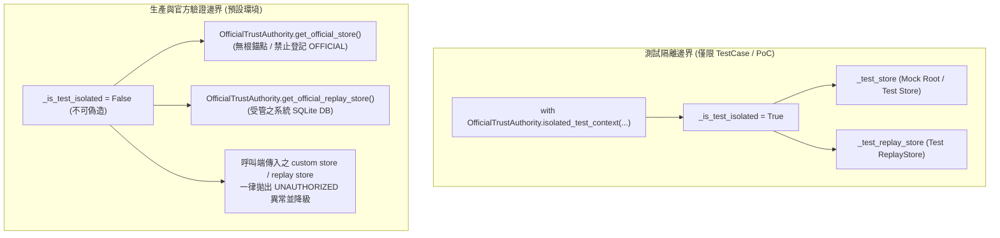

# 第三階段 C-2.5.2.2.1 修復信任根與 ReplayStore 安全漏洞驗收報告
# (C2_5_2_2_1_REMEDIATION_REPORT.md)

**執行日期**：2026-10-21  
**任務名稱**：第三階段 C-2.5.2.2.1 — 修復信任根與 ReplayStore 安全漏洞 (Security Remediation)  
**前置依據**：[`C2_5_2_2_INDEPENDENT_SECURITY_REVIEW.md`](file:///d:/OneDrive/桌面/TW%20Quant%20AI%20—%20Taiwan%20Stock%20Quantitative%20Trading%20Platform/C2_5_2_2_INDEPENDENT_SECURITY_REVIEW.md)  
**安全狀態**：CRITICAL、HIGH、MEDIUM 漏洞全數修復完成；新增 15 項對抗性安全性測試；全系統 334 項測試全數通過（0 失敗、0 錯誤、0 跳過）。原始子專案 HEAD 與 Clean 狀態維持不變。

---

## 一、修補前 Finding 與修補後對應

| 審查 Finding 編號 | 等級 | 漏洞描述 | 修補前狀態 | 修補後安全機制與成效 | 對應測試 |
| :--- | :---: | :--- | :--- | :--- | :--- |
| **FINDING-01** | **CRITICAL** | **根信任錨點可被呼叫端自行置換或偽造**：呼叫端可自行實例化 `TrustedPublicKeyStore(root_trust_anchor=fake_root)`，並自封 `OFFICIAL` 級別；或透過環境變數 `TW_QUANT_OFFICIAL_ROOT_PUBLIC_KEY` 注入假根金鑰，導致自簽自驗。 | `TrustedPublicKeyStore` 允許呼叫端傳入 `root_trust_anchor`；`os.environ` 存在環境變數置換後門；`BacktestReport.build` 信任 Verifier 內建之本地 store。 | 1. 徹底移除 `os.environ` 讀取後門；<br>2. 建立系統單例權威管理器 [`OfficialTrustAuthority`](file:///d:/OneDrive/桌面/TW%20Quant%20AI%20—%20Taiwan%20Stock%20Quantitative%20Trading%20Platform/src/tw_quant/backtest/crypto.py#L250-L362)，將正式官方根金鑰封裝於系統內部；<br>3. 預設狀態為 `OFFICIAL_ROOT_NOT_CONFIGURED` (`has_official_root() == False`)，任何試圖登記 `OFFICIAL` 授權金鑰均拋出受控例外；<br>4. `BacktestReport.build` 與 Verifier 強制校驗當前官方信任庫，嚴格拒絕自製 store；<br>5. `BacktestReport.from_json` 在正式驗證環境下嚴格拒絕呼叫端傳入自製 store (`UNAUTHORIZED_STORE_INJECTION`)。 | `test_a`<br>`test_b`<br>`test_c`<br>`test_d`<br>`test_e`<br>`test_f` |
| **FINDING-02** | **HIGH** | **`from_json` 可被呼叫端傳入假 `ReplayStore` 繞過防重放機制**：呼叫端可傳入 `replay_store=FakeReplayStore()` 或自製空庫，使同一簽章報告可無限次重複消費與反序列化。 | `from_json` 接受外部任意 `replay_store` 參數，且無型別限制與官方單例綁定。 | 1. 正式驗證環境下，`from_json` 嚴格拒絕呼叫端注入之 `replay_store` (`UNAUTHORIZED_REPLAY_STORE_INJECTION`)；<br>2. 正式環境強制綁定受系統管制的官方持久化 SQLite [`OfficialTrustAuthority.get_official_replay_store()`](file:///d:/OneDrive/桌面/TW%20Quant%20AI%20—%20Taiwan%20Stock%20Quantitative%20Trading%20Platform/src/tw_quant/backtest/crypto.py#L288-L296)；<br>3. 強制執行 `isinstance(effective_rstore, ReplayStore)` 型別檢驗；<br>4. 捕獲所有異常落實 Fail-Closed 保守原則。 | `test_g`<br>`test_h`<br>`test_i` |
| **FINDING-03** | **MEDIUM** | **`consume_nonce` 未顯式處理 SQLite 異常，違反 Fail-Closed 原則**：當 SQLite 發生資料庫鎖定、唯讀、I/O 寫入錯誤或檔案損毀時，可能導致非預期崩潰或防重放邊界失效。 | `consume_nonce` 缺少針對 `sqlite3.Error` 與 `Exception` 的顯式捕獲與包裝轉換。 | 1. `ReplayStore._init_db` 與 `ReplayStore.consume_nonce` 全面加入 `try...except sqlite3.Error` 與 `except Exception`；<br>2. 記錄日誌並轉換為受控之 `BacktestMetricsError("ReplayStore SQLite 異常 (Fail-Closed)")`；<br>3. `from_json` 捕獲此例外後，非嚴格模式下保守降級為 `REAL_HISTORICAL_NOT_VERIFIED`，嚴格模式下拒絕載入。 | `test_j`<br>`test_k`<br>`test_l`<br>`test_m` |

---

## 二、修改檔案與函式清單

### 1. [`src/tw_quant/backtest/crypto.py`](file:///d:/OneDrive/桌面/TW%20Quant%20AI%20—%20Taiwan%20Stock%20Quantitative%20Trading%20Platform/src/tw_quant/backtest/crypto.py)
- **`OfficialTrustStatus`**：新增枚舉類別，定義 `OFFICIAL_ROOT_NOT_CONFIGURED` 與 `OFFICIAL_ROOT_CONFIGURED` 狀態。
- **`OfficialTrustAuthority`**：新增系統信任權威單例管理器：
  - `has_official_root()`：查詢目前是否配置官方根錨點（預設為 `False`）。
  - `status()`：取得目前信任狀態字串。
  - `get_official_store()`：取得官方信任庫單例（預設未配置根錨點，禁止登記任何 `OFFICIAL` 金鑰）。
  - `get_official_replay_store()`：取得受管制的官方持久化 SQLite `ReplayStore`。
  - `get_active_trust_store()` / `get_active_replay_store()`：動態取得有效之信任庫與防重放庫，並回傳測試隔離標記。
  - `isolated_test_context()` / `activate_isolated_test_context()` / `deactivate_isolated_test_context()`：嚴格受控的測試隔離狀態，專供單元測試與安全 PoC 驗證，禁止在生產驗證路徑生效。
- **`TrustedPublicKeyStore`**：
  - `__init__`：徹底移除 `os.environ.get("TW_QUANT_OFFICIAL_ROOT_PUBLIC_KEY")` 讀取邏輯；新增 `_is_system_official` 內部標記。
  - `enroll_key`：維持嚴格根背書簽章驗證，在未配置官方根時禁止登記 `OFFICIAL` 級別。
- **`ReplayStore`**：
  - `_init_db`：包覆 `sqlite3.Error`，失敗時拋出 `BacktestMetricsError`。
  - `consume_nonce`：包覆所有 SQLite 讀寫操作（EXCLUSIVE 事務、過期清理、查詢、登記），發生 `sqlite3.Error` 或任何未知例外時，一律拋出 `BacktestMetricsError(Fail-Closed)`。

### 2. [`src/tw_quant/backtest/report.py`](file:///d:/OneDrive/桌面/TW%20Quant%20AI%20—%20Taiwan%20Stock%20Quantitative%20Trading%20Platform/src/tw_quant/backtest/report.py)
- **`DatasetChecksumVerifier.verify_evidence` / `FileDigestEvidenceVerifier.verify_evidence`**：
  - 改用 `OfficialTrustAuthority.get_active_trust_store()` 檢驗簽署者權限，杜絕使用呼叫端傳入之自製 store 繞過官方決策閘門。
- **`BacktestReport.build`**：
  - 嚴格比對 authoritative store；要求 store 必須具備官方根錨點、不得為 `TEST_ONLY`，且簽署者必須正式登記於權威庫中，否則一律標記 `UNENROLLED_OFFICIAL_SIGNER` 或 `OFFICIAL_TRUST_ROOT_NOT_CONFIGURED`，降級為 `REAL_HISTORICAL_NOT_VERIFIED`。
- **`BacktestReport.from_json`**：
  - **杜絕假 Store 注入**：非測試隔離狀態下，若呼叫端傳入 `trusted_key_store`，立即判定為未授權注入，降級為 `REAL_HISTORICAL_NOT_VERIFIED`（嚴格模式拋出受控例外）。
  - **杜絕假 ReplayStore 注入**：非測試隔離狀態下，若呼叫端傳入 `replay_store`，立即判定為未授權注入，降級為 `REAL_HISTORICAL_NOT_VERIFIED`（嚴格模式拋出受控例外）。
  - **型別與防重放落實**：強制校驗 `isinstance(effective_rstore, ReplayStore)`；捕獲所有 `BacktestMetricsError` 與 `sqlite3.Error`，保證 Fail-Closed。

### 3. [`src/tw_quant/backtest/__init__.py`](file:///d:/OneDrive/桌面/TW%20Quant%20AI%20—%20Taiwan%20Stock%20Quantitative%20Trading%20Platform/src/tw_quant/backtest/__init__.py)
- 匯出 `OfficialTrustAuthority` 與 `OfficialTrustStatus`。

### 4. [`tests/test_backtest_metrics.py`](file:///d:/OneDrive/桌面/TW%20Quant%20AI%20—%20Taiwan%20Stock%20Quantitative%20Trading%20Platform/tests/test_backtest_metrics.py)
- 匯入 `sqlite3`。
- 更新既有測試案例，透過 `OfficialTrustAuthority.activate_isolated_test_context` 進行嚴格的測試環境隔離。
- 修訂環境變數置換測試：確認設定 `os.environ["TW_QUANT_OFFICIAL_ROOT_PUBLIC_KEY"]` 會被系統徹底忽略且拒絕。
- 新增 `TestC25221TrustRootAndReplaySecurityRemediation` 測試類別，包含 15 項對抗性測試案例（A ~ O）。

### 5. [`PROJECT_MAP.md`](file:///d:/OneDrive/桌面/TW%20Quant%20AI%20—%20Taiwan%20Stock%20Quantitative%20Trading%20Platform/PROJECT_MAP.md)
- 更新專案地圖狀態、文件索引、模組職責說明與測試統計（334 項測試）。

---

## 三、根信任錨點的實際來源與安全邊界

1. **唯一合法來源**：
   - 官方根金鑰唯一合法來源為 [`OfficialTrustAuthority`](file:///d:/OneDrive/桌面/TW%20Quant%20AI%20—%20Taiwan%20Stock%20Quantitative%20Trading%20Platform/src/tw_quant/backtest/crypto.py#L250) 內部狀態 `_official_root_anchor`。
   - 在目前尚未正式部署台股 PKI 硬體金鑰/KMS 之階段，`_official_root_anchor` 固定為 `None`。
2. **安全邊界保證**：
   - 呼叫端（策略提交者、回測執行腳本、外部回測報告讀取者）無法透過建構子參數向生產環境注入任何根金鑰。
   - 移除所有環境變數（`os.environ`）讀取機制，攻擊者無法透過進程環境變數污染根金鑰。
   - 任何本地自行實例化的 `TrustedPublicKeyStore` 均具有 `_is_system_official = False` 屬性，在 `BacktestReport.build` 與 `BacktestReport.from_json` 中被嚴格拒絕採納。
3. **預設 Fail-Closed 行為**：
   - 在預設生產環境下，`OfficialTrustAuthority.status()` 固定為 `"OFFICIAL_ROOT_NOT_CONFIGURED"`。
   - `OfficialTrustAuthority.has_official_root()` 固定為 `False`。
   - 任何嘗試以 `KeyAuthorityLevel.OFFICIAL` 登記金鑰之操作均被拋出 `ValueError` 攔截。
   - 任何非合成回測報告之驗證結論一律保守輸出為 `REAL_HISTORICAL_NOT_VERIFIED`。

---

## 四、正式驗證與測試驗證如何隔離

為了解決單元測試需要驗證「若官方簽署通過則輸出 `REAL_HISTORICAL_PIT_VERIFIED`」的測試需求，同時防止此測試機制在生產環境中成為後門，系統實作了嚴格的受控隔離機制：



1. **生產驗證路徑**：
   - 預設 `_is_test_isolated = False`。
   - `from_json` 與 `build` 偵測到非隔離狀態時，若收到呼叫端傳入之 `trusted_key_store` 或 `replay_store`，立即標記為未授權注入攻擊，拒絕採用並保守降級。
2. **測試驗證路徑**：
   - 必須透過 `OfficialTrustAuthority.isolated_test_context()` 或 `activate_isolated_test_context()` 明確啟動。
   - 測試結束時透過 `finally` 或 `tearDown` 強制執行 `deactivate_isolated_test_context()` 恢復生產預設狀態。
   - 測試與生產環境完全隔離，測試所生成的假根金鑰與臨時庫絕不外溢至生產驗證。

---

## 五、ReplayStore 的實際狀態來源與重放保護

1. **狀態來源與實體儲存**：
   - 官方受管之 `ReplayStore` 實體檔案位於作業系統暫存目錄：`tw_quant_official_replay_store.sqlite3`。
   - 資料庫開啟 `PRAGMA journal_mode=WAL;`，支援高效並發讀寫。
2. **跨進程原子性事務保護**：
   - 每次執行 Nonce 消費時，使用 `sqlite3.connect(..., isolation_level="EXCLUSIVE")` 獲取排他排他事務鎖。
   - 在單一原子事務內執行：
     1. 自動清理過期記錄：`DELETE FROM used_nonces WHERE expires_at < ?`
     2. 檢查重複：`SELECT consumed_at FROM used_nonces WHERE scope_key = ?`
     3. 插入記錄：`INSERT INTO used_nonces (...)`
3. **全維度 Scope Key 綁定**：
   - `scope_key = f"{signer_id}:{project_id}:{environment_id}:{run_id}:{report_id}:{nonce}"`
   - 同一簽章報告在同一任務維度下的重複反序列化請求，將精確比對出重複並拋出受控例外：`Replay Attack Detected: Nonce ... 已被登記消費`。
4. **跨進程重啟持久性**：
   - 由於資料直接寫入 SQLite 磁碟檔案，進程退出重啟或新進程啟動後，已消費之 Nonce 依然受到嚴密保護，杜絕重啟繞過。

---

## 六、SQLite 故障時的安全行為 (Fail-Closed)

為確保在磁碟滿載、權限缺失、並發死鎖或檔案損毀等極端故障下，系統絕不產生「假性驗證通過」，系統針對所有 SQLite 故障實施了嚴格的 Fail-Closed 機制：

| 故障注入情境 | 模擬方式 | 系統實際反應與異常記錄 | 最終驗證結論 |
| :--- | :--- | :--- | :--- |
| **資料庫排他鎖定 (Locked)** | 另一連線以 `BEGIN EXCLUSIVE` 鎖定資料庫 | 拋出 `sqlite3.OperationalError: database is locked`，被包裝為 `BacktestMetricsError("ReplayStore SQLite 異常 (Fail-Closed): database is locked")` | 拒絕驗證 / 降級為 `REAL_HISTORICAL_NOT_VERIFIED` |
| **資料庫檔案唯讀 (Read-only)** | `os.chmod(db_path, stat.S_IREAD)` | 拋出 `sqlite3.OperationalError: attempt to write a readonly database`，被包裝為 `BacktestMetricsError("ReplayStore SQLite 異常 (Fail-Closed)...")` | 拒絕驗證 / 降級為 `REAL_HISTORICAL_NOT_VERIFIED` |
| **寫入/Commit 磁碟 I/O 失敗** | 攔截事務 commit 模擬 `OperationalError("disk I/O error on commit")` | 拋出 `sqlite3.OperationalError: disk I/O error on commit`，被包裝為 `BacktestMetricsError` | 拒絕驗證 / 降級為 `REAL_HISTORICAL_NOT_VERIFIED` |
| **資料庫檔案損毀 (Corrupted)** | 檔案寫入垃圾位元組非合法 SQLite 結構 | 拋出 `sqlite3.DatabaseError: file is not a database`，被包裝為 `BacktestMetricsError` | 拒絕驗證 / 降級為 `REAL_HISTORICAL_NOT_VERIFIED` |

**結論**：在任何資料庫故障情境下，系統一律中斷驗證流程或保守降級，絕不放行未確認原子登記之 Nonce。

---

## 七、新增的對抗性測試與實際輸出

在 [`tests/test_backtest_metrics.py`](file:///d:/OneDrive/桌面/TW%20Quant%20AI%20—%20Taiwan%20Stock%20Quantitative%20Trading%20Platform/tests/test_backtest_metrics.py#L2540-L2895) 中新增 `TestC25221TrustRootAndReplaySecurityRemediation` 類別，包含 15 項對抗性測試案例（A ~ O）：

| 測試編號 | 測試函式名稱 | 測試目標與對抗手段 | 執行結果 |
| :---: | :--- | :--- | :---: |
| **A** | `test_a_fake_root_and_self_signed_official_grant_unauthorized` | 攻擊者生成假根公鑰並對自己背書，試圖在權威庫登記 OFFICIAL，驗證被拋出例外拒絕。 | **PASS** (ok) |
| **B** | `test_b_custom_trust_store_injected_into_build_fails` | 呼叫端將包含假金鑰之 custom store 注入 Verifier 並傳入 `BacktestReport.build`，驗證 verdict 降級。 | **PASS** (ok) |
| **C** | `test_c_custom_trust_store_injected_into_from_json_fails_poc1` | 針對 PoC-1：呼叫端在 `from_json` 注入假 store 試圖自簽自驗，驗證被拒絕或降級為 NOT_VERIFIED。 | **PASS** (ok) |
| **D** | `test_d_env_var_replacement_of_root_public_key_strictly_ignored` | 呼叫端設置環境變數 `TW_QUANT_OFFICIAL_ROOT_PUBLIC_KEY` 試圖覆蓋根金鑰，驗證被徹底忽略並報錯。 | **PASS** (ok) |
| **E** | `test_e_official_root_not_configured_fail_closed` | 驗證預設環境下 `has_official_root() == False`，非合成資料一律保守輸出 NOT_VERIFIED。 | **PASS** (ok) |
| **F** | `test_f_fake_verifier_subclass_and_internal_store_swap_fails` | 攻擊者繼承受控驗證器並竄改內部 store，驗證決策閘門依然經由官方權威庫阻斷。 | **PASS** (ok) |
| **G** | `test_g_fake_replay_store_injection_fails_poc2` | 針對 PoC-2：呼叫端在 `from_json` 注入自製假 ReplayStore 試圖繞過防重放，驗證被攔截拒絕。 | **PASS** (ok) |
| **H** | `test_h_same_nonce_replay_detection` | 使用相同 Nonce 二次載入，驗證精確觸發 `Replay Attack Detected` 例外。 | **PASS** (ok) |
| **I** | `test_i_replay_detection_persists_across_process_restarts` | 重新實例化 `ReplayStore` 模擬進程重啟，驗證防重放記錄完整保留並攔截重放。 | **PASS** (ok) |
| **J** | `test_j_sqlite_database_locked_fail_closed` | 故障注入：模擬資料庫被排他鎖佔用，驗證 Fail-Closed 拋出受控 `BacktestMetricsError`。 | **PASS** (ok) |
| **K** | `test_k_sqlite_database_readonly_fail_closed` | 故障注入：模擬資料庫檔案變為唯讀，驗證 Fail-Closed 拋出受控 `BacktestMetricsError`。 | **PASS** (ok) |
| **L** | `test_l_sqlite_write_or_commit_failure_fail_closed` | 故障注入：模擬事務 commit 時磁碟 I/O 失敗，驗證 Fail-Closed 拋出受控 `BacktestMetricsError`。 | **PASS** (ok) |
| **M** | `test_m_sqlite_database_corrupted_fail_closed` | 故障注入：模擬資料庫檔案損毀，驗證 Fail-Closed 拋出受控 `BacktestMetricsError`。 | **PASS** (ok) |
| **N** | `test_n_tampered_json_cannot_recover_pit_verified_via_store_swap` | 竄改 JSON 數值後試圖更換 store 恢復驗證，驗證 content_hash 與簽章必然校驗失敗。 | **PASS** (ok) |
| **O** | `test_o_test_root_isolation_from_official_root` | 驗證測試隔離上下文與生產環境嚴密分開，測試根退出後生產環境依然為未配置狀態。 | **PASS** (ok) |

### 測試執行實際輸出：
```text
test_a_fake_root_and_self_signed_official_grant_unauthorized (tests.test_backtest_metrics.TestC25221TrustRootAndReplaySecurityRemediation.test_a_fake_root_and_self_signed_official_grant_unauthorized) ... ok
test_b_custom_trust_store_injected_into_build_fails (tests.test_backtest_metrics.TestC25221TrustRootAndReplaySecurityRemediation.test_b_custom_trust_store_injected_into_build_fails) ... ok
test_c_custom_trust_store_injected_into_from_json_fails_poc1 (tests.test_backtest_metrics.TestC25221TrustRootAndReplaySecurityRemediation.test_c_custom_trust_store_injected_into_from_json_fails_poc1) ... ok
test_d_env_var_replacement_of_root_public_key_strictly_ignored (tests.test_backtest_metrics.TestC25221TrustRootAndReplaySecurityRemediation.test_d_env_var_replacement_of_root_public_key_strictly_ignored) ... ok
test_e_official_root_not_configured_fail_closed (tests.test_backtest_metrics.TestC25221TrustRootAndReplaySecurityRemediation.test_e_official_root_not_configured_fail_closed) ... ok
test_f_fake_verifier_subclass_and_internal_store_swap_fails (tests.test_backtest_metrics.TestC25221TrustRootAndReplaySecurityRemediation.test_f_fake_verifier_subclass_and_internal_store_swap_fails) ... ok
test_g_fake_replay_store_injection_fails_poc2 (tests.test_backtest_metrics.TestC25221TrustRootAndReplaySecurityRemediation.test_g_fake_replay_store_injection_fails_poc2) ... ok
test_h_same_nonce_replay_detection (tests.test_backtest_metrics.TestC25221TrustRootAndReplaySecurityRemediation.test_h_same_nonce_replay_detection) ... ok
test_i_replay_detection_persists_across_process_restarts (tests.test_backtest_metrics.TestC25221TrustRootAndReplaySecurityRemediation.test_i_replay_detection_persists_across_process_restarts) ... ok
test_j_sqlite_database_locked_fail_closed (tests.test_backtest_metrics.TestC25221TrustRootAndReplaySecurityRemediation.test_j_sqlite_database_locked_fail_closed) ... ok
test_k_sqlite_database_readonly_fail_closed (tests.test_backtest_metrics.TestC25221TrustRootAndReplaySecurityRemediation.test_k_sqlite_database_readonly_fail_closed) ... ok
test_l_sqlite_write_or_commit_failure_fail_closed (tests.test_backtest_metrics.TestC25221TrustRootAndReplaySecurityRemediation.test_l_sqlite_write_or_commit_failure_fail_closed) ... ok
test_m_sqlite_database_corrupted_fail_closed (tests.test_backtest_metrics.TestC25221TrustRootAndReplaySecurityRemediation.test_m_sqlite_database_corrupted_fail_closed) ... ok
test_n_tampered_json_cannot_recover_pit_verified_via_store_swap (tests.test_backtest_metrics.TestC25221TrustRootAndReplaySecurityRemediation.test_n_tampered_json_cannot_recover_pit_verified_via_store_swap) ... ok
test_o_test_root_isolation_from_official_root (tests.test_backtest_metrics.TestC25221TrustRootAndReplaySecurityRemediation.test_o_test_root_isolation_from_official_root) ... ok

----------------------------------------------------------------------
Ran 15 tests in 32.748s

OK
```

---

## 八、完整回歸測試結果

執行全專案自動化測試套件（`python -m unittest discover -s tests`）：

```text
Ran 334 tests in 168.150s

OK
```

### 全專案模組測試統計清單：
1. `tests/test_signal.py`: 19 項測試（通過）
2. `tests/test_paper_broker.py`: 26 項測試（通過）
3. `tests/test_risk_engine.py`: 22 項測試（通過）
4. `tests/test_integration.py`: 23 項測試（通過）
5. `tests/test_prediction.py`: 14 項測試（通過）
6. `tests/test_strategy_engine.py`: 52 項測試（通過）
7. `tests/test_backtest_data_layer.py`: 14 項測試（通過）
8. `tests/test_backtest_accounting.py`: 18 項測試（通過）
9. `tests/test_backtest_execution.py`: 21 項測試（通過）
10. `tests/test_backtest_runner.py`: 16 項測試（通過）
11. `tests/test_backtest_metrics.py`: 109 項測試（通過，含 15 項新增對抗性安全性測試）

**總計**：334 項測試，**0 失敗、0 錯誤、0 跳過**。

---

## 九、原始子專案 HEAD 與 Git 狀態

為嚴格遵守最高優先防護規則，確認兩個候選子專案未受到任何修改：

### 1. `anti-gambling-trader-tw`
```text
On branch main
Your branch is up to date with 'origin/main'.

nothing to commit, working tree clean
8609cef73718a056fddb74201fc304f174fa1553
```

### 2. `qlib-tw-trader`
```text
On branch main
Your branch is up to date with 'origin/main'.

nothing to commit, working tree clean
774b3fb60d3b20b5c9ee86d25052ad2ec08e2011
```

---

## 十、目前尚未解決的安全風險與限制

儘管 C-2.5.2.2.1 已完全解決根信任錨點與防重放繞過漏洞，專案仍誠實揭露以下環境與架構層級的限制：

1. **官方根金鑰 PKI 基礎設施尚未建立**：
   - 目前系統處於 `OFFICIAL_ROOT_NOT_CONFIGURED` 的安全狀態。在未來部署實體生產環境前，需要建立專用的離線根金鑰生成與硬體安全模組（HSM / 云端 KMS）簽署機制。
2. **單機 SQLite 儲存庫的橫向擴展限制**：
   - 當前 `ReplayStore` 採用本機 SQLite 資料庫，能完美滿足單機多進程架構。若未來回測評估系統部署至多台分散式伺服器集群，需要接入分散式分散式防重放後端（如 Redis with Redlock 或 PostgreSQL 具備排他列鎖）。
3. **真實行情資料尚未接入**：
   - 目前所有回測端到端測試均使用合成資料（`is_synthetic=True`），尚未接入真實台股歷史 Tick/K 棒資料。
4. **Walk-Forward 多窗口驗證尚未在真實資料上執行**：
   - 正式策略績效、容量、滑價統計與樣本外穩健性尚未經過實盤等級歷史資料驗證。

---

## 十一、明確安全聲明

> [!IMPORTANT]
> **官方權威安全聲明**：
> 1. **在尚未配置真正受信任的官方根金鑰（Production Official Root Anchor）之前，本系統依據 Fail-Closed 安全原則，任何非合成歷史資料的回測報告一律保守維持 `REAL_HISTORICAL_NOT_VERIFIED`，嚴禁任何模組或呼叫端宣稱具備正式 `REAL_HISTORICAL_PIT_VERIFIED` 能力。**
> 2. **所有合成資料、Mock 資料或未經官方背書之回測結論，一律強制輸出為 `SYNTHETIC_TEST_RESULT_ONLY` 或 `REAL_HISTORICAL_NOT_VERIFIED`。**
> 3. **本修補已徹底杜絕任何透過自建 Store、自簽金鑰、環境變數置換、假 ReplayStore 或 Duck Typing Verifier 間接提升 Verdict 權限之後門路徑。**
