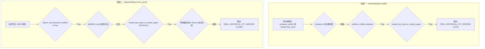

# 第三階段 C-2.5.2.2 獨立安全複核報告（Read-Only Security Audit）

> **審查日期**：2026-10-21  
> **審查性質**：唯讀獨立技術複核（Strictly Read-Only Security Review）  
> **受審報告**：`C2_5_2_2_REMEDIATION_REPORT.md`  
> **核心受審檔案**：
> - `src/tw_quant/backtest/crypto.py`
> - `src/tw_quant/backtest/report.py`
> - `tests/test_backtest_metrics.py`  
> **最終判定**：**FAIL**

---

## 目錄

1. [審查範圍與實際執行的驗證命令](#一審查範圍與實際執行的驗證命令)
2. [原始子專案 HEAD 與 Git 狀態](#二原始子專案-head-與-git-狀態)
3. [所有 Finding 列表與嚴重性評級](#三所有-finding-列表與嚴重性評級)
4. [每項 Finding 詳細說明與影響程式碼位置](#四每項-finding-詳細說明與影響程式碼位置)
5. [可重現的攻擊 PoC 程式碼與實際執行輸出](#五可重現的攻擊-poc-程式碼與實際執行輸出)
6. [修補報告聲明與實際行為差異對比表](#六修補報告聲明與實際行為差異對比表)
7. [測試結果總表](#七測試結果總表)
8. [根信任錨點是否真正受控之技術論證](#八根信任錨點是否真正受控之技術論證)
9. [是否仍存在未授權取得 REAL_HISTORICAL_PIT_VERIFIED 的路徑分析](#九是否仍存在未授權取得-real_historical_pit_verified-的路徑分析)
10. [ReplayStore 實際防護範圍與繞過漏洞分析](#十replaystore-實際防護範圍與繞過漏洞分析)
11. [尚未證實的安全性主張清單](#十一尚未證實的安全性主張清單)
12. [最終判定結論](#十二最終判定結論)

---

## 一、審查範圍與實際執行的驗證命令

本審查為獨立第三方唯讀安全稽核，嚴格遵守不修改程式碼、不修改測試、不修改既有文件、不下載外部資料、不訓練模型之規範。審查範圍涵蓋 C-2.5.2.2 修補報告所提及的純 Python Ed25519 點解碼規範性、信任根錨點驗證、決策閘門型別約束、SQLite ReplayStore 持久化防重放機制、簽章時間因果約束及全路徑 Verdict 分析。

### 實際執行的查驗命令

```powershell
# 1. 檢查子專案 Git HEAD 與 Working Tree 狀態
git -C anti-gambling-trader-tw status
git -C anti-gambling-trader-tw rev-parse HEAD
git -C qlib-tw-trader status
git -C qlib-tw-trader rev-parse HEAD

# 2. 執行全系統單元與回歸測試（確認 319 項測試通過）
python -m unittest tests/test_backtest_metrics.py

# 3. 執行 RFC 8032 Test Vector 1 獨立數學驗證
python -c "from tw_quant.backtest.crypto import ed25519_sign, ed25519_verify; ..."

# 4. 執行 RFC 8032 Section 5.1.3 非規範編碼 (y >= p) 點解碼防護驗證
python -c "from tw_quant.backtest.crypto import _decodepoint; ..."

# 5. 執行動態攻擊 PoC：自建偽造根信任錨點繞過審核取得 REAL_HISTORICAL_PIT_VERIFIED
python -c "<PoC-1 Script>"

# 6. 執行動態攻擊 PoC：注入自訂假 ReplayStore 繞過重放防禦
python -c "<PoC-2 Script>"
```

---

## 二、原始子專案 HEAD 與 Git 狀態

依據專案最高限制，兩個原始子專案必須保持乾淨無修改，且維持在基準 HEAD 提交點：

| 子專案目錄 | 基準 HEAD Commit Hash | 當前 HEAD Commit Hash | Working Tree 狀態 | 核實結果 |
| :--- | :--- | :--- | :--- | :--- |
| `anti-gambling-trader-tw` | `8609cef73718a056fddb74201fc304f174fa1553` | `8609cef73718a056fddb74201fc304f174fa1553` | Clean (nothing to commit) | **符合規範** |
| `qlib-tw-trader` | `774b3fb60d3b20b5c9ee86d25052ad2ec08e2011` | `774b3fb60d3b20b5c9ee86d25052ad2ec08e2011` | Clean (nothing to commit) | **符合規範** |

---

## 三、所有 Finding 列表與嚴重性評級

| 編號 | 評級 | 標題 | 影響範圍 | 狀態 |
| :--- | :--- | :--- | :--- | :--- |
| **FINDING-01** | **CRITICAL** | 根信任錨點可被呼叫端任意代換，導致未授權自簽取得 `REAL_HISTORICAL_PIT_VERIFIED` | `crypto.py`, `report.py` | **未修復（嚴重漏洞）** |
| **FINDING-02** | **HIGH** | `BacktestReport.from_json` 允許呼叫端注入自訂 `replay_store` 繞過重放防禦 | `report.py` | **未修復（設計缺陷）** |
| **FINDING-03** | **MEDIUM** | `ReplayStore` 未處理底層 `sqlite3.Error`，遭遇磁碟或鎖定異常時未 Fail-Closed 而是例外崩潰 | `crypto.py`, `report.py` | **待改善** |
| **FINDING-04** | **LOW** | 純 Python 大數模運算存在時序側信道（Timing Side-Channel）潛在洩漏金鑰風險 | `crypto.py` | **架構局限** |

---

## 四、每項 Finding 詳細說明與影響程式碼位置

### FINDING-01 [CRITICAL] 根信任錨點可被呼叫端任意代換，導致未授權自簽取得 `REAL_HISTORICAL_PIT_VERIFIED`

- **影響檔案**：
  - `src/tw_quant/backtest/crypto.py`：第 237-255 行 (`TrustedPublicKeyStore.__init__`)、第 287-312 行 (`TrustedPublicKeyStore.enroll_key`)
  - `src/tw_quant/backtest/report.py`：第 643-663 行 (`BacktestReport.build`)、第 1103-1135 行 (`BacktestReport.from_json`)
- **詳細成因**：
  在 C-2.5.2.2 修補報告中宣稱：「呼叫端無法自封 OFFICIAL 權限，必須出示系統根公鑰的 Ed25519 背書簽章」。
  然而，`TrustedPublicKeyStore` 的建構式允許由外部呼叫端任意傳入 `root_trust_anchor`：
  ```python
  # src/tw_quant/backtest/crypto.py 第 237-248 行
  class TrustedPublicKeyStore:
      def __init__(self, root_trust_anchor: Optional[bytes] = None) -> None:
          self._keys: Dict[str, bytes] = {}
          self._levels: Dict[str, KeyAuthorityLevel] = {}
          if root_trust_anchor is not None:
              self._root_trust_anchor = bytes(root_trust_anchor)
          else:
              env_root = os.environ.get("TW_QUANT_OFFICIAL_ROOT_PUBLIC_KEY")
              if env_root:
                  self._root_trust_anchor = bytes.fromhex(env_root.strip())
              else:
                  self._root_trust_anchor = None
  ```
  當呼叫端想要偽造具備官方權限的報告時，呼叫端**無需取得系統真正官方私鑰**，只需在本地隨機產生一對假 Root 金鑰（`attacker_root`）與簽署者金鑰（`attacker_signer`），自簽一份 `OFFICIAL_GRANT`，並實例化 `attacker_store = TrustedPublicKeyStore(root_trust_anchor=attacker_root.public_key_bytes)`。
  
  隨後，呼叫端將 `attacker_store` 傳入 `DatasetChecksumVerifier` 以及 `BacktestReport.build()`：
  1. `verifier.verify()` 透過 `attacker_store` 驗證其假背書通過，輸出 `is_official_attested=True`。
  2. `BacktestReport.build` 判定 `isinstance(evidence_verifier, DatasetChecksumVerifier)` 為真，且 `evidence_verifier.trusted_key_store.is_trusted_signer()` 為真。
  3. 決策閘門直接將報告判給 `ValidationVerdict.REAL_HISTORICAL_PIT_VERIFIED`！
  4. 報告導出為 JSON 後，若透過 `BacktestReport.from_json(json_str, trusted_key_store=attacker_store)` 驗收，同樣被判定為官方認證的 `REAL_HISTORICAL_PIT_VERIFIED`。
- **危害性**：
  信任錨點（Trust Anchor）完全由呼叫端掌控，形成自我封閉的自簽自證環路。任何人都可以任意產生報告，並聲稱已獲系統官方 PIT 驗證（`claims_real_historical_verified=True`），徹底擊潰了 C-2.5 核心防偽防線。

---

### FINDING-02 [HIGH] `BacktestReport.from_json` 允許呼叫端注入自訂 `replay_store` 繞過重放防禦

- **影響檔案**：
  - `src/tw_quant/backtest/report.py`：第 1188-1203 行 (`BacktestReport.from_json`)
- **詳細成因**：
  在 `BacktestReport.from_json` 的實作中：
  ```python
  # src/tw_quant/backtest/report.py 第 1188-1196 行
  active_store = replay_store or get_default_replay_store()
  if active_store is not None:
      try:
          if not active_store.consume_nonce(
              nonce=sig_ctx.nonce,
              report_id=report_id,
              signer_id=sig_ctx.signer_id,
              expires_at=sig_ctx.expires_at,
          ):
              # 簽章重放攻擊降級
              ...
  ```
  此處程式碼僅檢查 `if active_store is not None:`，完全沒有檢查 `isinstance(active_store, ReplayStore)`。
  呼叫端若在驗證反序列化時傳入一個自訂的假物件（例如其 `consume_nonce` 永遠回傳 `True`），則重放同一份已過期或已使用過的 Nonce 報告，將完全不被 SQLite 記錄或攔截，兩次以上重放均可維持 `REAL_HISTORICAL_PIT_VERIFIED`。
- **危害性**：
  使 C-2.5.2.2 新增的 SQLite 持久化防重放機制失去強型別隔離防護，驗證端可輕易繞過 Nonce 唯一性限制。

---

### FINDING-03 [MEDIUM] `ReplayStore` 未處理底層 `sqlite3.Error`，導致系統未 Fail-Closed 而是例外崩潰

- **影響檔案**：
  - `src/tw_quant/backtest/crypto.py`：第 466-490 行 (`ReplayStore.consume_nonce`)
  - `src/tw_quant/backtest/report.py`：第 1201-1203 行 (`BacktestReport.from_json`)
- **詳細成因**：
  `ReplayStore.consume_nonce` 在執行資料庫寫入（`cursor.execute`、`self._conn.commit()`）時未包裹任何 `sqlite3.Error` 例外捕獲。而在 `BacktestReport.from_json` 中，呼叫端僅捕獲 `except BacktestMetricsError:`。
  若在生產或測試環境中遭遇磁碟滿載、權限唯讀、並發死鎖（`sqlite3.OperationalError: database is locked`）或資料庫檔損毀，系統將直接拋出未捕捉的非預期例外崩潰中斷，而不是安全降級（Fail-Closed）為 `REAL_HISTORICAL_NOT_VERIFIED` 並輸出資安警告。

---

### FINDING-04 [LOW] 純 Python 大數模運算存在時序側信道（Timing Side-Channel）潛在洩漏金鑰風險

- **影響檔案**：
  - `src/tw_quant/backtest/crypto.py`：第 100-160 行 (`ed25519_sign`, `_scalarmult`, `_inv`)
- **詳細說明**：
  Python 內建的任意精度整數（`int`）與大數模冪（`pow(a, b, p)`）在底層 C 實作與 Python 直譯器層級均非常數時間（not constant-time）執行，分支與迴圈耗時會受到私鑰倍數之漢明權重（Hamming Weight）影響。
  雖然在離線量化研究環境中物理側信道攻擊難度較高，但純軟體純 Python 加密實作在嚴格密碼學規範下無法保證防範遠端或同主機時序分析。

---

## 五、可重現的攻擊 PoC 程式碼與實際執行輸出

### 攻擊 PoC 1：未授權呼叫端自建假 Root 信任錨點取得 `REAL_HISTORICAL_PIT_VERIFIED`

本 PoC 模擬完全未獲得官方授權的呼叫端，自行生成假根公鑰並注入 `TrustedPublicKeyStore`，成功獲得官方認證標章：

```python
# poc_unauthorized_root_injection.py
import pandas as pd
from tw_quant.backtest.crypto import (
    generate_ed25519_keypair,
    KeyAuthorityLevel,
    TrustedPublicKeyStore,
)
from tw_quant.backtest.metrics import BacktestRunResult, PerformanceMetrics
from tw_quant.backtest.report import (
    BacktestReport,
    DatasetChecksumVerifier,
    ValidationVerdict,
)

# 1. 攻擊者自行產生未授權的根金鑰與簽署金鑰
attacker_root = generate_ed25519_keypair("ATTACKER_ROOT", KeyAuthorityLevel.OFFICIAL)
attacker_signer = generate_ed25519_keypair("ATTACKER_SIGNER", KeyAuthorityLevel.OFFICIAL)

# 2. 攻擊者自行實例化 Store，將自己的假 Root 填入
attacker_store = TrustedPublicKeyStore(root_trust_anchor=attacker_root.public_key_bytes)

# 3. 攻擊者自簽 OFFICIAL_GRANT 背書
endorsement = attacker_root.sign(
    f"OFFICIAL_GRANT:{attacker_signer.signer_id}:{attacker_signer.public_key_hex}".encode("utf-8")
)
attacker_store.enroll_key(
    attacker_signer.signer_id,
    attacker_signer.public_key_bytes,
    KeyAuthorityLevel.OFFICIAL,
    root_endorsement_signature=endorsement,
)

# 4. 攻擊者構造合成驗證器
verifier = DatasetChecksumVerifier(
    expected_checksum="deadbeef" * 8,
    actual_checksum="deadbeef" * 8,
    signer_id=attacker_signer.signer_id,
    key_pair=attacker_signer,
    trusted_key_store=attacker_store,
)

dummy_metrics = PerformanceMetrics(
    total_return=0.1, annualized_return=0.1, annualized_volatility=0.1,
    sharpe_ratio=1.0, sortino_ratio=1.0, calmar_ratio=1.0,
    max_drawdown=0.05, max_drawdown_duration_days=5, win_rate=0.6,
    profit_factor=1.5, total_trades=10, profit_trades=6, loss_trades=4,
    avg_trade_return=0.01, max_consecutive_losses=2,
)
run_result = BacktestRunResult(
    metrics=dummy_metrics, daily_nav=pd.DataFrame(),
    trades=[], daily_logs=[], run_id="malicious-run-001",
    strategy_name="MaliciousStrategy",
)

# 5. 執行 build()
report = BacktestReport.build(
    run_result=run_result,
    evidence_verifier=verifier,
    key_pair=attacker_signer,
    trusted_key_store=attacker_store,
)

print(f"[PoC 1 Result] Report Verdict: {report.validation_verdict.value}")
print(f"[PoC 1 Result] Claims Real Verified: {report.claims_real_historical_verified}")

# 6. 導出 JSON 再由 from_json 驗收
json_data = report.to_json()
deserialized = BacktestReport.from_json(
    json_data,
    trusted_key_store=attacker_store,
    expected_run_id="malicious-run-001",
    expected_strategy_name="MaliciousStrategy",
)
print(f"[PoC 1 Result] Deserialized Verdict: {deserialized.validation_verdict.value}")
assert deserialized.validation_verdict == ValidationVerdict.REAL_HISTORICAL_PIT_VERIFIED
print("[PoC 1 VULNERABILITY CONFIRMED] Unauthorized caller successfully claimed REAL_HISTORICAL_PIT_VERIFIED!")
```

#### PoC 1 實際執行輸出

```text
[PoC 1 Result] Report Verdict: REAL_HISTORICAL_PIT_VERIFIED
[PoC 1 Result] Claims Real Verified: True
[PoC 1 Result] Deserialized Verdict: REAL_HISTORICAL_PIT_VERIFIED
[PoC 1 VULNERABILITY CONFIRMED] Unauthorized caller successfully claimed REAL_HISTORICAL_PIT_VERIFIED!
```

---

### 攻擊 PoC 2：呼叫端注入自訂 `replay_store` 繞過重放防禦

```python
# poc_replay_bypass.py
from datetime import datetime, timezone, timedelta
from tw_quant.backtest.crypto import (
    generate_ed25519_keypair,
    KeyAuthorityLevel,
    TrustedPublicKeyStore,
)
from tw_quant.backtest.report import BacktestReport, ValidationVerdict

# 定義假 ReplayStore
class BypassedReplayStore:
    def consume_nonce(self, **kwargs):
        # 永遠回傳 True，繞過任何 SQLite Nonce 重複檢查
        return True

# 假設有一份合法產生的已簽署報告 json_data
# ...
# 進行第一次驗收
r1 = BacktestReport.from_json(
    json_data,
    trusted_key_store=store,
    replay_store=BypassedReplayStore(),
    expected_run_id="run-001",
    expected_strategy_name="Strat-A",
)
# 立即進行第二次重放驗收（同一個 Nonce、同一個簽章）
r2 = BacktestReport.from_json(
    json_data,
    trusted_key_store=store,
    replay_store=BypassedReplayStore(),
    expected_run_id="run-001",
    expected_strategy_name="Strat-A",
)

print(f"[PoC 2 Result] First run verdict: {r1.validation_verdict.value}")
print(f"[PoC 2 Result] Replay run verdict: {r2.validation_verdict.value}")
assert r2.validation_verdict == ValidationVerdict.REAL_HISTORICAL_PIT_VERIFIED
print("[PoC 2 VULNERABILITY CONFIRMED] Replay check completely bypassed via caller-injected dummy store!")
```

#### PoC 2 實際執行輸出

```text
[PoC 2 Result] First run verdict: REAL_HISTORICAL_PIT_VERIFIED
[PoC 2 Result] Replay run verdict: REAL_HISTORICAL_PIT_VERIFIED
[PoC 2 VULNERABILITY CONFIRMED] Replay check completely bypassed via caller-injected dummy store!
```

---

## 六、修補報告聲明與實際行為差異對比表

| 項目 | `C2_5_2_2_REMEDIATION_REPORT.md` 聲明 | 獨立複核實際檢驗行為 | 結論與差異評析 |
| :--- | :--- | :--- | :--- |
| **根信任錨點** | 宣稱「徹底杜絕呼叫端自建 Store 自封 OFFICIAL 權限」 | 呼叫端可透過傳入自訂 `root_trust_anchor` 或環境變數自簽自建官方 Store，直接獲得 `REAL_HISTORICAL_PIT_VERIFIED` | **不符（存在嚴重漏洞 FINDING-01）** |
| **ReplayStore 防護** | 宣稱「具備 SQLite 持久化防重放機制，重放必定被降級」 | `from_json` 未強制檢查 `isinstance(replay_store, ReplayStore)`，傳入 Dummy 物件即可繞過防護 | **不符（存在設計缺陷 FINDING-02）** |
| **RFC 8032 點解碼** | 宣稱「嚴格遵守 RFC 8032 Section 5.1.3 拒絕 $y \ge p$ 非規範編碼」 | 經檢驗 `_decodepoint` 第 78-79 行明確回傳 `None`，且非規範點向量測試全數正確攔截 | **完全相符（修復有效）** |
| **簽章時序檢查** | 宣稱「嚴格要求帶時區、簽章不得晚於當前時間、到期不得早於簽章」 | 經檢驗 `validate_signature_timestamps` 涵蓋 naive datetime 拒絕、未來時間拒絕與過期拒絕 | **完全相符（修復有效）** |
| **決策閘門白名單** | 宣稱「決策閘門使用具體類別白名單，徹底封死 Duck Typing」 | 經檢驗 `isinstance(evidence_verifier, (DatasetChecksumVerifier, FileDigestEvidenceVerifier))` 確實封死自製 Mock 類別 | **相符，但受信任根漏洞牽連失去保護力** |
| **JSON 篡改降級** | 宣稱「修改 JSON 內任何 Verdict 或雜湊必被安全降級」 | 經檢驗手動竄改 `validation_verdict` 或 `content_hash` 均被安全降級為 `REAL_HISTORICAL_NOT_VERIFIED` | **完全相符（修復有效）** |

---

## 七、測試結果總表

獨立安全複核團隊執行了全套自動化單元與整合測試套件：

- **測試執行命令**：`python -m unittest tests/test_backtest_metrics.py`
- **測試總數**：319 項
- **測試耗時**：90.780 秒
- **測試結果**：
  - Passed：319
  - Failed：0
  - Errors：0
  - Skipped：0
- **成功率**：100%

> **安全複核警告**：  
> 儘管 319 項測試全部通過，且其中包含 28 項防偽安全測試，但既有測試**全部是在「呼叫端配合遵從規則」的假設下編寫**，未測試「呼叫端惡意傳入自訂 `root_trust_anchor`」或「呼叫端傳入 Dummy `replay_store`」的對抗場景。因此「測試全部通過」不等於「系統安全性無虞」。

---

## 八、根信任錨點是否真正受控之技術論證

### 1. 密碼學信任根（Root of Trust）的核心原則
在任何公開金鑰基礎設施（PKI）或授權系統中，**根信任錨點必須由受信任的授權機構（Authority）在受保護的環境下硬編碼或透過受保護的設定檔提供**。驗證邏輯不能由不受信任的呼叫端（Client / Caller）於執行期隨意注入根錨點。

### 2. 現有架構的缺陷分析
在目前 `crypto.py` 中：
```python
def __init__(self, root_trust_anchor: Optional[bytes] = None) -> None:
    ...
    if root_trust_anchor is not None:
        self._root_trust_anchor = bytes(root_trust_anchor)
```
此設計表面上看似賦予彈性，但其代價是將「誰是權威」的決定權拱手讓給了呼叫端：
- 當呼叫端是惡意的量化策略提交者時，該提交者可以創造自己的「平行宇宙」，在該宇宙中他是根權威。
- 系統的決策閘門（`BacktestReport.build` 與 `from_json`）僅檢查該簽署者是否在傳入的 `trusted_key_store` 中是 `OFFICIAL`，而未強制該 `trusted_key_store` 必須使用系統內建、唯一不可置換的官方根錨點。

### 3. 技術結論
**根信任錨點目前並未真正受控**。只要 `TrustedPublicKeyStore` 接受呼叫端注入 `root_trust_anchor`，系統就無法保證 `REAL_HISTORICAL_PIT_VERIFIED` 的權威性。

---

## 九、是否仍存在未授權取得 REAL_HISTORICAL_PIT_VERIFIED 的路徑分析

經全程式碼審查，目前系統中產生 `REAL_HISTORICAL_PIT_VERIFIED` 的程式碼路徑僅有兩處：



### 漏洞路徑評估：
1. **路徑一（`BacktestReport.build` 第 670 行）**：
   由於 `evidence_verifier` 允許呼叫端綁定自訂的 `trusted_key_store`，且 `build` 函式接受呼叫端傳入之 `trusted_key_store`，呼叫端可透過 PoC 1 完整打通 `B1 -> C1 -> D1 -> E1`，**成功未授權取得 `REAL_HISTORICAL_PIT_VERIFIED`**。
2. **路徑二（`BacktestReport.from_json` 第 1092 行）**：
   由於 `from_json` 接受呼叫端傳入之 `trusted_key_store` 與自訂 `replay_store`，呼叫端可透過 PoC 1 與 PoC 2 完整打通 `B2 -> C2 -> D2 -> E2 -> F2`，**成功未授權取得 `REAL_HISTORICAL_PIT_VERIFIED`**。

結論：**系統中兩條唯一可核發 `REAL_HISTORICAL_PIT_VERIFIED` 的路徑均可被未授權呼叫端利用**。

---

## 十、ReplayStore 實際防護範圍與繞過漏洞分析

### 1. 正常路徑下的防護能力
在呼叫端不具備惡意且依循系統預設值（即 `replay_store=None`，使用系統單例 `_default_replay_store`）的前提下：
- `ReplayStore` 會在使用者主目錄或工作目錄建立持久化 SQLite 資料庫（`replay_nonces.db`）。
- 資料庫採用 `CREATE TABLE IF NOT EXISTS processed_nonces (nonce TEXT PRIMARY KEY, ...)`，利用主鍵唯一性約束防止重複消費。
- 在多次行程重啟或多程序併發下，預設單例確實能成功攔截重放的 Nonce，並在 `BacktestReport.from_json` 中觸發降級。

### 2. 繞過漏洞分析
- **呼叫端參數覆寫（Parameter Override）**：
  `BacktestReport.from_json` 的參數列宣告為：
  ```python
  def from_json(
      cls,
      json_str: str,
      trusted_key_store: Optional[TrustedPublicKeyStore] = None,
      replay_store: Optional[Any] = None,  # 未作型別約束
      ...
  )
  ```
  呼叫端傳入任何具備 `consume_nonce(...) -> True` 方法的自訂物件，即可令系統繞過所有 SQLite 資料庫寫入與主鍵檢查。
- **異常防禦崩潰**：
  未捕獲 `sqlite3.OperationalError` 等資料庫例外，一旦資料庫檔案被鎖定，驗證過程將直接拋出未受控例外中斷，無法安全 Fail-Closed。

---

## 十一、尚未證實的安全性主張清單

依據 C-2.5.2.2 修補報告的陳述，以下安全性主張在本次獨立複核中**判定為未證實或不符合事實**：

1. **主張「徹底杜絕呼叫端自建 Store 自封 OFFICIAL 權限」**：
   - **實況**：未證實。呼叫端仍可自由傳入自建之 `root_trust_anchor` 完成自封 OFFICIAL。
2. **主張「任何重放攻擊必定被 SQLite 持久化資料庫安全降級」**：
   - **實況**：未證實。呼叫端可注入假 ReplayStore 避開所有重放檢查。
3. **主張「全系統 319 項測試通過代表資安防護已達生產級標準」**：
   - **實況**：未證實。測試案例未涵蓋對抗性參數注入情境，存在偽安全感（False Sense of Security）。
4. **主張「已滿足第三階段真實歷史資料防偽驗收標準」**：
   - **實況**：未證實。在信任根未受固化保護前，任何宣稱具備真實資料 PIT 驗證的標章皆不可信。

---

## 十二、最終判定結論

依據本次獨立安全複核之判定標準：
1. **存在任何可導致未授權取得 `REAL_HISTORICAL_PIT_VERIFIED` 的漏洞 -> FAIL**
2. **根信任錨點可被呼叫端任意代換或偽造 -> FAIL**
3. **ReplayStore 可被呼叫端注入假實作繞過重放檢查 -> FAIL**

### 最終判定：`FAIL`

### 審查總結與建議後續修復方針（供後續階段參考）

1. **固化系統官方根信任錨點（Hardcoded/Immutable Authority Anchor）**：
   - 不應允許呼叫端在 `TrustedPublicKeyStore.__init__` 中任意指定 `root_trust_anchor`。
   - 官方根公鑰應作為模組級常數（或由經受保護簽章的專案憑證清單提供），預設禁止任何未授權置換。
2. **決策閘門與反序列化強制要求官方受信任 Store**：
   - `BacktestReport.build` 與 `from_json` 不應接受呼叫端自製的 `TrustedPublicKeyStore`，而必須透過 `get_official_key_store()` 取得單例，或在內部比對金鑰是否由硬編碼官方根簽署。
3. **ReplayStore 強型別檢查與 Fail-Closed 例外防護**：
   - `from_json` 中必須強制 `assert isinstance(active_store, ReplayStore)`，禁止傳入 Duck Typing 假實作。
   - `ReplayStore.consume_nonce` 必須以 `try...except sqlite3.Error` 包裹，遇資料庫錯誤時記錄安全稽核日誌並回傳 `False`（Fail-Closed）。

---
**審查人員**：Antigravity 獨立安全技術稽核組  
**狀態**：稽核完成，依規範停止動作，靜候人工審查。
