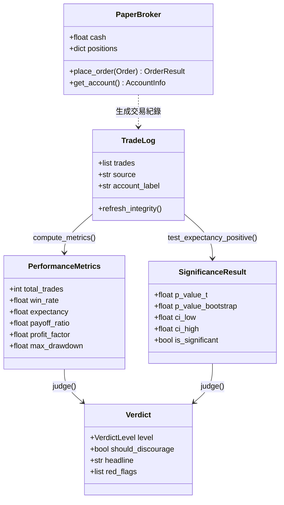
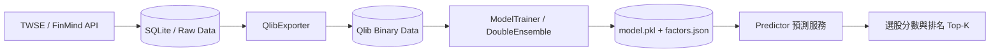
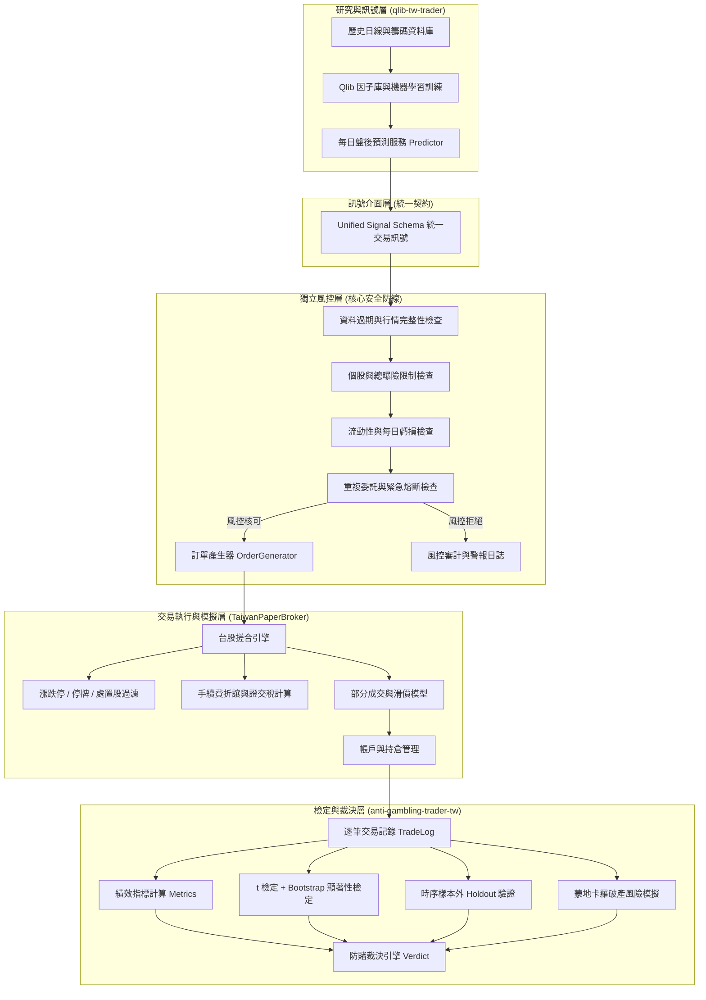

# 台股量化交易系統整合審查報告 (INTEGRATION_AUDIT.md)

**審查日期**：2026-10-20  
**審查階段**：第一階段（原始碼審查與架構整合規劃）  
**審查原則**：嚴格隔離真實交易、零外部依賴離線審核、防止資料洩漏與過度配適。

---

## 一、專案基線資訊

本評估審查兩個候選開源專案之原始碼，並記錄原始版本之 Commit SHA 作為後續整合基準：

1. **風控、統計檢定與模擬交易模組庫**：
   - **專案名稱**：`anti-gambling-trader-tw`
   - **Git 遠端**：`https://github.com/mars-tw/anti-gambling-trader-tw.git`
   - **基準 Commit SHA**：`8609cef73718a056fddb74201fc304f174fa1553`
   - **最新提交說明**：`Add read-only API research for Pionex, Binance and Shioaji (#8)`

2. **量化特徵工程與 AI 選股研究模組庫**：
   - **專案名稱**：`qlib-tw-trader`
   - **Git 遠端**：`https://github.com/Docat0209/qlib-tw-trader.git`
   - **基準 Commit SHA**：`774b3fb60d3b20b5c9ee86d25052ad2ec08e2011`
   - **最新提交說明**：`docs: sync Chinese README to match English version completely`

---

## 二、anti-gambling-trader-tw 優先模組深度審查

針對任務指定檢查的模組，逐一分析其輸入、輸出、依賴關係、錯誤處理機制，並精確區分已完成功能、示意範本與需自行實作部分。



---

### 1. 裁決引擎模組：`core/verdict/` (`judge.py`, `statistics.py`)

#### (1) 功能定位與設計理念
將量化策略的績效指標與統計檢定翻譯為客觀、保守的定性與定量判斷。遵循「寧可錯殺，不可放過」之保守原則，避免量化交易者將隨機波動誤認為 Alpha 優勢。

#### (2) 輸入與輸出
- **輸入**：
  - `TradeLog` 物件（包含逐筆已平倉交易記錄 `Trade`）。
  - 可選參數：`min_trades: int = 30`（最小樣本數）、`n_bootstrap: int = 5000`、`alpha: float = 0.05`。
- **輸出**：
  - `Verdict` 物件：包含 `level`（`VerdictLevel` 五級枚舉：`GAMBLING`, `INSUFFICIENT`, `LUCK_SUSPECTED`, `FRAGILE_EDGE`, `STATISTICAL_EDGE`）、`should_discourage: bool`、`headline: str`、`red_flags: list[RedFlag]`、`reasons: list[str]`、`advice: list[str]`、`required_trades: int`。

#### (3) 內部依賴與演算法
- **零外部依賴**：完全不依賴 `scipy` 或 `numpy`，純 Python 標準函式庫（`math`, `random`）實作。
- **統計檢定演算法**：
  - **Student's t 檢定**：使用正則化不完全 Beta 函數（Regularized Incomplete Beta Function, Lentz 算法）精確計算小樣本 $t$ 分布之單尾存活函數 $P(T > t)$。
  - **Bootstrap 置中重抽樣（Shift Method）**：將樣本均值平移至 $H_0: \mu = 0$ 虛無假設空間重抽，精確計算經驗單尾 $p$ 值（計算公式採用 $(n_{ge} + 1)/(B + 1)$ 消除假精確）與 Percentile 95% 信賴區間。
- **紅旗警訊掃描（Red Flag Scanner）**：
  - 負期望值（`negative_expectancy`）
  - 獲利過度集中（`concentrated_profit`: 單筆獲利佔比 > 50%）
  - 賺小賠大（`win_small_lose_big`: 勝率 > 70% 但盈虧比 < 0.4）
  - 安全邊際過薄（`thin_edge_margin`: 盈虧比距打平門檻過近）
  - 嚴重回撤（`severe_drawdown`: 最大回撤 > 50%）
  - 長期連虧（`long_losing_streak`: 連虧 >= 8 次）
  - 當沖雜訊（`intraday_noise`: 當沖佔比 > 70% 且無統計顯著性）

#### (4) 錯誤處理與邊界防護
- 檢查輸入是否為有限數字（防禦 `bool`, `NaN`, `Inf`）。
- 檢查資料完整性：若 `rejected_row_count > 0` 或 `suspected_duplicate_count > 0`，判定為 `INSUFFICIENT` 並發出 `high` 嚴重度警告，禁止發放正優勢認證。
- 大樣本保護：自動限制最大抽樣次數（`MAX_BOOTSTRAP_DRAWS = 20_000_000`），避免大數據量下單執行緒假死。

#### (5) 完成度分類
- **已完成（Production-ready）**：統計檢定、紅旗掃描、裁決決策樹、資料完整性驗證。
- **需自行實作部分**：目前僅支援「單一策略事後檢定」，尚未能直接對接即時線上串流交易進行動態防賭監控。

---

### 2. 樣本外驗證模組：`core/backtest/validate.py`

#### (1) 功能定位
針對已發生之時序交易資料進行「單一時序 Holdout（樣本內/樣本外）驗證」，檢驗策略優勢是否延續至未見過的時間段，防止過度配適（Overfitting）與資料洩漏（Data Leakage）。

#### (2) 輸入與輸出
- **輸入**：`TradeLog` 物件、`split_ratio: float = 0.7`、`n_bootstrap: int = 3000`。
- **輸出**：`OutOfSampleReport` 物件（包含 `in_sample: SegmentResult`, `out_sample: SegmentResult`, `edge_persisted: bool`, `degradation: float`, `available: bool`, `unavailable_reason: str`）。

#### (3) 關鍵防護與依賴
- **防範 Lookahead Bias 與資料扭曲**：
  - 嚴格要求每筆交易具備真實且可靠的 `exit_time`；缺少出場時間者直接拒絕驗證。
  - 時區基準檢查：嚴禁混合 offset-naive 與 offset-aware 時間。
  - 幣別一致性防護：樣本內外幣別不同時拒絕比較，避免匯率折算造成之假性優勢。
  - 同一時點切分保護：禁止將同一時點出場的多筆單拆分到樣本內與樣本外，防止事後偷看。
- **優勢延續判定條件**：
  - 樣本內期望值為正且統計顯著（$p < 0.05$）。
  - 樣本外期望值仍為正。
  - 期望值衰減比例 $< 50\%$。
  - 樣本外本身具備統計顯著性（防範因樣本外筆數少但碰巧為正的假陽性）。

#### (4) 完成度分類
- **已完成**：單一時序 Holdout 切分、時序防洩漏驗證、雙段統計比較。
- **需自行實作部分**：滾動式 Walk-Forward 矩陣檢驗（作者已於註解坦承因小樣本緣故僅實作單一 Holdout，若整合 `qlib-tw-trader` 的大規模時序資料，需補強多折 Walk-Forward 時序切分）。

---

### 3. 券商介面基底：`core/broker/base.py`

#### (1) 功能定位
定義所有券商連接器（實盤與紙上）的統一抽象介面與標準資料結構。

#### (2) 核心資料結構
- `Order`：包含 `symbol`, `side` (`OrderSide.BUY` / `SELL`), `quantity`, `order_type` (`OrderType.MARKET` / `LIMIT`), `limit_price`, `client_tag`, `client_order_id`。包含 `validate()` 嚴格校驗。
- `OrderResult`：包含 `ok: bool`, `order_id: str`, `filled_quantity: float`, `avg_price: float`, `message: str`, `raw: dict`。
- `Position`：包含 `symbol`, `quantity`, `avg_price`, `market_price`, `cost_basis_known`，以及計算 `unrealized_pnl`。
- `AccountInfo`：包含 `cash: float`, `equity: float`, `currency: str`。
- `BrokerAdapter(ABC)`：抽象基類，包含 `connect()`, `get_account()`, `get_positions()`, `get_price()`, `place_order()`, `cancel_order()`。

#### (3) 安全機制：實盤雙重閘門
- 預設 `is_live = False`。
- 若 `is_live = True`，在呼叫 `place_order()` 前會強制執行 `_guard_live()`：必須由使用者手動呼叫 `confirm_live_trading(i_understand_the_risk=True)`，傳入字面布林值 `True` 始可解除，否則直接拋出 `PermissionError`。

#### (4) 完成度分類
- **已完成**：基礎資料型別封裝、安全閘門、委託驗證。
- **需自行實作部分**：台股特有委託屬性（現股/融資/融券、當沖旗標、ROD/IOC/FOK、市價/限價/平盤下可否放空）。

---

### 4. 紙上模擬券商：`core/broker/paper.py`

#### (1) 功能定位
以本機記憶體狀態模擬券商撮合、持倉與帳戶損益計算。

#### (2) 輸入與內部狀態
- 參數：`cash: float = 1_000_000`, `fee_rate: float = 0.001`, `slippage: float = 0.0005`, `currency: str = "USD"`, `allow_short: bool = False`。
- 內部維護：`_cash`, `_positions: dict[str, Position]`, `_prices: dict[str, float]`, `fills: list[OrderResult]`。

#### (3) 撮合邏輯與部位計算亮點
- **防禦性計算**：在改變帳戶狀態前，透過 `_preview_fill()` 預先試算持倉與平均成本，確認無浮點數溢位後才寫入。
- **四種持倉變更精準處理**：
  1. 無部位/已平倉：建立新部位。
  2. 同向加碼：加權平均成本計算。
  3. 反向減碼（未超量）：數量扣減，持倉均價維持不變。
  4. 反向超量（平倉且反手翻倉）：剩餘數量以「本次成交價」建立反向部位，修正了傳統回測系統中翻倉均價錯誤的重大缺陷。
- **防範非法放空**：`allow_short=False` 時，賣出數量大於持有數量立即拒單，防止非預期裸賣。

#### (4) 完成度分類與局限性
- **已完成**：即時撮合、資金扣減、持倉更新、溢位保護。
- **重大缺口（需自行實作）**：
  - 缺乏台股手續費折讓與最低 20 元手續費限制。
  - 缺乏賣出證券交易稅（0.3% / 0.1%）。
  - 缺乏限價單掛單佇列（目前僅支援 immediate-fill，無法成交則直接拒單）。
  - 缺乏部分成交（Partial Fill）。
  - 缺乏台股 10% 漲跌停限制、停牌、處置股票過濾。
  - 缺乏每日淨值曲線（Daily NAV）與最大回撤歷史追蹤。

---

### 5. 券商連接器註冊表：`core/broker/registry.py` & `registry_tw.py`

#### (1) 模組現況審查
該模組包含元大 (`YuantaBroker`)、富邦 (`FubonBroker`)、永豐 (`ShioajiBroker`)、凱基 (`KgiBroker`)、群益/統一/元富期貨 (`TwFuturesBroker`) 等台股券商，以及 Binance、IBKR、Alpaca、Pionex 等海外券商。

#### (2) 完成度屬性判定
- **完全為「示意範本（BrokerTemplate / Code Stub）」**：
  - 各券商模組僅為字串形式的 Python 範本程式碼，主要方法皆為 `raise NotImplementedError` 或僅有概念性 pseudo-code。
  - 即使永豐 Shioaji 包含較多代碼片段，其 `activate_ca` 憑證載入、真實回報接收、股票張/股單位換算、斷線重連均未實作。
- **結論**：本模組絕對**不可直接用於實盤下單**，第一階段必須嚴格鎖定於模擬交易（Paper Trading）。

---

### 6. 專案腳架模組：`core/scaffold/` (`generator.py`, `templates.py`)

#### (1) 功能定位
將驗證後的策略打包成可獨立執行的程式專案（包含獨立的 `broker_lib.py`、`main.py` 等）。

#### (2) 安全機制
- 輸入安全防禦：防止路徑穿越（`..`）與專案名稱注入。
- 階段分流控制：唯有當分析結果達到 `tiny_live_validation` 時，生成的設定檔才會允許配置實盤旗標；否則預設硬性封鎖實盤。

#### (3) 完成度分類
- **已完成**：自包含腳本生成、安全分流旗標產生。
- **整合考量**：台股量化平台不需頻繁透過 CLI 產生獨立專案，但可吸收其 `broker_lib` 獨立解耦之架構精神。

---

### 7. 核心績效與損益平衡模組：`core/metrics/` (`performance.py`, `breakeven.py`)

#### (1) 功能定位
計算交易紀錄之完整績效輪廓，並反推「讓期望值由負轉正」所需的最低勝率、盈虧比或成本降幅。

#### (2) 關鍵指標與時序保護
- **時序完整性判定（`sequence_metrics_reliable`）**：
  - 檢查是否所有交易之 `exit_time` 皆已知且唯一。
  - 若存在出場時間缺失、時區不一致、或相同時間無法確定真實先後時，拒絕計算最大回撤與連續虧損，並設置 `sequence_note`，杜絕造假數據。
- **指標體系**：
  - 勝率、平均獲利、平均虧損、盈虧比（分母為 0 時輸出 $\infty$ 而非 0 或崩潰）。
  - 期望值（金額 Expectancy 與以 R 為單位之 Expectancy R）。
  - 最賺交易獲利佔比（`top_trade_pnl_share`）。
  - 當沖交易佔比（`intraday_ratio`）。
- **損益平衡反推（`breakeven.py`）**：
  - 給定當前盈虧比，計算期望值轉正所需勝率 $W^* = \frac{L_{rate} \times Loss}{Win + Loss}$。
  - 給定當前勝率，計算期望值轉正所需盈虧比。

#### (3) 完成度分類
- **已完成**：多維度績效評估、時序可靠度檢驗、轉正目標計算。
- **需自行實作部分**：台股專用的年化換手率（Turnover rate）與投資組合加權淨值指標。

---

### 8. 蒙地卡羅情境模擬：`core/montecarlo/simulate.py`

#### (1) 功能定位
使用重抽樣（Resampling）模擬未來資金路徑，量化長期交易中的破產風險（Ruin Probability）與回撤極端值。

#### (2) 輸入與輸出
- **輸入**：歷史損益陣列 `pnls: Sequence[float]`、初始資金 `start_equity: float`、停損/破產門檻 `threshold: float`、模擬期數 `horizon: int`、模擬路徑數 `paths: int = 1000`。
- **輸出**：期末資金分位數（P05, Q1, Median, Q3, P95, Mean）、最大回撤分位數、觸及門檻機率（首次跌破停損點的比例與時間分佈）、扇形走勢圖數據。

#### (3) 核心防護機制
- 支援協同中斷（`cancel_event`）與安全超時保護（`deadline_seconds`），防止長時間佔用 CPU。
- 陣列運算採用 `array('d')` 節省記憶體，並進行逐筆浮點數溢位防護。

#### (4) 完成度分類
- **已完成（Production-ready）**：蒙地卡羅重抽樣引擎、破產機率評估、分位數彙整。
- **擴充建議**：目前為獨立非同質抽樣，後續可支援區塊重抽樣（Block Bootstrap）以捕捉台股行情之時序自相關性（Serial Correlation）。

---

## 三、qlib-tw-trader 核心架構審查

`qlib-tw-trader` 專注於台股特徵計算與機器學習選股：



### 1. 資料與特徵管線
- 支援證交所 OpenAPI 與 FinMind 抓取台股日線與三大法人、融資融券數據。
- 透過 `QlibExporter` 轉換為 Qlib 高性能二進位格式儲存於 `data/qlib`。
- 因子庫涵蓋 Alpha 158、動量、籌碼面（外資/投信/自營商買賣超）等。

### 2. 預測服務：`Predictor.predict`
- **防範 Lookahead Bias**：在 `predictor.py` 中，明確規定買入日 $T$ 的預測必須嚴格使用 $T-1$ 日收盤後的特徵資料。
- **輸出資料結構**：
  ```python
  (feature_date, [
      {"symbol": "2330", "score": 0.8523, "rank": 1},
      {"symbol": "2454", "score": 0.7412, "rank": 2},
      ...
  ])
  ```
- **核心缺口**：
  - `qlib-tw-trader` 目前的回測僅為粗略的週報酬模擬，缺乏真實的訂單撮合、交易稅費、委託排隊、漲跌停限制與獨立風控閘門。
  - 模型預測分數（Score）直接作為持倉權重，未進行信號有效期限、流動性衝擊與個股曝險過濾。

---

## 四、雙系統整合評估與架構分工規劃

兩個專案優勢互補，整合後將形成專業級的台股量化交易平台架構：



### 職責分工總結表

| 子系統 | 核心職責 | 採用/擴充來源 | 狀態 |
| :--- | :--- | :--- | :--- |
| **選股與預測引擎** | 資料同步、特徵工程、模型滾動訓練、每日截面選股評分 | `qlib-tw-trader` | 既有完備，需標準化輸出格式 |
| **統一訊號介面** | 規範訊號欄位、版本戳記、有效期限與風險邊界，杜絕模型直連券商 | 新增標準規格契約 | 待實作 |
| **獨立風控模組** | 10 項風控防線、訂單過濾、即時部位計算、緊急停機 | 新增獨立模組 | 待實作 |
| **台股 PaperBroker** | 台股撮合、漲跌停/停牌過濾、手續費折讓/證交稅、掛單佇列 | 擴充 `anti-gambling-trader-tw/core/broker/paper.py` | 待擴充 |
| **統計裁決與驗證** | 防賭裁決、Bootstrap 檢定、樣本外切分、蒙地卡羅模擬 | `anti-gambling-trader-tw/core/{verdict, backtest, montecarlo}` | 既有完備，直接整合呼叫 |

---

## 五、第一階段審查結論

1. **防賭與驗證模組品質優異**：`anti-gambling-trader-tw` 在統計檢定、防範前視偏差、時序完整性檢查與保守裁決決策樹之設計具極高水準，適合作為整個量化系統的「品質與安全裁判」。
2. **券商連接器未達實盤標準**：所有台股券商範本均為骨架代碼，必須禁止任何實盤連線，完全使用擴充後的台股專用 `TaiwanPaperBroker`。
3. **風控必須嚴格獨立**：AI 模型不得具備任何直接下單權限，必須經過獨立風控模組檢驗後始能生成委託單。
4. **下一步執行方向**：完成券商能力審查、台股模擬缺口分析、風控規格設計與離線測試計畫，等待使用者審查確認後，再行展開程式實作。
