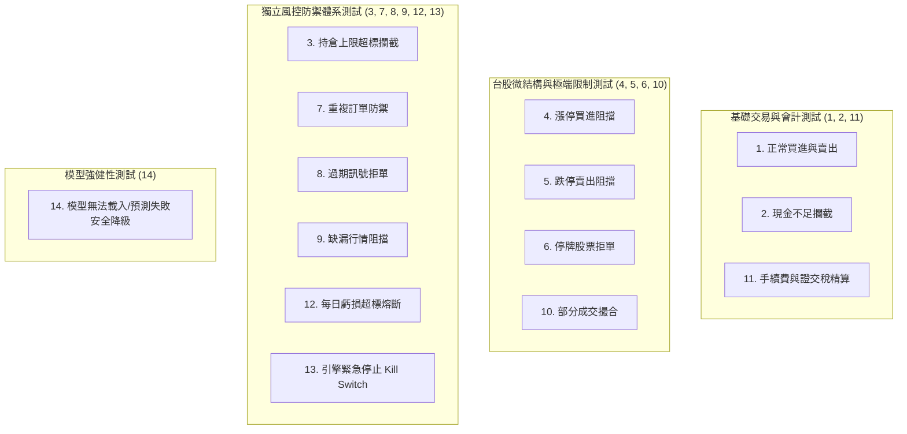

# 離線整合測試計畫與驗證標準 (INTEGRATION_TEST_PLAN.md)

**計畫日期**：2026-10-20  
**測試原則**：
1. **完全離線執行**：使用預先生成的固定測試資料（Mock Data），不依賴外部網路、不調用外部行情 API、不連接真實券商。
2. **測試前置原則**：所有風控機制、台股交易稅費與撮合邏輯必須具備可自動化回歸之測試案例。
3. **優先回報規範**：測試執行後優先回報失敗項目、錯誤原因及修復對策。

---

## 一、固定測試資料集 (Mock Fixtures)

建立標準台股測試資料集，涵蓋各類極端行情報價：

| 股票代碼 | 模擬情境特徵 | 參考價格 | 昨收價 | 漲停價 | 跌停價 | 模擬交易量 | 標的狀態 |
| :--- | :--- | :--- | :--- | :--- | :--- | :--- | :--- |
| **2330** (台積電) | 正常流動性藍籌股 | 1000.0 | 990.0 | 1085.0 | 891.0 | 25,000,000 | 正常交易 |
| **2454** (聯發科) | 正常中大型權值股 | 1200.0 | 1200.0 | 1320.0 | 1080.0 | 8,000,000 | 正常交易 |
| **9991** (漲停鎖死) | 一字線漲停、無賣單 | 55.0 | 50.0 | 55.0 | 45.0 | 1,000 | 漲停鎖死 |
| **9992** (跌停鎖死) | 一字線跌停、無買單 | 45.0 | 50.0 | 55.0 | 45.0 | 500 | 跌停鎖死 |
| **9993** (暫停交易) | 發生重大事件停牌 | 100.0 | 100.0 | 110.0 | 90.0 | 0 | 暫停交易 (Halted) |
| **9994** (缺漏行情) | 行情丟失/無報價 | None | 80.0 | 88.0 | 72.0 | None | 資料缺失 |

---

## 二、14 項核心情境測試規格與斷言標準



---

### 情境 1：正常買進與賣出 (Normal Buy & Sell)
- **測試目標**：驗證常態下訊號生成、風控審核通過、PaperBroker 撮合成交及持倉平均成本計算。
- **測試輸入**：
  - 帳戶現金：1,000,000 TWD。
  - 訊號：買進 2330 股票 1,000 股（1 張），市價委託。
  - 後續訊號：賣出 2330 股票 1,000 股，市價委託。
- **斷言標準 (Assertions)**：
  - 買單撮合成功，`OrderResult.ok == True`，持倉數量變更為 1,000 股。
  - 現金扣除成交額、手續費。
  - 賣單撮合成功，持倉數量歸 0。
  - 產生 1 筆已平倉 `Trade`，正確記錄已實現損益（含手續費與證交稅）。

---

### 情境 2：現金不足 (Insufficient Cash)
- **測試目標**：驗證當委託所需資金（含手續費）超過現金餘額時，正確被攔截拒單，帳戶狀態不變。
- **測試輸入**：
  - 帳戶現金：10,000 TWD。
  - 訊號：買進 2330 股票 1,000 股（市價 1000 元，需 1,000,000 元）。
- **斷言標準 (Assertions)**：
  - 風控或券商回報 `OrderResult.ok == False`。
  - 回報訊息包含「資金不足」關鍵字。
  - 現金餘額維持 10,000 TWD，未產生任何持倉變更。

---

### 情境 3：超過持倉上限 (Single / Total Position Limit Violation)
- **測試目標**：驗證單檔標的市值佔比超過設定門檻（例如 NAV 的 10%）時，風控強制拒單。
- **測試輸入**：
  - 帳戶 NAV：1,000,000 TWD，目前持有 2330 市值 80,000 TWD（8%）。
  - 訊號：加碼買進 2330 市值 50,000 TWD（若成交總佔比達 13% > 10%）。
- **斷言標準 (Assertions)**：
  - 風控引擎在抵達券商前直接攔截，`RiskCheckResult.approved == False`。
  - 拒單原因標記 `SINGLE_POSITION_LIMIT_EXCEEDED`。
  - 未向券商發送任何委託。

---

### 情境 4：漲停買進阻擋 (Limit Up Buy Block)
- **測試目標**：模擬台股漲停鎖死（10% 上限且無賣量）時，買單不可撮合成交。
- **測試輸入**：
  - 標的 9991 當前報價 55.0（昨收 50.0，漲停鎖死）。
  - 訊號：以市價或限價 55.0 買進 9991 股票 1,000 股。
- **斷言標準 (Assertions)**：
  - 模擬撮合器回傳未成交，訂單維持 `PENDING` 或依設定撤單。
  - 嚴禁在無賣單狀態下以市價虛擬撮合成交（杜絕回測假象）。

---

### 情境 5：跌停賣出阻擋 (Limit Down Sell Block)
- **測試目標**：模擬台股跌停鎖死（10% 下限且無買量）時，賣單停損無法立即成交。
- **測試輸入**：
  - 已持有 9992 股票 1,000 股。
  - 標的 9992 報價 45.0（昨收 50.0，跌停鎖死無買單）。
  - 訊號：以市價或限價 45.0 賣出 9992 股票 1,000 股。
- **斷言標準 (Assertions)**：
  - 模擬撮合器回傳無法成交，持倉維持 1,000 股，未實現虧損持續擴大。
  - 驗證系統不會產生「跌停仍能保證停損」的樂觀偏差。

---

### 情境 6：停牌股票限制 (Trading Halt Handling)
- **測試目標**：標的處於暫停交易狀態時，系統應拒絕受理交易委託。
- **測試輸入**：
  - 標的 9993 處於重大訊息停牌狀態。
  - 訊號：買進 9993 股票 1,000 股。
- **斷言標準 (Assertions)**：
  - 委託直接被風控標記為 `TRADING_HALTED` 拒單。
  - 系統發送警示日誌。

---

### 情境 7：重複訂單保護 (Duplicate Order / Rate Limit Guard)
- **測試目標**：模擬程式 bug 或非同步重複觸發，短時間內送出相同訊號時的攔截防禦。
- **測試輸入**：
  - 在 100 毫秒內連續送出 2 筆完全相同的委託（2330, BUY, 1000 股）。
- **斷言標準 (Assertions)**：
  - 第 1 筆訂單正常通過審查。
  - 第 2 筆訂單被風控攔截，回報 `DUPLICATE_ORDER_REJECTED`。

---

### 情境 8：過期訊號拒絕 (Expired Signal Rejection)
- **測試目標**：訊號因網路延遲或排程阻塞，抵達風控引擎時已超過有效期限。
- **測試輸入**：
  - 訊號 `valid_until` 為 2026-10-20 09:00:00。
  - 風控審查時間為 2026-10-20 09:05:00（過期 5 分鐘）。
- **斷言標準 (Assertions)**：
  - 風控引擎直接判定無效並拒單，標記 `SIGNAL_EXPIRED`。

---

### 情境 9：缺漏行情防護 (Missing Market Data Handling)
- **測試目標**：當股票行情丟失（NaN 或 None）時，系統安全拒單，不得引發未捕捉之異常。
- **測試輸入**：
  - 標的 9994 之行情報價為 None 或 NaN。
  - 委託買進 9994 股票 1,000 股。
- **斷言標準 (Assertions)**：
  - 系統捕捉缺失，回傳 `MISSING_MARKET_DATA`。
  - 系統不發生崩潰（ZeroDivisionError 或 TypeError）。

---

### 情境 10：部分成交撮合 (Partial Fill Simulation)
- **測試目標**：當委託量大於當下流動性上限時，僅撮合部分數量，剩餘數量保留掛單。
- **測試輸入**：
  - 委託買進某股票 10,000 股。
  - 當前市場撮合區間成交量為 20,000 股，設定最大參與率 10%（即最多撮合 2,000 股）。
- **斷言標準 (Assertions)**：
  - `OrderResult.filled_quantity == 2000`。
  - 訂單狀態變更為 `PARTIALLY_FILLED`，剩餘 8,000 股繼續保留在佇列中。

---

### 情境 11：手續費與證交稅精算 (Taiwan Broker Fee & Transaction Tax Verification)
- **測試目標**：精確核算台股交易成本公式。
- **測試輸入**：
  - 買進 2330 股票 1,000 股，成交價 1,000 元（成交額 1,000,000 元）。
  - 設定：手續費率 0.1425%，折讓 6 折，最低 20 元。
  - 賣出 2330 股票 1,000 股，成交價 1,050 元（成交額 1,050,000 元）。
  - 設定：證券交易稅 0.3%。
- **斷言標準 (Assertions)**：
  - 買入手續費：$1,000,000 \times 0.001425 \times 0.6 = 855$ 元（大於 20 元）。
  - 賣出手續費：$1,050,000 \times 0.001425 \times 0.6 = 897.75 \rightarrow 898$ 元。
  - 賣出證交稅：$\lfloor 1,050,000 \times 0.003 \rfloor = 3,150$ 元。
  - 毛獲利：$1,050,000 - 1,000,000 = +50,000$ 元。
  - 淨獲利：$50,000 - 855 - 898 - 3,150 = +45,097$ 元。
  - 系統計算之淨損益與精算數值完全一致。

---

### 情境 12：每日虧損超標熔斷 (Daily Loss Circuit Breaker)
- **測試目標**：當日虧損達到 2% 門檻時，啟動當日停機熔斷。
- **測試輸入**：
  - 起始 NAV：1,000,000 TWD。
  - 當日累積已實現 + 未實現虧損達 21,000 TWD（2.1% > 2.0%）。
  - 新訊號：買進 2454 股票 1,000 股。
- **斷言標準 (Assertions)**：
  - 每日虧損防線觸發，`DAILY_LOSS_LIMIT_REACHED`。
  - 新開倉買單全數拒絕，並發送熔斷警報。

---

### 情境 13：交易引擎緊急停止開關 (Emergency Kill Switch)
- **測試目標**：手動或外部監控觸發緊急停止時，瞬間切斷所有交易通道。
- **測試輸入**：
  - 呼叫 `risk_engine.activate_kill_switch(reason="手動緊急中斷")`。
  - 送出買入訊號與賣出訊號。
- **斷言標準 (Assertions)**：
  - 所有新買單直接被拒絕，回傳 `KILL_SWITCH_ACTIVE`。
  - 平倉賣單依配置可選擇緊急全清或維持鎖定。

---

### 情境 14：模型無法載入或預測失敗防護 (Model Load Failure Graceful Degradation)
- **測試目標**：模擬 AI 模型權重損壞或 Qlib 特徵庫缺失時，系統安全降級處理。
- **測試輸入**：
  - 模擬 `predictor._load_model("corrupted_model")` 拋出 `FileNotFoundError` 或 `UnpicklingError`。
- **斷言標準 (Assertions)**：
  - 預測服務捕捉異常，標記當日無有效選股訊號。
  - 交易引擎保持現有持倉狀態，不發送任何未預期或異常委託。
  - 發送高優先級系統錯誤日誌。

---

## 三、執行與自動化驗證規範

1. **離線單元測試架構**：使用標準 Python `unittest` 框架編寫，零第三方測試依賴，可於乾淨環境直接執行：
   ```bash
   python -m unittest discover -s tests -p "test_*.py"
   ```
2. **驗收門檻**：
   - 14 項情境測試通過率必須為 **100%**。
   - 所有浮點數與金額計算需以整數或固定小數點比對，嚴禁誤差外溢。
   - 遇有失敗案例，測試日誌必須輸出失敗參數、期望值與實際值，並於修改後優先回報。
