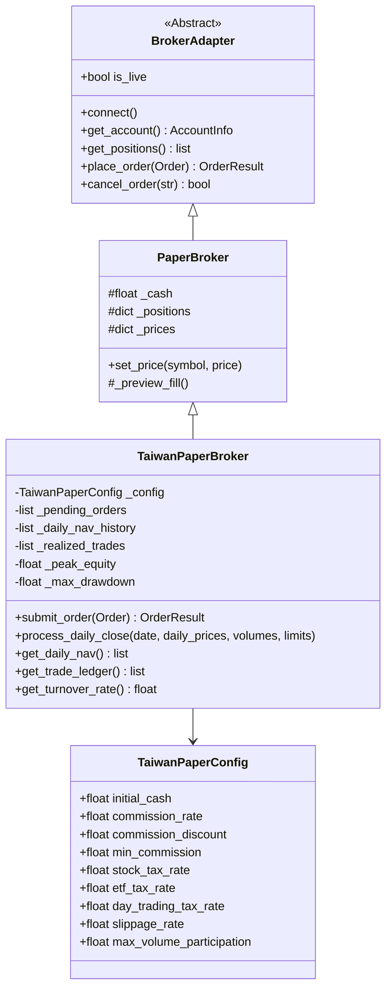

# 台股 Paper Trading 缺口分析與擴充規格 (PAPER_TRADING_GAP_ANALYSIS.md)

**審查日期**：2026-10-20  
**基準模組**：`anti-gambling-trader-tw/core/broker/paper.py`（類別 `PaperBroker`）  
**目標系統**：台股專用高擬真模擬券商（`TaiwanPaperBroker`）

---

## 一、15 項核心功能現狀與缺口對照表

本審查逐項比對台股真實交易制度與既有 `PaperBroker` 的實作差異，明確標示現有狀態、缺口及擴充優先級：

| # | 評估項目 | 原有 PaperBroker 現狀 | 台股真實制度與要求 | 缺口狀態 | 優先級 |
| :--- | :--- | :--- | :--- | :--- | :--- |
| **1** | **初始資金** | 支援（`cash: float = 1_000_000.0`），具正有限數檢查。 | 支援自訂台幣起始資本（如 1,000,000 TWD）。 | **完全具備** | P0 (保留) |
| **2** | **現金餘額** | 支援（`_cash` 即時動態扣減/結算）。 | 即時扣除買入金額與稅費，賣出時即時回收款項。 | **完全具備** | P0 (保留) |
| **3** | **持倉及平均成本** | 支援加權平均成本、反手翻倉新均價（`_preview_fill`）。 | 需支援整股（張=1000股）與零股計算，持倉均價精確到小數第二位。 | **基本具備** (需補張/股單位) | P0 (微調) |
| **4** | **買賣委託** | 支援市價（MARKET）與限價（LIMIT）。 | 台股委託型態（ROD/IOC/FOK）、限價單掛單佇列、整股/零股。 | **部分具備** (缺掛單佇列) | P1 (擴充) |
| **5** | **成交與未成交狀態** | 僅支援立即撮合（Immediate-fill）或立即拒單。 | 委託單生命週期狀態機：PENDING, PARTIALLY_FILLED, FILLED, CANCELLED, REJECTED, EXPIRED。 | **重大缺口** (無狀態機) | P0 (新建) |
| **6** | **手續費** | 僅有單純固定費率 `fee_rate`（預設 0.1%）。 | 台股法定 0.1425%，券商電子下單折讓（如 2.8 折、5 折、6 折），每筆最低 20 元台幣。 | **重大缺口** (費率不符台股) | P0 (補強) |
| **7** | **證交稅** | 完全無證券交易稅機制。 | 賣出時由賣方負擔：現股股票 0.3%、ETF 0.1%、當沖交易 0.15%。買進不課稅。 | **完全缺失** | P0 (新建) |
| **8** | **滑價模型** | 固定比例滑價（`_slippage` 預設 0.05%）。 | 台股跳動級距（Tick Size 0.01~5 元）離散滑價、成交量衝擊滑價模型。 | **部分具備** (可升級) | P1 (優化) |
| **9** | **部分成交** | 不支援（每次撮合均為全額成交）。 | 依委託當下市場成交量（Volume Participation Rate，如佔市場 5-10%）進行分批撮合。 | **完全缺失** | P1 (新建) |
| **10** | **漲跌停限制** | 不支援（任意價格均撮合）。 | 台股每日 10% 漲跌幅限制。漲停鎖死時買單排隊無法買入；跌停鎖死時賣單排隊無法賣出。 | **完全缺失** | P0 (新建) |
| **11** | **停牌及處置股票限制** | 不支援任何標的狀態過濾。 | 暫停交易（Trading Halt）拒絕下單；注意/處置股票（如分盤 5 分鐘/20 分鐘撮合、需預收股款）。 | **完全缺失** | P1 (新建) |
| **12** | **每日資產淨值** | 僅支援呼叫時的即時權益（`get_account().equity`），無時序紀錄。 | 每日收盤逐日結算（Daily Mark-to-Market），保存每日 NAV、Cash、Market Value 歷史走勢。 | **完全缺失** | P0 (新建) |
| **13** | **已實現與未實現損益** | 僅即時計算部位之 `unrealized_pnl`，未實現損益無分筆歸檔。 | 逐筆扣減計算已實現損益（含手續費與證交稅），維護投資組合未實現損益對帳單。 | **重大缺口** (無會計帳簿) | P0 (新建) |
| **14** | **最大回撤動態追蹤** | 模組內無歷史回撤計算（僅在事後 metrics 靜態計算）。 | 每日動態追蹤歷史資產淨值高點（Peak Equity）與當前回撤幅度（Current Drawdown）。 | **重大缺口** | P0 (新建) |
| **15** | **換手率計算** | 完全無換手率統計。 | 統計特定期間總交易金額相對於平均資產淨值之換手率（Portfolio Turnover Rate）。 | **完全缺失** | P1 (新建) |

---

## 二、台股交易規則與計算依據詳解

### 1. 手續費計算依據（Broker Commission）
- **主管機關公定上限**：成交金額之 **0.1425%**（0.001425）。
- **券商電子下單折讓**：實務上電子下單依券商政策提供折讓（例如：一般券商 6 折 = 0.6，元大/富邦 5 折 = 0.5，新光/國泰/永豐等特定方案最低 2.8 折 = 0.28）。
- **最低手續費**：依證券商受託買賣外國有價證券業務操作辦法及台股常規，單筆委託成交手續費不滿 20 元以 20 元計收（部分超低折讓方案有 1 元最低手續費優惠，需做成可配置項）。
- **公式**：
  $$\text{Fee} = \max(\text{Minimum Fee}, \text{Round}(\text{Notional} \times 0.001425 \times \text{Discount}))$$

### 2. 證券交易稅計算依據（Securities Transaction Tax）
- **法令依據**：依中華民國《證券交易稅條例》第 2 條。
- **買進**：免徵證交稅。
- **賣出**：
  - 一般公司股票（上市櫃股票）：按成交價格課徵 **0.3%**（千分之三）。
  - 指數股票型基金（ETF）：按成交價格課徵 **0.1%**（千分之一）。
  - 現股當沖降稅優惠（依現行法規延長）：當日沖銷賣出課徵 **0.15%**（千分之一點五）。
- **公式**：
  $$\text{Tax}_{\text{Sell}} = \lfloor \text{Notional} \times \text{Tax Rate} \rfloor$$

### 3. 台股撮合與漲跌幅限制依據
- **漲跌幅限制**：每日以上一營業日收盤價為基準，上下 **10%** 限制。
- **委託單位**：整股以 1 張（1,000 股）為標準交易單位；零股以 1 股為單位。
- **漲跌停撮合禁令**：
  - 委託買進時，若最新市場報價為漲停價且量縮鎖死（漲停無賣單），買單不得成交，維持掛單或退單。
  - 委託賣出時，若最新市場報價為跌停價且量縮鎖死（跌停無買單），賣單不得成交，維持掛單或退單。

---

## 三、台股專用 TaiwanPaperBroker 模組規格擴充方案

為彌補既有 `PaperBroker` 的不足，設計台股專用擴充類別 `TaiwanPaperBroker`，保留原專案優秀的邊界數值與防浮點溢位機制，新增台股專用功能：



### 1. 配置資料類別：`TaiwanPaperConfig`
```python
@dataclass
class TaiwanPaperConfig:
    initial_cash: float = 1_000_000.0
    commission_rate: float = 0.001425       # 法定手續費率 0.1425%
    commission_discount: float = 0.6         # 券商折讓 (預設 6 折)
    min_commission: float = 20.0             # 最低手續費 20 元
    stock_tax_rate: float = 0.003            # 股票證交稅 0.3%
    etf_tax_rate: float = 0.001              # ETF 證交稅 0.1%
    day_trading_tax_rate: float = 0.0015     # 當沖證交稅 0.15%
    slippage_rate: float = 0.0005           # 模擬滑價 0.05%
    max_volume_participation: float = 0.05  # 最大單筆成交佔當日量比例 (部分成交上限)
    allow_odd_lot: bool = True              # 是否支援零股
```

### 2. 訂單狀態機（Order State Machine）
擴充 `OrderStatus` 枚舉：
- `PENDING`：已送出，進入佇列撮合中。
- `FILLED`：全部成交。
- `PARTIALLY_FILLED`：部分成交（剩餘數量仍在佇列中）。
- `CANCELLED`：手動取消或因過期撤銷。
- `REJECTED`：被風控或因資金不足/漲跌停限制拒單。

### 3. 每日收盤處理與會計帳本（Daily Mark-to-Market）
新增 `process_daily_close(date, daily_prices, volumes, limits)` 方法：
1. **未成交掛單檢查**：ROD 委託單若當日未撮合成交，收盤時標記為 `EXPIRED` 並移出佇列。
2. **每日淨值快照**：計算當日現金、持倉市值，記錄 `DailyNAV(date, cash, market_value, total_equity)`。
3. **動態最大回撤計算**：
   $$\text{Peak} = \max(\text{Peak}, \text{Equity})$$
   $$\text{Drawdown} = \frac{\text{Peak} - \text{Equity}}{\text{Peak}}$$
   $$\text{MaxDrawdown} = \max(\text{MaxDrawdown}, \text{Drawdown})$$
4. **換手率統計**：
   $$\text{Turnover} = \frac{\sum \text{Turnover Turnover Volume}}{\text{Average Daily Equity}}$$

---

## 四、實施與測試驗證優先級

1. **第一優先級（P0，核心必須）**：
   - 建立 `TaiwanPaperBroker`，實作台股手續費折讓（0.1425% $\times$ 折讓，最低 20 元）與證交稅（賣出 0.3% / 0.1%）。
   - 實作每日淨值（Daily NAV）與逐筆已實現損益（Realized PnL）紀錄。
   - 實作漲跌停價撮合限制（漲停買進阻擋、跌停賣出阻擋）。
2. **第二優先級（P1，擬真補強）**：
   - 建立掛單佇列與非同步訂單狀態變更。
   - 依成交量比例（Volume Participation）進行部分成交（Partial Fill）模擬。
   - 停牌與處置股票狀態過濾。
   - 期間換手率計算。
