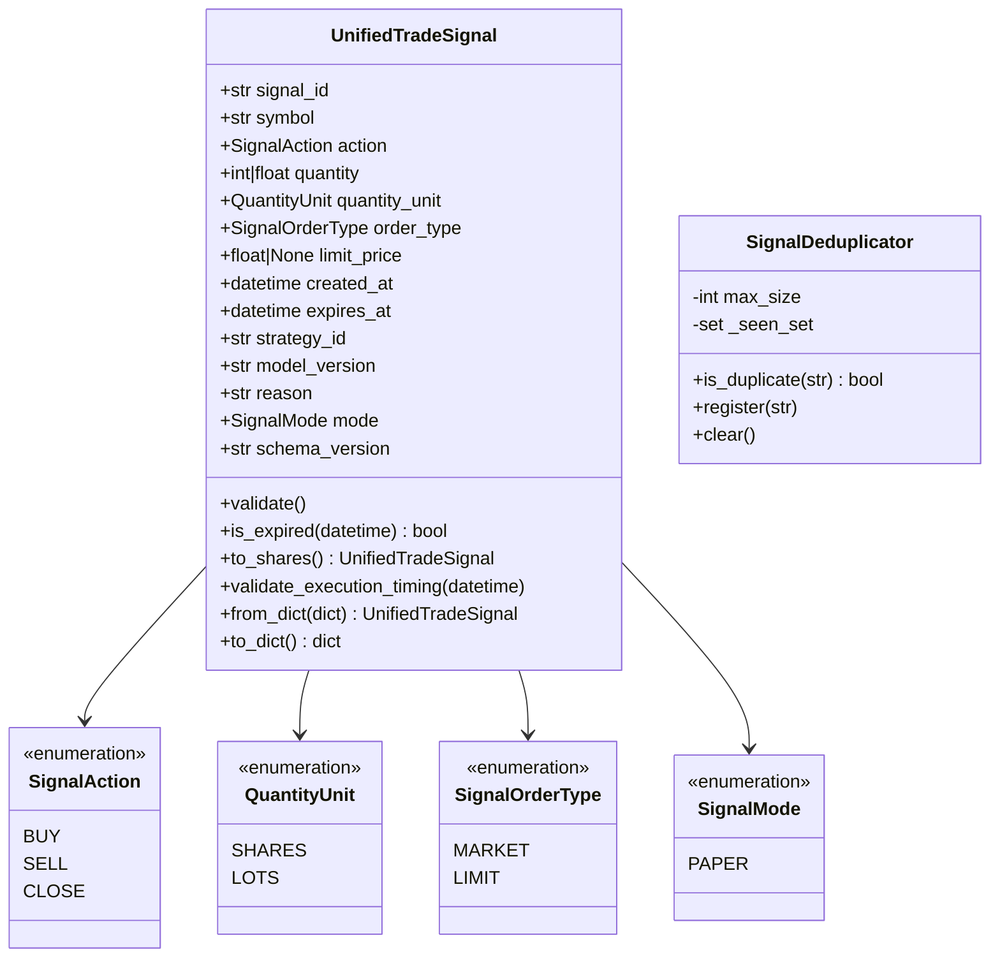

# 第二階段 A 實作報告：UnifiedTradeSignal 統一交易訊號介面 (PHASE2A_IMPLEMENTATION_REPORT.md)

**實作日期**：2026-10-21  
**階段目標**：建立 AI 選股模型、獨立風控引擎與台股 Paper Trading 之間的標準交易訊號契約。  
**設計原則**：純標準函式庫實作、零外部相依、強制時區與單位防禦、絕不改動原始專案核心代碼。

---

## 一、新增與修改之檔案清單

本次實作完全在獨立套件目錄 `src/tw_quant/` 與 `tests/` 下進行，**未修改、未覆寫兩個原始子專案（`anti-gambling-trader-tw` 與 `qlib-tw-trader`）的任何一行原始代碼**。

| 檔案路徑 | 類型 | 職責與內容說明 |
| :--- | :--- | :--- |
| [`src/tw_quant/__init__.py`](file:///d:/OneDrive/桌面/TW%20Quant%20AI%20—%20Taiwan%20Stock%20Quantitative%20Trading%20Platform/src/tw_quant/__init__.py) | 新增 | 台股量化交易系統核心套件入口。 |
| [`src/tw_quant/contracts/__init__.py`](file:///d:/OneDrive/桌面/TW%20Quant%20AI%20—%20Taiwan%20Stock%20Quantitative%20Trading%20Platform/src/tw_quant/contracts/__init__.py) | 新增 | 匯出訊號合約、列舉型別、去重器與單位轉換函式。 |
| [`src/tw_quant/contracts/conversion.py`](file:///d:/OneDrive/桌面/TW%20Quant%20AI%20—%20Taiwan%20Stock%20Quantitative%20Trading%20Platform/src/tw_quant/contracts/conversion.py) | 新增 | 實作台股「張 (LOTS)」與「股 (SHARES)」之明確轉換（`lots_to_shares`、`shares_to_lots`），嚴格排除 bool、NaN 與非有限數。 |
| [`src/tw_quant/contracts/dedup.py`](file:///d:/OneDrive/桌面/TW%20Quant%20AI%20—%20Taiwan%20Stock%20Quantitative%20Trading%20Platform/src/tw_quant/contracts/dedup.py) | 新增 | 實作 `SignalDeduplicator`，防止相同 `signal_id` 重複處理或二次下單。 |
| [`src/tw_quant/contracts/signal.py`](file:///d:/OneDrive/桌面/TW%20Quant%20AI%20—%20Taiwan%20Stock%20Quantitative%20Trading%20Platform/src/tw_quant/contracts/signal.py) | 新增 | 實作 `UnifiedTradeSignal` 不可變資料結構、防禦性驗證（`validate`）、時效檢驗（`is_expired`）、單位標準化（`to_shares`）、前視偏差防禦（`validate_execution_timing`）與嚴格反序列化（`from_dict`/`to_dict`）。 |
| [`tests/__init__.py`](file:///d:/OneDrive/桌面/TW%20Quant%20AI%20—%20Taiwan%20Stock%20Quantitative%20Trading%20Platform/tests/__init__.py) | 新增 | 頂層測試套件入口。 |
| [`tests/test_signal.py`](file:///d:/OneDrive/桌面/TW%20Quant%20AI%20—%20Taiwan%20Stock%20Quantitative%20Trading%20Platform/tests/test_signal.py) | 新增 | 實作 18 個單元測試案例（覆蓋 16 大核心場景與 13 個參數化子測試）。 |
| [`PROJECT_MAP.md`](file:///d:/OneDrive/桌面/TW%20Quant%20AI%20—%20Taiwan%20Stock%20Quantitative%20Trading%20Platform/PROJECT_MAP.md) | 更新 | 將 `src/tw_quant/contracts` 與新測試加入全景專案架構圖。 |

---

## 二、模組設計與核心介面



### 1. 欄位架構設計
- **`signal_id`**：唯一字串識別碼。
- **`symbol`**：台股代號，強制符合 `^[0-9A-Z]{4,6}(\.(TW|TWO))?$` 規範。
- **`action`**：列舉值 `BUY`, `SELL`, `CLOSE`。
- **`quantity`**：委託數量（正數，排除 bool）。
- **`quantity_unit`**：明確區分 `SHARES`（股）與 `LOTS`（張）。
- **`order_type`**：列舉值 `MARKET`, `LIMIT`。
- **`limit_price`**：
  - 若 `order_type == LIMIT`：必須為有限正數。
  - 若 `order_type == MARKET`：強制為 `None`（避免混淆）。
- **`created_at` / `expires_at`**：必須具有明確時區資訊（timezone-aware），且 `expires_at > created_at`。
- **`strategy_id` / `model_version` / `reason`**：策略溯源與可解釋性字串。
- **`mode`**：固定限制為 `SignalMode.PAPER`，杜絕任何實盤模式穿透。
- **`schema_version`**：格式版本（預設 "1.0.0"）。

---

## 三、驗證規則詳細規格

1. **代碼規格嚴檢**：空字串、純空白、含特殊符號（如 `$$$`, `2330@TW`）均拋出 `ValueError`。
2. **布林值嚴格排除**：Python 中 `bool` 是 `int` 的子類別，本模組在 `quantity` 與 `limit_price` 中強制執行 `if isinstance(val, bool): raise TypeError`，杜絕將 `True` 誤認為數量 `1` 或價格 `1` 的隱蔽錯誤。
3. **有限正數防護**：使用 `math.isfinite()` 嚴格排除 `NaN`、`+Inf`、`-Inf` 與小於等於 0 之數值。
4. **張與股明確換算**：
   - 系統內部唯一運算標準為「股（SHARES）」。
   - 若外部訊號為「張（LOTS）」，必須透過 `to_shares()` 或 `lots_to_shares()` 換算；若小數張換算後非整數股數（如 1.0001 張）則拋出 `ValueError` 拒絕。
5. **時區防禦與正規化**：
   - 拒絕任何 naive datetime（缺少 `tzinfo` 者直接報錯）。
   - 比較時一律正規化為 UTC 基準，防止不同時區偏差導致過期判定失效。
6. **時序因果律與前視偏差（Lookahead Bias）防護**：
   - 成交撮合時間不得早於訊號產生時間。
   - 若訊號產生於 $T$ 日盤後（如 13:30 之後），**嚴禁使用 $T$ 日當日或收盤時間成交**（直接拋出 `ValueError: Lookahead Bias`），強制必須在 $T+1$ 日開盤後成交。
7. **嚴格反序列化防護**：
   - `from_dict()` 嚴格比對允許欄位，若有未知欄位注入或缺少必要欄位，直接拋出 `ValueError`。
8. **重複訊號防禦**：
   - `SignalDeduplicator` 提供記憶體去重與先進先出容量淘汰，若出現相同 `signal_id` 立即拋出 `DuplicateSignalError`。

---

## 四、單元測試執行結果

在完全離線、無外部依賴、純 Python 標準環境下執行測試套件：

### 1. `unittest` 原生執行結果
```bash
python -m unittest tests/test_signal.py
```
- **測試總數**：18 個測試案例（涵蓋 13 個參數化子測試，總計 31 項檢核點）
- **通過數 (Passed)**：**18**
- **失敗數 (Failed)**：**0**
- **跳過數 (Skipped)**：**0**
- **執行耗時**：0.001 秒

### 2. `pytest` 執行結果
```bash
python -m pytest tests/test_signal.py -v
```
- **測試結果**：`18 passed, 13 subtests passed in 0.04s`
- **通過率**：**100%**

### 3. 測試覆蓋矩陣

| 序號 | 測試案例名稱 | 驗證之核心邏輯 | 測試結果 |
| :--- | :--- | :--- | :--- |
| 1 | `test_normal_buy_signal` | 正常限價 BUY 訊號建立與屬性比對 | **PASS** |
| 2 | `test_normal_sell_signal` | 正常市價 SELL 訊號（limit_price 為 None） | **PASS** |
| 3 | `test_invalid_symbol` | 空字串、過長、含特殊符號代碼攔截 | **PASS** |
| 4 | `test_invalid_action` | 非法 action 列舉值型別攔截 | **PASS** |
| 5 | `test_zero_or_negative_quantity` | 0、-1、-500 等數量攔截 | **PASS** |
| 6 | `test_bool_rejected_as_quantity` | 布林值 `True`/`False` 作為數量之型別拒絕 | **PASS** |
| 7 | `test_missing_required_fields_in_from_dict` | 字典反序列化缺少必要欄位防護 | **PASS** |
| 8 | `test_invalid_limit_price` | 限價單缺價格、價格<=0、市價單誤給價格防護 | **PASS** |
| 9 | `test_nan_and_inf_price` | 價格為 `NaN`、`+Inf`、`-Inf`、`bool` 之攔截 | **PASS** |
| 10 | `test_lots_and_shares_conversion` | 張轉股、股轉張、小數張換算非整數股攔截、訊號 `to_shares()` | **PASS** |
| 11 | `test_signal_expiration` | 訊號過期判定（到期前 False、到期後 True） | **PASS** |
| 12 | `test_expires_before_created` | 到期時間早於或等於產生時間攔截 | **PASS** |
| 13 | `test_naive_datetime_rejected` | 無時區 naive datetime 強制拒絕 | **PASS** |
| 14 | `test_duplicate_signal_id` | `SignalDeduplicator` 重複訊號註冊異常攔截 | **PASS** |
| 15 | `test_unknown_fields_rejected_in_from_dict` | 反序列化惡意/未定義欄位注入防護 | **PASS** |
| 16 | `test_timing_lookahead_bias_guard` | T 日盤後訊號偷打 T 日收盤價之前視偏差攔截 | **PASS** |
| 17 | `test_mode_must_be_paper` | mode 嘗試設定為 "LIVE" 之拒絕 | **PASS** |
| 18 | `test_roundtrip_serialization` | `to_dict` 與 `from_dict` 往返完整性檢驗 | **PASS** |

---

## 五、原始碼完整性查驗

經由 `git -C anti-gambling-trader-tw status --porcelain` 與 `git -C qlib-tw-trader status --porcelain` 嚴格核對：
- **輸出為空**。
- **確認無任何既有核心程式碼被修改或覆寫**。

---

## 六、已知限制與下一階段 TaiwanPaperBroker 所需介面

### 1. 本階段已知限制
- 本階段僅實作交易訊號合約與驗證層，**尚未包含部位推導（Position Sizing）**，亦不包含直接撮合成交能力。
- 訊號目前以單筆獨立驗證為主，多檔股票的截面權重配置需在風控層實作。

### 2. 下一階段 TaiwanPaperBroker 所需介面需求
為使 `UnifiedTradeSignal` 能順暢輸入台股模擬券商，下一階段 `TaiwanPaperBroker` 需支援：
1. **訊號轉委託介面**：接收已轉為 `SHARES` 單位的 `UnifiedTradeSignal`，自動映射至 `core/broker/base.py` 的標準 `Order`（side, symbol, quantity, order_type, limit_price）。
2. **台股法定稅費精算**：
   - 買賣手續費：$0.1425\% \times \text{Discount}$，最低 20 元台幣。
   - 賣出證券交易稅：股票 $0.3\%$、ETF $0.1\%$。
3. **台股撮合限制**：
   - 漲停價鎖死時拒絕買單撮合。
   - 跌停價鎖死時拒絕賣單撮合。
4. **會計帳簿維護**：
   - 記錄每日淨值走勢（`DailyNAV`）。
   - 記錄逐筆平倉已實現損益（含手續費與證交稅扣減）。

---

本實作已全數完成且測試通過，等待您的下一步指令！
