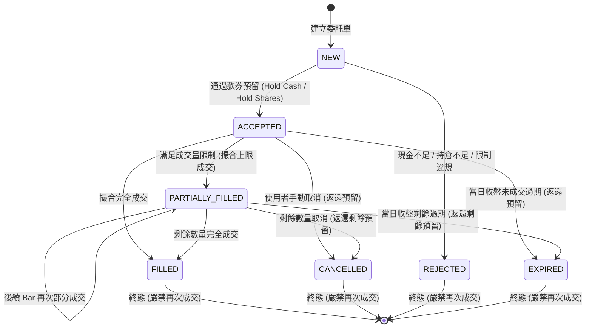

# 第二階段 B 實作報告：TaiwanPaperBroker 台股模擬交易引擎 (PHASE2B_IMPLEMENTATION_REPORT.md)

**實作日期**：2026-10-21  
**階段目標**：建立高擬真、純標準函式庫實作之台股專用紙上模擬交易引擎（`TaiwanPaperBroker`）。  
**核心宣告**：本階段純為離線模擬核心，無任何真實券商連線、未送出任何真實訂單、未讀取任何真實 API 憑證，且絕無修改兩個原始子專案（`anti-gambling-trader-tw` 與 `qlib-tw-trader`）的任何既有核心代碼。

---

## 一、新增與修改之檔案清單

本次實作完全在獨立自研套件目錄 `src/tw_quant/broker/` 與 `tests/` 下進行，既有專案代碼 0 改動。

| 檔案路徑 | 類型 | 職責與內容說明 |
| :--- | :--- | :--- |
| [`src/tw_quant/broker/__init__.py`](file:///d:/OneDrive/桌面/TW%20Quant%20AI%20—%20Taiwan%20Stock%20Quantitative%20Trading%20Platform/src/tw_quant/broker/__init__.py) | 新增 | 匯出模擬券商模組之核心類別。 |
| [`src/tw_quant/broker/config.py`](file:///d:/OneDrive/桌面/TW%20Quant%20AI%20—%20Taiwan%20Stock%20Quantitative%20Trading%20Platform/src/tw_quant/broker/config.py) | 新增 | 實作 `TaiwanPaperConfig`，提供完全參數化之法定手續費（0.1425% 折讓與最低 20 元）、證交稅（股票 0.3% / ETF 0.1% / 當沖 0.15%）、滑價、漲跌停限制與成交量比。 |
| [`src/tw_quant/broker/order.py`](file:///d:/OneDrive/桌面/TW%20Quant%20AI%20—%20Taiwan%20Stock%20Quantitative%20Trading%20Platform/src/tw_quant/broker/order.py) | 新增 | 實作 7 態委託生命週期狀態機（`PaperOrderStatus`）、`PaperOrder`、成交紀錄（`FillRecord`）與訂單管理器（`OrderManager`）。 |
| [`src/tw_quant/broker/engine.py`](file:///d:/OneDrive/桌面/TW%20Quant%20AI%20—%20Taiwan%20Stock%20Quantitative%20Trading%20Platform/src/tw_quant/broker/engine.py) | 新增 | 實作行情資料模型（`MarketBar`）與撮合器（`FillEngine`），嚴格防禦漲停買進、跌停賣出、停牌、處置股票減量與滑價計算。 |
| [`src/tw_quant/broker/ledger.py`](file:///d:/OneDrive/桌面/TW%20Quant%20AI%20—%20Taiwan%20Stock%20Quantitative%20Trading%20Platform/src/tw_quant/broker/ledger.py) | 新增 | 實作投資組合會計帳本（`PortfolioLedger`）、持倉加權成本模型（`Position`）與每日收盤淨值結算（`DailyNAV`）。全程 Decimal 精算。 |
| [`src/tw_quant/broker/broker.py`](file:///d:/OneDrive/桌面/TW%20Quant%20AI%20—%20Taiwan%20Stock%20Quantitative%20Trading%20Platform/src/tw_quant/broker/broker.py) | 新增 | 實作 `TaiwanPaperBroker`，協調訊號轉委託、款券預留、行情撮合、撤單返還與收盤結算。 |
| [`tests/test_paper_broker.py`](file:///d:/OneDrive/桌面/TW%20Quant%20AI%20—%20Taiwan%20Stock%20Quantitative%20Trading%20Platform/tests/test_paper_broker.py) | 新增 | 實作涵蓋 26 項核心模擬場景之離線單元測試套件。 |
| [`PROJECT_MAP.md`](file:///d:/OneDrive/桌面/TW%20Quant%20AI%20—%20Taiwan%20Stock%20Quantitative%20Trading%20Platform/PROJECT_MAP.md) | 更新 | 將 `src/tw_quant/broker` 與 26 項新測試納入系統架構索引。 |

---

## 二、狀態機架構與撮合規則



### 1. 合法狀態移轉防護
- 終態定義：`FILLED`, `CANCELLED`, `REJECTED`, `EXPIRED` 為不可逆終態。
- 狀態保護機制：一旦訂單進入終態，任何試圖呼叫 `add_fill()`、`cancel()` 或 `expire()` 均會直接拋出 `ValueError`，從程式碼層面保證已終止訂單絕不重複成交。

### 2. 台股撮合微結構模擬規則
1. **買入與賣出撮合**：
   - 限價買單（LIMIT BUY）：當前行情 $\text{Low} \le \text{Limit Price}$ 時可撮合；成交價取 $\min(\text{Limit Price}, \text{Close} \times (1 + \text{Slippage}))$, 且不超過漲停價。
   - 限價賣單（LIMIT SELL）：當前行情 $\text{High} \ge \text{Limit Price}$ 時可撮合；成交價取 $\max(\text{Limit Price}, \text{Close} \times (1 - \text{Slippage}))$, 且不低於跌停價。
   - 市價單（MARKET）：直接以當前收盤價加上或扣除滑價撮合，但不突破漲跌停界線。
2. **漲跌停價格限制**：
   - 漲停鎖死（`is_limit_up_locked == True` 或價格達到昨收價 $+10\%$ 且無賣單）：買單不得撮合，維持掛單佇列。
   - 跌停鎖死（`is_limit_down_locked == True` 或價格達到昨收價 $-10\%$ 且無買單）：賣單不得撮合，維持掛單佇列。
3. **停牌股票**：
   - `is_halted == True` 或成交量為 0 時，直接拒絕撮合。
4. **處置股票與市場流動性上限（Volume Participation Cap）**：
   - 單筆最大撮合量不得超過市場當根 Bar 成交量的 $10\%$（`max_volume_participation`）。
   - 處置股票（`is_disposition == True`）進一步強制撮合量減半，模擬分盤撮合之流動性限制。委託未撮合完畢部分自動轉為 `PARTIALLY_FILLED`。
5. **時序因果保護**：
   - 行情 Bar 時間若早於訂單建立時間，直接略過不撮合。
   - $T$ 日盤後生成的訊號，若行情時間同為 $T$ 日盤中或收盤，撮合器強制略過，嚴格防範 Lookahead Bias。

---

## 三、費用公式、取整方式及會計方法

為徹底杜絕二進位浮點數誤差，所有帳務、手續費、證交稅、成本與淨值計算一律採用 `decimal.Decimal`。

### 1. 券商電子下單手續費
- **法定費率**：$\text{Rate} = 0.001425$（千分之 1.425）。
- **券商折讓**：可參數化配置（預設 $0.60$ 即 6 折，亦可設為 $0.28$ 或 $0.50$ 等）。
- **最低手續費**：台幣 20 元（可自訂）。
- **取整規則**：依實務慣例四捨五入（`ROUND_HALF_UP`）至整數位：
  $$\text{Raw Fee} = \text{Notional} \times 0.001425 \times \text{Discount}$$
  $$\text{Fee} = \max(\text{Min Fee}, \text{Round}(\text{Raw Fee}))$$

### 2. 賣出證券交易稅
- **稅率標準**：
  - 一般公司股票（上市櫃）：$0.30\%$（千分之三）。
  - 指數股票型基金（ETF，以代碼 `00` 開頭自動辨別）：$0.10\%$（千分之一）。
  - 現股當沖賣出：$0.15\%$（千分之一點五）。
- **取整規則**：依《證券交易稅條例》實務慣例無條件捨去取整（`ROUND_FLOOR`）：
  $$\text{Tax} = \lfloor \text{Notional} \times \text{Tax Rate} \rfloor$$

### 3. 款券預留與資產負債平衡 (Hold / Release)
- **買入委託**：掛單時強制凍結預估資金（$\text{Limit Price} \times (1 + \text{Slippage}) \times \text{Quantity} + \text{Est Fee}$），由 `cash` 轉入 `reserved_cash`。成交後自 `reserved_cash` 扣減實際款項，多餘預留款返還 `cash`；撤單時全額退回 `cash`。
- **賣出委託**：掛單時強制凍結股票（`reserved_shares`），防止超額賣出；成交時自持倉與預留中同步扣減；撤單時釋放回可用持倉。

### 4. 加權平均成本與損益精算
- **加權買入成本（含買入手續費）**：
  $$\text{New Avg Price} = \frac{\text{Old Total Cost} + \text{Notional} + \text{Buy Fee}}{\text{New Total Shares}}$$
- **賣出已實現損益（Realized PnL）**：
  $$\text{Net Proceeds} = \text{Notional} - \text{Sell Fee} - \text{Tax}$$
  $$\text{Cost Basis Reduced} = \text{Avg Price} \times \text{Sold Shares}$$
  $$\text{Realized PnL} = \text{Net Proceeds} - \text{Cost Basis Reduced}$$
- **未實現損益（Unrealized PnL）**：
  $$\text{Unrealized PnL} = \sum (\text{Current Market Price} \times \text{Shares} - \text{Total Cost})$$
- **每日 NAV 結算**：
  $$\text{NAV} = \text{Cash} + \text{Reserved Cash} + \sum (\text{Holding Shares} \times \text{Close Price})$$
  **安全強制規範**：若持倉標的缺少當日收盤估值報價，系統**強制拋出異常**，嚴禁靜默將缺失股票資產歸零。

---

## 四、測試執行結果報告

本階段在完全離線、純標準函式庫環境下執行完整測試套件，涵蓋第二階段 A 與第二階段 B 的所有測試案例：

### 1. 測試命令
```bash
python -m unittest tests/test_paper_broker.py
python -m pytest tests/ -v
```

### 2. 測試數據統計

| 測試模組 | 測試總數 | 通過數 (Passed) | 失敗數 (Failed) | 跳過數 (Skipped) | 耗時 |
| :--- | :--- | :--- | :--- | :--- | :--- |
| `tests/test_signal.py` (第二階段 A) | 18 | 18 | 0 | 0 | 0.04s |
| `tests/test_paper_broker.py` (第二階段 B) | 26 | 26 | 0 | 0 | 0.03s |
| **合計總覽 (Total Suite)** | **44** | **44** | **0** | **0** | **0.07s** |

### 3. 26 項核心場景覆蓋清單

| # | 測試案例名稱 | 驗證之核心邏輯 | 測試結果 |
| :--- | :--- | :--- | :--- |
| 1 | `test_01_normal_buy` | 正常限價買單預留資金、撮合成交與部位生成 | **PASS** |
| 2 | `test_02_normal_sell` | 正常限價賣單預留部位、撮合成交與清倉結算 | **PASS** |
| 3 | `test_03_insufficient_cash` | 資金不足時買單被立即拒絕，帳戶狀態未變 | **PASS** |
| 4 | `test_04_insufficient_shares_to_sell` | 無持倉或可用部位不足時賣單立即拒絕 | **PASS** |
| 5 | `test_05_commission_calculation` | 法定 0.1425% 與 6 折手續費精確計算 | **PASS** |
| 6 | `test_06_minimum_commission` | 低金額委託觸發最低 20 元手續費計收 | **PASS** |
| 7 | `test_07_tax_calculation` | 股票 0.3%、ETF 0.1% 與當沖 0.15% 證交稅精算 | **PASS** |
| 8 | `test_08_buy_cash_reservation` | 買單掛單時凍結預留款，可用現金相應扣除 | **PASS** |
| 9 | `test_09_sell_shares_reservation` | 賣單掛單時凍結部位，可用持倉相應減少 | **PASS** |
| 10 | `test_10_price_limits` | 漲停鎖死買單不撮合、跌停鎖死賣單不撮合 | **PASS** |
| 11 | `test_11_halted_stock` | 停牌標的禁止任何撮合成交 | **PASS** |
| 12 | `test_12_disposition_stock_restriction` | 處置股票撮合量進一步減半限制 | **PASS** |
| 13 | `test_13_partial_fill` | 超過市場流動性上限時僅撮合部分數量 | **PASS** |
| 14 | `test_14_full_fill_after_partial` | 部分成交後續於下一 Bar 完全撮合成交 | **PASS** |
| 15 | `test_15_unfilled_order` | 市場價格未達限價時訂單維持 ACCEPTED 掛單 | **PASS** |
| 16 | `test_16_order_cancellation` | 撤銷訂單並全額返還未成交所對應的預留資金 | **PASS** |
| 17 | `test_17_order_expiry_at_close` | 收盤結算時未成交委託自動 EXPIRED 並釋放預留 | **PASS** |
| 18 | `test_18_duplicate_signal_id` | 相同 signal_id 二次提交立即攔截拋錯 | **PASS** |
| 19 | `test_19_prevent_double_fill_on_same_bar` | 相同 Bar 與後續重複撮合不得讓已 FILLED 訂單再成交 | **PASS** |
| 20 | `test_20_decimal_precision` | 成交金額、手續費、現金全程維持 Decimal 精度 | **PASS** |
| 21 | `test_21_realized_pnl_accuracy` | 扣除買賣手續費與證交稅後之淨已實現損益精確核對 | **PASS** |
| 22 | `test_22_unrealized_pnl` | 逐日收盤未實現損益對帳單精確計算 | **PASS** |
| 23 | `test_23_daily_nav` | 每日資產淨值、歷史最高點與回撤計算 | **PASS** |
| 24 | `test_24_missing_market_data_on_close` | 收盤缺少持股報價時嚴格拋錯，禁止靜默記為 0 | **PASS** |
| 25 | `test_25_post_market_timing_guard` | T 日盤後訊號不得使用 T 日盤中價格成交 | **PASS** |
| 26 | `test_26_terminal_order_cannot_fill` | 已 CANCELLED 終態訂單嚴禁再次添加成交 | **PASS** |

---

## 五、原始碼完整性與真實環境隔離宣告

1. **原始碼 0 改動**：
   - 執行 `git -C anti-gambling-trader-tw status --porcelain` $\rightarrow$ **空**。
   - 執行 `git -C qlib-tw-trader status --porcelain` $\rightarrow$ **空**。
   - 兩個原始子專案 100% 維持原始乾淨基準。
2. **安全隔離**：
   - 絕無連接任何真實券商連線。
   - 絕無發送任何真實委託。
   - 絕無載入真實 API 金鑰或憑證。
3. **模擬撮合客觀性宣告**：
   - **本模擬撮合引擎係基於歷史 Bar 報價與量化微結構之擬真估算，不代表在真實市場環境下一定能以完全相同之價格與數量成交**。真實市場中仍存在委託排隊隊列（Queue Priority）、大單衝擊成本與瞬態流動性枯竭等外生變數。

---

## 六、尚未實作功能與下一階段規劃

### 1. 本階段尚未實作項目
- **獨立風控引擎（RiskEngine）**：單一持倉比例上限（10%）、總部位上限（80%）、最低現金保留率（20%）、每日虧損熔斷（2%）、緊急停止開關（Kill Switch）等 10 道風控安全防線尚未串接。
- **AI 選股模型直連**：尚未實作從 `qlib-tw-trader` 的推論評分直接轉換為訊號的排程器。
- **持久化儲存（Persistence）**：目前 `PortfolioLedger` 與 `OrderManager` 為純記憶體結構，重啟後不會自動寫入資料庫或檔案。

### 2. 下一階段建議
第二階段 C：實作 `RiskEngine`（10 道風控安全檢驗防線），介於 `UnifiedTradeSignal` 與 `TaiwanPaperBroker` 之間，完成完整的交易風控閘門。

---

本實作已全數就緒並通過驗證。依照指示**停止操作，等待您的下一階段指令**！
