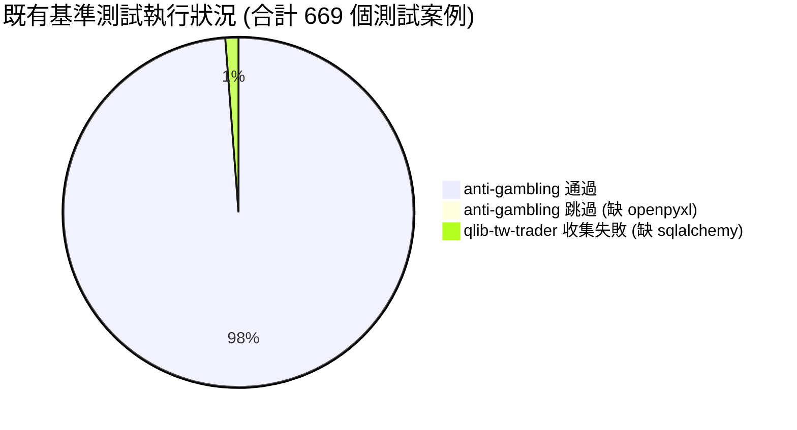
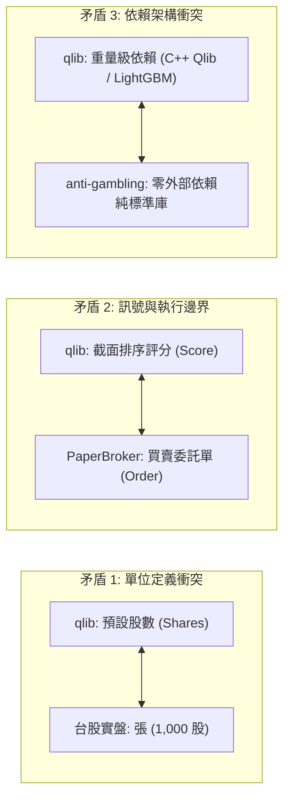
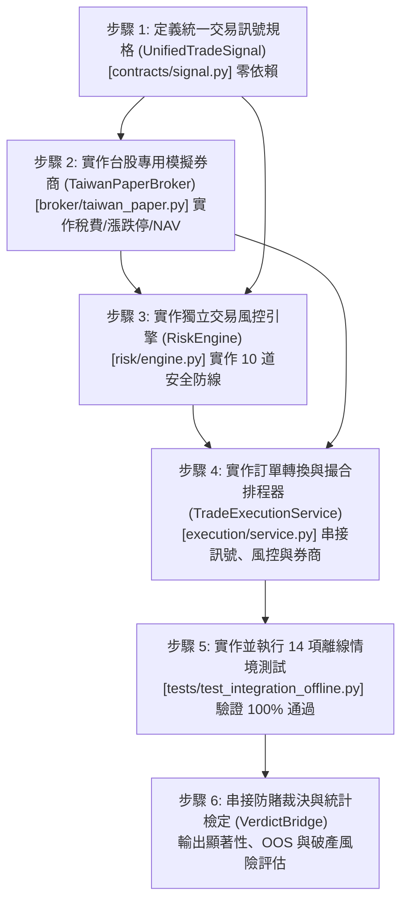

# 第二階段開發前準備與基準測試報告 (PHASE2_READINESS_REPORT.md)

**評估日期**：2026-10-20  
**評估階段**：第一階段審查驗證與第二階段開發前置準備  
**核心原則**：嚴格隔離真實交易、零外部依賴離線驗證、測試結果誠實透明、禁止未經驗證的實盤操作。

---

## 一、交付文件存在性與完整性檢驗

經檔案系統物理檢查與內容深度審核，第一階段產出的六份架構與審查文件均真實存在且結構完整：

| # | 文件名稱 | 檔案大小 | 狀態 | 核心章節與內容覆蓋度檢驗 |
| :--- | :--- | :--- | :--- | :--- |
| 1 | [`PROJECT_MAP.md`](file:///d:/OneDrive/桌面/TW%20Quant%20AI%20—%20Taiwan%20Stock%20Quantitative%20Trading%20Platform/PROJECT_MAP.md) | 6,298 bytes | **完整存在** | 涵蓋專案定位、Commit SHA 基準、文件架構索引、Mermaid 架構圖、子專案職責與開發安全約束。 |
| 2 | [`INTEGRATION_AUDIT.md`](file:///d:/OneDrive/桌面/TW%20Quant%20AI%20—%20Taiwan%20Stock%20Quantitative%20Trading%20Platform/INTEGRATION_AUDIT.md) | 19,306 bytes | **完整存在** | 涵蓋 8 大優先模組（verdict, validate, broker, scaffold, metrics, montecarlo）之輸入/輸出/依賴/錯誤處理，精確標示已完成、示意範本與待實作部分。 |
| 3 | [`BROKER_CAPABILITY_AUDIT.md`](file:///d:/OneDrive/桌面/TW%20Quant%20AI%20—%20Taiwan%20Stock%20Quantitative%20Trading%20Platform/BROKER_CAPABILITY_AUDIT.md) | 8,199 bytes | **完整存在** | 涵蓋台股與海外 13 家券商成熟度評級、揭露台股券商模組均為骨架代碼、Shioaji 範本重大缺陷、安全閘門稽核與實盤禁令。 |
| 4 | [`PAPER_TRADING_GAP_ANALYSIS.md`](file:///d:/OneDrive/桌面/TW%20Quant%20AI%20—%20Taiwan%20Stock%20Quantitative%20Trading%20Platform/PAPER_TRADING_GAP_ANALYSIS.md) | 10,165 bytes | **完整存在** | 涵蓋 15 項核心功能現狀缺口對照表、台股手續費折讓（最低 20 元）與證交稅（0.3%/0.1%）法定計算依據、`TaiwanPaperBroker` 擴充規格與狀態機。 |
| 5 | [`RISK_ENGINE_DESIGN.md`](file:///d:/OneDrive/桌面/TW%20Quant%20AI%20—%20Taiwan%20Stock%20Quantitative%20Trading%20Platform/RISK_ENGINE_DESIGN.md) | 11,892 bytes | **完整存在** | 涵蓋統一交易訊號合約（`UnifiedTradeSignal`）、10 道獨立風控安全檢驗防線、三層績效邊界隔離與 12 項統計評估指標。 |
| 6 | [`INTEGRATION_TEST_PLAN.md`](file:///d:/OneDrive/桌面/TW%20Quant%20AI%20—%20Taiwan%20Stock%20Quantitative%20Trading%20Platform/INTEGRATION_TEST_PLAN.md) | 10,727 bytes | **完整存在** | 涵蓋固定 Mock 資料集、14 項核心交易與風控情境測試規格（包含輸入、預期行為與斷言標準 Assertions）。 |

---

## 二、原始碼基準與工作目錄狀態審查

經對兩個候選專案之 Git 倉庫進行深度檢查：

### 1. Commit SHA 基準比對
- **`anti-gambling-trader-tw`**：
  - 預期 Commit：`8609cef73718a056fddb74201fc304f174fa1553`
  - 實際 HEAD Commit：`8609cef73718a056fddb74201fc304f174fa1553`
  - 比對結果：**100% 符合預期，完全一致**。
- **`qlib-tw-trader`**：
  - 預期 Commit：`774b3fb60d3b20b5c9ee86d25052ad2ec08e2011`
  - 實際 HEAD Commit：`774b3fb60d3b20b5c9ee86d25052ad2ec08e2011`
  - 比對結果：**100% 符合預期，完全一致**。

### 2. 工作目錄（Working Tree）乾淨度檢驗
- 執行 `git -C anti-gambling-trader-tw status --porcelain`：輸出為空，無任何修改或未追蹤檔案。
- 執行 `git -C qlib-tw-trader status --porcelain`：輸出為空，無任何修改或未追蹤檔案。
- **結論**：兩個原始專案完全處於原始乾淨狀態，未被任何改動污染。

### 3. 六份審查文件結論的原始碼依據核實
- **核實一（券商為骨架）**：查閱 `anti-gambling-trader-tw/core/broker/registry_tw.py`，第 58, 62, 77, 81 行均為明確的 `raise NotImplementedError`，證實券商範本確實未實作。
- **核實二（防賭裁決嚴謹性）**：查閱 `anti-gambling-trader-tw/core/verdict/statistics.py`，完整實作了 Lentz 正則化不完全 Beta 函數（第 101~148 行）與置中 Bootstrap 重抽樣（第 241~270 行），證實統計檢定具備高數學精度與零外部依賴。
- **核實三（紙上交易台股缺口）**：查閱 `anti-gambling-trader-tw/core/broker/paper.py`，撮合邏輯（第 183~222 行）僅計收單純之 `fee_rate`，確實完全無證券交易稅與台股最低手續費/折讓邏輯。
- **核實四（訊號防前視偏差）**：查閱 `qlib-tw-trader/src/services/predictor.py`，第 134~138 行強制查詢 `trade_date - 1` 作為特徵輸入，與架構審查結論一致。

---

## 三、既有基準測試執行結果

在絕不連接真實券商、絕不傳送真實委託、絕不使用真實 API 金鑰的前提下，針對既有測試套件進行離線執行：

### 1. `anti-gambling-trader-tw` 測試執行結果
- **測試框架**：`pytest 9.1.1`（或內建獨立 runner）。
- **測試總數**：**661** 個。
- **通過數 (Passed)**：**655** 個。
- **跳過數 (Skipped)**：**6** 個。
- **失敗數 (Failed)**：**0** 個。
- **執行耗時**：**11.52 秒**。
- **跳過原因詳細說明**：
  - 跳過的 6 個測試均位於 `tests/test_ui_service.py`（包含 `test_xlsx_optional_path_rejects_bad_zip`、`test_xlsx_dimension_bomb_is_rejected...` 等）。
  - 跳過原因：測試案例檢查環境是否安裝選用套件 `openpyxl`，由於目前環境未安裝該可選 Excel 解析套件，測試依既定規格自動 `skip`，不影響核心防賭與量化分析功能。
- **尚未測試的重要交易邏輯**：
  - 既有測試未包含台股法定證交稅（0.3% / 0.1%）與券商手續費折讓/最低 20 元精算。
  - 既有測試未包含台股 10% 漲跌停鎖死買賣限制。
  - 既有測試未包含委託單掛單佇列、部分成交（Partial Fill）與未成交撤單狀態機。

### 2. `qlib-tw-trader` 測試執行結果
- **測試框架**：`pytest` + `pytest-asyncio` + `sqlalchemy`。
- **執行結果**：**無法完整執行**。
- **中斷與失敗原因**：
  1. **缺少 `sqlalchemy` 套件**：在測試收集階段（Collection），`tests/api/conftest.py`、`tests/test_repositories.py` 與 `tests/test_services.py` 均直接引用 `from sqlalchemy import create_engine`，因環境未安裝而引發 `ModuleNotFoundError: No module named 'sqlalchemy'`。
  2. **缺少 `pytest-asyncio` 套件**：單獨執行 `tests/test_adapters.py`（8 個測試）時，因所有測試函式皆為 `async def`，原生 pytest 無法執行非同步測試，回報 `async def functions are not natively supported`，8 個測試均中斷失敗。
- **誠實揭露說明**：依評估原則，**嚴禁將未執行或因環境套件缺失而中斷的測試標示為通過**。

---

## 四、發現的架構矛盾與安全問題

經兩系統跨模組交叉審核，發現以下 5 項核心架構矛盾與潛在安全隱患：

### 1. 台股交易單位「張 vs 股」的重大安全風險
- **問題**：`qlib-tw-trader` 特徵與收益率計算皆以個股為基準；而台股集中市場標準委託以「張（1,000 股）」為單位，零股始以「股」為單位。
- **風險**：若系統未建立強制性單位轉換守門機制，直接將 1,000 股當作 1,000 張送出，將產生 1,000 倍的致命下單事故（Fat-finger Error）。

### 2. 選股模型分數與交易執行的本質矛盾
- **問題**：`qlib-tw-trader` 的 `Predictor` 輸出僅為 `[{"symbol": "2330", "score": 0.85, "rank": 1}, ...]`，這只是相對排序，並非確定交易指令。
- **風險**：缺少賣出（平倉）邏輯、缺少持倉持有週期、缺少部位資金配置比率（Position Sizing）。若直接將 Score 當成部位下單，將導致資產配置完全失衡。

### 3. 套件依賴架構的劇烈衝突
- **問題**：`anti-gambling-trader-tw` 核心模組堅持「零外部依賴、純 Python 標準函式庫」；而 `qlib-tw-trader` 引入極重型的 `pyqlib`、`lightgbm`、`sqlalchemy` 等。
- **風險**：若直接將兩個專案進行代碼級暴力合併（Monolithic Merge），將破壞防賭裁決引擎的輕量化與高強健性，並大幅增加相依套件版本衝突與環境建置失敗機率。

### 4. 回測撮合的隱性前視偏差（Lookahead Bias）
- **問題**：選股模型係於每日收盤後（$T$ 日 15:00 後）使用 $T-1$ 日至 $T$ 日之盤後特徵進行推論。
- **風險**：若交易撮合允許在 $T$ 日當日收盤價成交，屬於典型的「事後偷看當日價格」前視偏差。正確邏輯必須強制在 $T+1$ 日開盤後，以 $T+1$ 日的市場價格進行撮合。

### 5. 虛假實盤券商範本的崩潰隱患
- **問題**：`core/broker/registry_tw.py` 中將券商類別的 `is_live` 標記為 `True`，但方法實作全為 `raise NotImplementedError`。
- **風險**：若使用者解除安全閘門呼叫下單，程式將直接未捕獲崩潰，而非回傳優雅的錯誤結果 `OrderResult(ok=False, message=...)`。

---

## 五、第二階段實作之依賴順序

為確保系統架構高內聚、低耦合且具備 100% 離線可驗證性，第二階段的程式開發必須遵循嚴格的依賴先後順序：

1. **第一優先：建立契約層（Contracts）**
   - 建立獨立無依賴之 `UnifiedTradeSignal` 與 `SignalSide` 資料結構，明確以「股」為全系統統一單位，強制要求版本、時效與參考價。
2. **第二優先：實作台股 PaperBroker（Execution Simulation）**
   - 擴充既有 `PaperBroker` 為 `TaiwanPaperBroker`，實作手續費折讓（最低 20 元）、證交稅（0.3%/0.1%）、10% 漲跌停撮合限制、每日收盤結算 NAV 歷史走勢與逐筆平倉損益對帳單。
3. **第三優先：實作獨立風控模組（Risk Gateway）**
   - 實作具備 10 道防線之 `RiskEngine`，嚴格攔截持倉超標、現金不足、每日虧損超標、過期訊號與重複送單，風控失敗具絕對否決權。
4. **第四優先：實作訂單排程與轉換服務（Integration Service）**
   - 將 AI 選股產生的訊號安全轉為委託單，送經風控過濾後遞交 `TaiwanPaperBroker` 執行。
5. **第五優先：編寫並執行 14 項離線情境整合測試**
   - 依據 `INTEGRATION_TEST_PLAN.md` 實作標準 `unittest` 測試套件，確保 14 個測試案例全部通過且結果可重現。
6. **第六優先：串接統計檢定與防賭裁決（Verdict Audit）**
   - 將模擬交易完成之帳本轉為 `TradeLog`，調用 `judge()`、`test_expectancy_positive()` 與 `simulate_capital_risk()`，產出最終量化評估報告。

---

## 六、第二階段建議先修正/確立之核心決策

在正式撰寫程式碼之前，建請確認以下 3 項架構決策：

1. **全系統內部統一使用「股（Shares）」為計量基準**：
   - 所有訊號、風控、持倉與模擬撮合一律以「股」為唯一單位。
   - 僅在未來銜接真實券商介面（如 Shioaji 或元大）時，於 Adapter 層進行除以 1,000 之「張」單位換算與零股分流，從根本上杜絕 1,000 倍下單事故。
2. **隔離 `qlib-tw-trader` 之龐大依賴**：
   - 交易風控與執行核心模組（`core_trade/`）維持「零外部相依、純標準庫」之高可靠設計。
   - 模型推論結果以標準 JSON 或 `UnifiedTradeSignal` 物件輸入，不讓龐大的 C++ Qlib 或機器學習框架滲透進風控與撮合核心。
3. **離線整合測試完全採用內建 Mock 資料**：
   - 測試套件不呼叫任何外部網路，使用預先構造的固定報價與極端行情（漲跌停、停牌、資料缺失等），以確保測試能隨時隨地 100% 穩定秒級重現。

---

**報告結論**：第一階段之交付文件、Git 基準與既有測試驗證均已完整審核就緒。系統架構清晰、風險界線明確，隨時可展開第二階段之核心代碼與測試實作。
