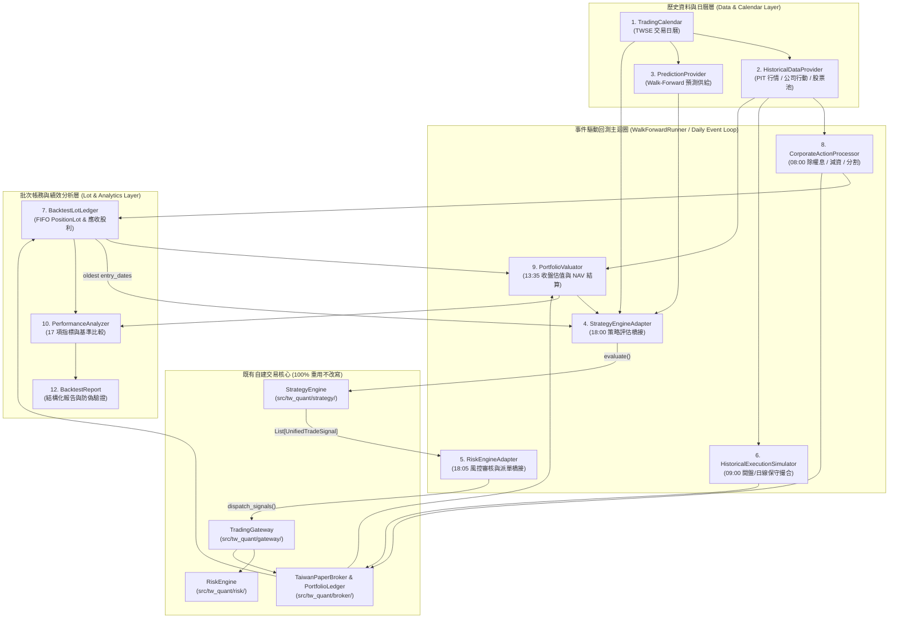
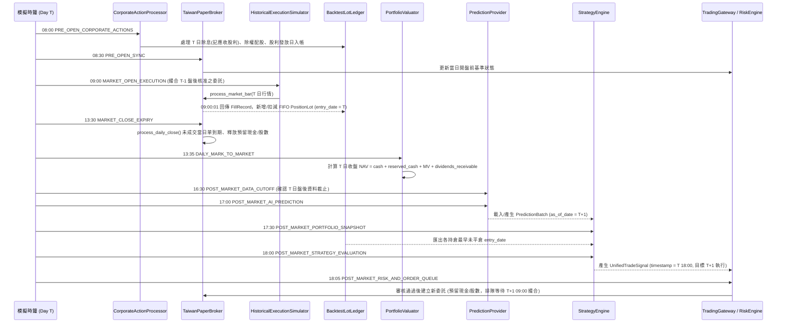

# 第三階段 C-1：台股歷史回測引擎架構設計書（PHASE3C_DESIGN.md）

> **文件狀態**：第三階段 C-1 架構設計與前置驗收正式交付物  
> **版本**：v1.0.0  
> **適用範圍**：`src/tw_quant/backtest/`（規劃中模組，本階段僅完成設計與驗收，尚未實作回測引擎程式碼）  
> **核心原則**：純 Python 標準庫（零第三方強依賴）、直接重用既有 `StrategyEngine` / `RiskEngine` / `TradingGateway` / `TaiwanPaperBroker`、嚴格防止前視偏差（Lookahead Bias）與倖存者偏差（Survivorship Bias）。

---

## 目錄

1. [設計背景與核心問題對策](#一設計背景與核心問題對策)
2. [事件驅動回測架構設計（12 大核心元件）](#二事件驅動回測架構設計12-大核心元件)
3. [每日時間軸與事件順序（Causal Timeline）](#三每日時間軸與事件順序causal-timeline)
4. [持倉批次（Lot）與進場日期管理設計（解決問題 A-1）](#四持倉批次lot與進場日期管理設計解決問題-a-1)
5. [除權息、現金股利與價格基準設計（解決問題 A-2）](#五除權息現金股利與價格基準設計解決問題-a-2)
6. [第一版歷史撮合模型（Execution Fill Model）](#六第一版歷史撮合模型execution-fill-model)
7. [第三階段 C-2 實作前測試計畫（17 項合成案例）](#七第三階段-c-2-實作前測試計畫17-項合成案例)

---

## 一、設計背景與核心問題對策

### 1.1 現有系統已完成之基礎建設

截至第三階段 B 獨立審查完成，`src/tw_quant/` 已具備以下通過 156 項測試（含 50 項子測試）的核心模組：

1. **資料合約層（`src/tw_quant/contracts/`）**：
   - `UnifiedTradeSignal`：具備單調時鐘驗證、整股/零股驗證与確定性 SHA-256 `signal_id`。
   - `SignalDeduplicator`：防止重複訊號執行。
2. **模擬券商層（`src/tw_quant/broker/`）**：
   - `TaiwanPaperBroker`：處理委託生命周期（`SUBMITTED` $\to$ `RESTING` $\to$ `PARTIALLY_FILLED` / `FILLED` / `EXPIRED` / `REJECTED`）。
   - `FillEngine` & `CostModel`：實作台股 6 級升降單位（Tick Size）、$\pm 10\%$ 漲跌停限制、處置股（Disposition）量能折半、0.1425% 手續費（最低 20 元）與 0.3% 賣出證交稅。
   - `PortfolioLedger`：管理可用現金（`cash`）、買單預留現金（`reserved_cash`）、賣單預留股數（`reserved_shares`）與持倉成本。
3. **獨立風控層（`src/tw_quant/risk/`）**：
   - `RiskEngine`：執行 12 道順序風控檢查（Kill Switch、熔斷、每日最大虧損、滾動高點回撤、單筆金額、單一持倉集中度、總曝險、每日交易次數、重複訊號、冷卻時間、處置股攔截、零股攔截）。
4. **交易閘道層（`src/tw_quant/gateway/`）**：
   - `TradingGateway`：強制所有訊號先經 `RiskEngine` 審核取得 `approval_token` 後，方能進入 `TaiwanPaperBroker`。
5. **AI 預測合約與策略引擎層（`src/tw_quant/prediction/`、`src/tw_quant/strategy/`）**：
   - `PredictionBatch` / `StockPrediction` / `PredictionMetadata`：具備防偽驗證（阻擋 `MOCK` 模型混入正式模式）與特徵時序因果驗證（`latest_feature_timestamp <= data_cutoff_time <= generated_at`）。
   - `StrategyEngine`：支援分位數/Top-N 排名選股、流動性過濾、確定性等權重資金配置、固定持有天數到期出場（`HOLDING_PERIOD_EXPIRED`）、停損出場（`STOP_LOSS`）、排名跌出出場（`RANK_BREAKDOWN`）與減倉再平衡（`REBALANCE_TRIM`）。

### 1.2 第三階段 B 獨立審查揭露之關鍵缺口與本設計對策

| 審查編號 | 問題描述 | 根本原因（程式碼位置） | 第三階段 C 架構解決方案 |
| :--- | :--- | :--- | :--- |
| **A-1** | `PortfolioLedger` 未記錄每筆持倉的進場日期與分批明細，若無外部傳入 `entry_dates`，固定持有期限出場（`HOLDING_PERIOD_EXPIRED`）將被略過。 | [`Position`](file:///d:/OneDrive/桌面/TW%20Quant%20AI%20—%20Taiwan%20Stock%20Quantitative%20Trading%20Platform/src/tw_quant/broker/ledger.py#L20-L55) 僅儲存加權平均 `(symbol, quantity, avg_price, total_cost)`，不含 `entry_date` 與 `PositionLot` 清單。 | 新增獨立 **`BacktestLotLedger`**（方案三），以 FIFO 規則追蹤每一批成交 `PositionLot`，並自動匯出各標的「最早未平倉批次進場日」供 `PortfolioSnapshot.from_broker()` 使用。 |
| **A-2** | 除權息與現金股利帳務未建模，除息日股價下跳會造成帳面未實現損益虛假暴跌，進而誤觸 `RiskEngine` 單日虧損（2%）或回撤（10%）熔斷。 | `PortfolioLedger` 無「應收股利（`dividends_receivable`）」科目，亦無除權配股/分割之股數與成本調整介面。 | 新增 **`CorporateActionProcessor`** 與應收股利科目，將除息日（產生應收股利）與發放日（應收股利轉入可用現金）分離建模，維持除息當日總資產淨值（NAV）連續不跳水。 |
| **B-1** | `FillEngine.match_order` 目前以當日收盤價 `bar.close` 作為市價單與限價單之基準價 `ref_price`。 | [`FillEngine.match_order`](file:///d:/OneDrive/桌面/TW%20Quant%20AI%20—%20Taiwan%20Stock%20Quantitative%20Trading%20Platform/src/tw_quant/broker/engine.py#L118) 設定 `ref_price = bar.close`。在日線回測中，09:00 開盤送出的委託若以 13:30 收盤價成交，隱含日內價格前視且可能產生限價單超額有利價格成交。 | 在 **`HistoricalExecutionSimulator`** 中提供明確的日線撮合基準轉換（預設 `OPEN_PRICE` 開盤價撮合模式與 `CONSERVATIVE_OHLC` 保守價撮合模式），並重用 `TaiwanPaperBroker` 進行帳務交割與手續費/稅計算。 |
| **B-2** | `TaiwanPaperBroker.build_risk_context` 對缺少當日報價之持倉回退使用 `pos.avg_price`，且將 `daily_unrealized_pnl` 硬編碼為 `0.00`。 | [`TaiwanPaperBroker.build_risk_context`](file:///d:/OneDrive/桌面/TW%20Quant%20AI%20—%20Taiwan%20Stock%20Quantitative%20Trading%20Platform/src/tw_quant/broker/broker.py#L65-L95)。 | 在 **`PortfolioValuator`** 與 **`RiskEngineAdapter`** 中建立明確的「停牌/缺價最後已知收盤價（Last Known Close Price）」推進機制與真實未實現損益計算。 |

---

## 二、事件驅動回測架構設計（12 大核心元件）

### 2.1 整體系統架構圖



### 2.2 模組目錄結構規劃（`src/tw_quant/backtest/`）

```text
src/tw_quant/backtest/
├── __init__.py
├── exceptions.py       # BacktestError, LookaheadViolationError, DataIntegrityError
├── calendar.py         # 1. TradingCalendar (實作 TradingCalendarProtocol)
├── data_provider.py    # 2. HistoricalDataProvider & PIT 資料結構
├── prediction_feed.py  # 3. PredictionProvider (歷史預測批次載入與防洩漏攔截)
├── adapters.py         # 4. StrategyEngineAdapter & 5. RiskEngineAdapter
├── simulator.py        # 6. HistoricalExecutionSimulator (日線開盤/保守撮合轉換)
├── lot_ledger.py       # 7. BacktestLotLedger & PositionLot (解決 A-1)
├── corporate_actions.py# 8. CorporateActionProcessor & DividendReceivable (解決 A-2)
├── valuator.py         # 9. PortfolioValuator & DailyNAVRecord
├── analyzer.py         # 10. PerformanceAnalyzer (17 項績效指標與 Benchmark 對比)
├── runner.py           # 11. WalkForwardRunner (單區間與滾動 Walk-Forward 引擎)
└── report.py           # 12. BacktestReport (含資料等級與模型真偽標記之稽核報告)
```

### 2.3 12 大元件詳細規格表

#### 元件 1：`TradingCalendar`（台股交易日曆模組）
- **職責**：提供確定性的 TWSE 交易日查詢、前後 $N$ 個交易日推算、區間交易日列舉，以及實作 [`TradingCalendarProtocol`](file:///d:/OneDrive/桌面/TW%20Quant%20AI%20—%20Taiwan%20Stock%20Quantitative%20Trading%20Platform/src/tw_quant/strategy/calendar.py#L14-L42)。
- **輸入資料結構**：`FrozenSet[date]`（經核驗之歷史交易日集合）與 `valid_from: date`、`valid_until: date` 邊界。
- **輸出資料結構**：`is_trading_day(d: date) -> bool`、`trading_days_between(d1: date, d2: date) -> int`、`next_trading_day(d: date) -> date`、`prev_trading_day(d: date) -> date`、`shift_trading_days(d: date, offset: int) -> date`。
- **依賴關係**：僅依賴 Python 標準庫 `datetime` 與 `src.tw_quant.strategy.calendar.TradingCalendarProtocol`。
- **重用說明**：直接實作第三階段 B 定義之 `TradingCalendarProtocol`，取代 `WeekdayCalendar` 近似實作。若查詢超出日曆涵蓋範圍（例如回測最後一日查詢 `next_trading_day`），若無預載未來日曆則拋出明確 `CalendarBoundaryError`，絕不靜默退回週曆。

#### 元件 2：`HistoricalDataProvider`（Point-in-Time 歷史資料供應器）
- **職責**：以嚴格的 Point-in-Time（PIT）時間鎖供應每日行情（`MarketBar`）、近 20 日均量（`adv_20`）、除權息與公司行動事件（`CorporateActionEvent`）、當時點可交易股票池（`PITUniverseSnapshot`）與基準指數日報酬。
- **輸入資料結構**：查詢日期 `query_date: date` 與查詢當下系統時間 `current_sim_time: datetime`（必須含 `+08:00` 時區）。
- **輸出資料結構**：
  - `Dict[str, MarketBar]`（當日 OHLCV、前收價 `prev_close`、`is_disposition`、`is_halted`）
  - `Dict[str, Decimal]`（截至 $T-1$ 收盤之 20 日平均成交金額/股數，供 $T$ 日盤後選股與流動性過濾使用）
  - `List[CorporateActionEvent]`（當日生效之除息、除權、配股發放、分割、減資、下市事件）
- **依賴關係**：`TradingCalendar`、`src.tw_quant.broker.order.MarketBar`。
- **重用說明**：直接產出 `TaiwanPaperBroker` 原生使用的 `MarketBar` 物件；內建 **時間鎖防護（Temporal Guard）**：若回測迴圈在模擬時間 $T$ 試圖讀取 $T' > T$ 的價格，或在 $T$ 日 `13:30` 收盤前讀取 $T$ 日收盤統計，立即拋出 `LookaheadViolationError`。

#### 元件 3：`PredictionProvider`（歷史 AI 預測批次供應器）
- **職責**：在每個交易日 $T$ 盤後（`17:00+08:00`），提供目標交易日為 $T+1$（即 `as_of_date = next_trading_day(T)`）的 `PredictionBatch`，並驗證模型訓練視窗與特徵時間戳未跨越 $T$ 日盤後截止時間。
- **輸入資料結構**：決策交易日 `decision_date: date`、下一交易日 `target_as_of_date: date`、當下模擬時間 `sim_time: datetime`、目前生效之 Walk-Forward 區間設定 `WalkForwardFoldSpec`。
- **輸出資料結構**：[`PredictionBatch`](file:///d:/OneDrive/桌面/TW%20Quant%20AI%20—%20Taiwan%20Stock%20Quantitative%20Trading%20Platform/src/tw_quant/prediction/contract.py#L209-L361)。
- **依賴關係**：`src.tw_quant.prediction.contract.PredictionBatch`、`TradingCalendar`。
- **重用說明**：100% 重用第三階段 A 之 `PredictionBatch` 與 `PredictionMetadata` 合約，並額外加上 **Walk-Forward 訓練邊界檢查**：強制驗證 `metadata.train_end_date + embargo_days < decision_date`，防止模型訓練期重疊測試期（In-Sample Leakage）。

#### 元件 4：`StrategyEngineAdapter`（策略引擎橋接器）
- **職責**：在交易日 $T$ 盤後（`18:00+08:00`），將 `TaiwanPaperBroker` 帳務狀態、`BacktestLotLedger` 的各標的最早進場日期（`entry_dates`）、以及 $T$ 日收盤價（含停牌股最後已知收盤價）組裝為 `PortfolioSnapshot`，呼叫既有 `StrategyEngine.evaluate()`。
- **輸入資料結構**：`PredictionBatch`、`TaiwanPaperBroker`、`BacktestLotLedger`、`PortfolioValuator`（提供完整收盤價與應收股利調整）、`decision_time: datetime`。
- **輸出資料結構**：`StrategyEvaluationResult`（含排序後的 `SELL` / `CLOSE` 先行、`BUY` 在後的 `Tuple[UnifiedTradeSignal, ...]`）。
- **依賴關係**：`src.tw_quant.strategy.engine.StrategyEngine`、`src.tw_quant.strategy.snapshot.PortfolioSnapshot`。
- **重用說明**：**直接呼叫既有 `StrategyEngine.evaluate()` 與 `PortfolioSnapshot.from_broker()`，不重寫任何選股、權重配置或出場規則邏輯**。針對應收股利（`dividends_receivable`），透過快照現金修正項或獨立屬性確保 `total_nav` 正確反映除息日資產，但不將未入帳之應收股利納入當晚可立即動用的買進現金預算（`available_cash`）。

#### 元件 5：`RiskEngineAdapter`（風控與派單橋接器）
- **職責**：在交易日 $T$ 盤後（`18:05+08:00`），建立包含真實當日未實現損益與應收股利修正之 `AccountRiskContext`，並呼叫既有 `dispatch_signals()` 將策略訊號送入 `TradingGateway` $\to$ `RiskEngine` $\to$ `TaiwanPaperBroker`。
- **輸入資料結構**：`StrategyEvaluationResult`、`TradingGateway`、`PortfolioValuator`、`current_sim_time: datetime`。
- **輸出資料結構**：`StrategyDispatchSummary`（記錄核准與拒絕之訊號明細）。
- **依賴關係**：`src.tw_quant.strategy.engine.dispatch_signals`、`src.tw_quant.gateway.gateway.TradingGateway`、`src.tw_quant.risk.engine.RiskEngine`。
- **重用說明**：**100% 重用既有 `TradingGateway`、`RiskEngine` 與 `dispatch_signals`**。唯一增強點是修補 `TaiwanPaperBroker.build_risk_context` 中 `daily_unrealized_pnl = 0.00` 的簡化問題，改由 `PortfolioValuator` 傳入精確的當日未實現損益變化與含應收股利之 `current_nav`，使 `RiskEngine` 的單日最大虧損（Rule 3）與滾動高點回撤（Rule 4）完全精準且不因除息誤觸。

#### 元件 6：`HistoricalExecutionSimulator`（歷史委託撮合模擬器）
- **職責**：在交易日 $T$ 開盤（`09:00+08:00`），根據設定的日線撮合模式（`OPEN_PRICE` 或 `CONSERVATIVE_OHLC`），將當日原始 `MarketBar` 轉換為供 `TaiwanPaperBroker.process_market_bar()` 執行的有效撮合行情，處理停牌股攔截、一字漲跌停鎖死攔截與量能上限（Volume Cap）控制。
- **輸入資料結構**：`MarketBar`（$T$ 日 OHLCV）、`prev_day_adv: Optional[int]`（$T-1$ 日已知量能）、`ExecutionSimConfig`（撮合模式設定）。
- **輸出資料結構**：`List[FillRecord]`（由 `TaiwanPaperBroker.process_market_bar` 產出之成交紀錄）與 `List[OrderExecutionAudit]`（未成交原因明細，如 `HALTED`、`LOCKED_LIMIT_UP`、`LOCKED_LIMIT_DOWN`、`VOLUME_CAPPED`）。
- **依賴關係**：`src.tw_quant.broker.broker.TaiwanPaperBroker`、`src.tw_quant.broker.engine.FillEngine`。
- **重用說明**：直接重用 `TaiwanPaperBroker.process_market_bar()`、`FillEngine` 與 `CostModel` 進行手續費、證交稅、預留金扣減與零股/整股交割，不重複實作任何帳務扣款邏輯。

#### 元件 7：`BacktestLotLedger`（持倉批次與應收股利追蹤帳本）
- **職責**：同步接收 `TaiwanPaperBroker` 的 `FillRecord` 與 `CorporateActionProcessor` 的公司行動事件，以 **FIFO（先進先出）** 規則維護每一筆未平倉 `PositionLot`，記錄確切 `entry_date`、剩餘股數与調整後成本，並管理 `DividendReceivable`（應收股利清單）。
- **輸入資料結構**：`FillRecord`、`trade_date: date`、`CorporateActionEvent`。
- **輸出資料結構**：
  - `get_oldest_entry_dates() -> Dict[str, date]`（直接供給 `PortfolioSnapshot.from_broker(entry_dates=...)`）
  - `get_open_lots(symbol: Optional[str]) -> Tuple[PositionLot, ...]`
  - `get_closed_lot_trades() -> Tuple[ClosedLotTrade, ...]`（供勝率、賠率、平均持有天數分析）
  - `get_total_dividends_receivable() -> Decimal`
- **依賴關係**：`src.tw_quant.broker.order.FillRecord`、`src.tw_quant.broker.ledger.PortfolioLedger`。
- **重用說明**：作為 `PortfolioLedger` 的非侵入式平行擴充層（詳見第四節方案三比較），在每次成交與公司行動後自動與 `PortfolioLedger.positions` 核對總股數一致性（Invariant Check：`sum(lot.remaining_quantity) == ledger.positions[sym].quantity`）。

#### 元件 8：`CorporateActionProcessor`（除權息與公司行動處理器）
- **職責**：在交易日 $T$ 開盤前（`08:00+08:00`），依序處理當日生效之現金除息（建立應收股利）、現金股利發放（轉入可用現金）、股票除權/分割/減資（調整 `PortfolioLedger` 與 `BacktestLotLedger` 股數與單位成本）。
- **輸入資料結構**：`trade_date: date`、`List[CorporateActionEvent]`、`TaiwanPaperBroker`、`BacktestLotLedger`。
- **輸出資料結構**：`List[CorporateActionAuditRecord]`。
- **依賴關係**：`BacktestLotLedger`、`PortfolioLedger`。
- **重用說明**：透過受控帳務調整介面更新 `PortfolioLedger` 與 `BacktestLotLedger`，確保除息日與配股日帳務嚴密守恆。

#### 元件 9：`PortfolioValuator`（投資組合每日估值器）
- **職責**：在交易日 $T$ 收盤後（`13:35+08:00`），結合可用現金、預留現金、各持倉市值（支援停牌股最後已知收盤價追蹤）與應收股利，計算當日完整 `DailyNAVRecord`。
- **輸入資料結構**：`trade_date: date`、`PortfolioLedger`、`BacktestLotLedger`、`Dict[str, MarketBar]`。
- **輸出資料結構**：`DailyNAVRecord`（含 `cash`、`reserved_cash`、`market_value`、`dividends_receivable`、`total_nav`、`daily_return`、`drawdown_from_peak`、`halted_symbols`）。
- **依賴關係**：`PortfolioLedger`、`BacktestLotLedger`。
- **重用說明**：呼叫 `PortfolioLedger.mark_to_market()` 並補充 `dividends_receivable` 與停牌股最後已知價格（`last_known_close`），確保不重複計算亦不遺漏任何資產。

#### 元件 10：`PerformanceAnalyzer`（回測績效與風險分析器）
- **職責**：根據回測期間之 `DailyNAVRecord` 序列、`ClosedLotTrade` 序列、成交紀錄與 Benchmark 指數序列，計算 `BACKTEST_METHODOLOGY.md` 定義之 17 項核心績效指標。
- **輸入資料結構**：`Sequence[DailyNAVRecord]`、`Sequence[ClosedLotTrade]`、`Sequence[FillRecord]`、`Sequence[BenchmarkDailyRecord]`。
- **輸出資料結構**：`PerformanceMetricsSummary`。
- **依賴關係**：純 Python 標準庫（`math`、`decimal`、`statistics`）。
- **重用說明**：可選配匯出標準成交明細供 `anti-gambling-trader-tw` 的 `core/metrics/performance.py` 與 `core/verdict/judge.py` 進行統計檢定。

#### 元件 11：`WalkForwardRunner`（事件驅動回測與滾動驗證執行器）
- **職責**：編排單一期間或多個滾動 Walk-Forward Fold 的完整回測流程，嚴格執行訓練期（Train）、驗證期（Validation）、隔離期（Embargo）與測試期（Out-of-Sample Test）的切分與每日 12 步驟時間軸。
- **輸入資料結構**：`WalkForwardConfig`、`HistoricalDataProvider`、`PredictionProvider`、`TradingCalendar`、`StrategyConfig`、`RiskConfig`、`BrokerConfig`。
- **輸出資料結構**：`BacktestReport`。
- **依賴關係**：串接上述元件 1 至 10。

#### 元件 12：`BacktestReport`（結構化回測稽核報告）
- **職責**：封裝回測結果、17 項績效指標、逐日 NAV、逐筆交易明細、公司行動明細、未成交原因統計，以及 **強制防偽標籤（`is_mock_model`、`data_readiness_grade`、`survivorship_bias_free`、`lookahead_audit_passed`）**。
- **輸入資料結構**：`WalkForwardRunner` 產出之所有紀錄。
- **輸出資料結構**：不可變資料類別 `BacktestReport`，支援匯出為 JSON 與 Markdown 報告。

---

## 三、每日時間軸與事件順序（Causal Timeline）

為徹底杜絕「同日收盤價預測、同日收盤價（或開盤價）成交」的時間穿越錯誤，回測引擎在每一個交易日 $T$ 強制以單調遞增的模擬時鐘（`Simulated Monotonic Clock`，時區固定為 `UTC+08:00`）依序執行以下 12 個階段：



### 3.1 單一交易日 $T$ 的 12 步驟時間表

| 順序 | 模擬時間 (`+08:00`) | 事件階段代碼 | 執行動作與因果限制 |
| :---: | :---: | :--- | :--- |
| **1** | `T 08:00:00` | `PRE_OPEN_CORPORATE_ACTIONS` | 根據 **$T-1$ 日收盤最終持倉股數**，處理 $T$ 日生效之除權息與公司行動：<br/>• 若 $T$ 為除息日：新增 `DividendReceivable`（應收股利）。<br/>• 若 $T$ 為現金股利發放日：將對應之 `DividendReceivable` 轉入 `ledger.cash`。<br/>• 若 $T$ 為除權/分割/減資生效日：調整持倉股數與單位成本。 |
| **2** | `T 08:30:00` | `PRE_OPEN_RISK_SYNC` | 清理任何跨日殘留異常狀態，確認開盤前風控基準（以 $T-1$ 收盤總 NAV 為當日風控起算基準）。 |
| **3** | `T 09:00:00` | `MARKET_OPEN_EXECUTION` | `HistoricalExecutionSimulator` 載入 $T$ 日行情，僅針對 **$T-1$ 盤後（`18:05`）已建立並處於 `SUBMITTED`/`RESTING` 狀態之委託** 進行撮合。若標的於 $T$ 日停牌（`is_halted=True`），該標的跳過撮合，委託維持掛單至收盤到期。 |
| **4** | `T 09:00:01` | `FILL_AND_LOT_SETTLEMENT` | 針對步驟 3 產生的每一筆 `FillRecord`：<br/>• `PortfolioLedger` 已完成現金/預留金與總股數交割。<br/>• `BacktestLotLedger` 同步更新：若為 `BUY` 成交，建立新 `PositionLot(entry_date=T)`；若為 `SELL`/`CLOSE` 成交，依 FIFO 順序扣減最早批次之 `remaining_quantity`。 |
| **5** | `T 13:30:00` | `MARKET_CLOSE_EXPIRY` | 呼叫 `TaiwanPaperBroker.process_daily_close(T 13:30)`：所有當日未完全成交之委託（如漲停買不到、跌停賣不出、量能受限部分成交後的餘額、停牌未成交）統一轉為 `EXPIRED`，並**立即釋放預留現金（`reserved_cash`）與預留股數（`reserved_shares`）**。 |
| **6** | `T 13:35:00` | `DAILY_MARK_TO_MARKET` | `PortfolioValuator` 以 $T$ 日 13:30 收盤價（停牌股採最後已知收盤價並標記 `is_stale_price=True`）計算當日收盤市值與 `DailyNAVRecord`，更新歷史最高 NAV（`rolling_peak_nav`）。 |
| **7** | `T 16:30:00` | `POST_MARKET_DATA_CUTOFF` | 確認 $T$ 日盤後資料截止點（`data_cutoff_time = T 16:30:00+08:00`）。只有 `published_at <= T 16:30:00+08:00` 的行情、三大法人籌碼、月營收或財報可被後續步驟讀取。 |
| **8** | `T 17:00:00` | `POST_MARKET_AI_PREDICTION` | `PredictionProvider` 載入或觸發離線推論，產出 `PredictionBatch`。強制驗證：<br/>1. `batch.as_of_date == next_trading_day(T)`（即 $T+1$）<br/>2. `batch.metadata.latest_feature_timestamp <= T 16:30:00+08:00`<br/>3. `batch.metadata.generated_at <= T 17:00:00+08:00` |
| **9** | `T 17:30:00` | `POST_MARKET_PORTFOLIO_SNAPSHOT` | 由 `StrategyEngineAdapter` 建立 `PortfolioSnapshot`：<br/>• `snapshot_time = T 17:30:00+08:00`<br/>• `prices_as_of = T 13:30:00+08:00`<br/>• `entry_dates = BacktestLotLedger.get_oldest_entry_dates()` |
| **10** | `T 18:00:00` | `POST_MARKET_STRATEGY_DECISION` | 呼叫 `StrategyEngine.evaluate(batch, snapshot, decision_time=T 18:00:00+08:00)`。產生的所有 `UnifiedTradeSignal` 其 `timestamp = T 18:00:00+08:00`，代表在 $T$ 日盤後決策、排定於下一交易日 $T+1$ 執行。 |
| **11** | `T 18:05:00` | `POST_MARKET_RISK_AND_QUEUE` | 呼叫 `dispatch_signals()` 經由 `TradingGateway` 與 `RiskEngine` 審核。由於訊號已按 `SELL`/`CLOSE` 在前、`BUY` 在後排序：<br/>• 核准的賣單預留股數（`reserved_shares`）。<br/>• 核准的買單預留資金（`reserved_cash`）。<br/>• **注意**：此時僅建立委託單（`SUBMITTED`），**絕不在 $T$ 日進行撮合**，全部排入佇列等待下一交易日 $T+1$ 的步驟 3（`T+1 09:00:00`）撮合。 |
| **12** | `T 18:10:00` | `DAILY_AUDIT_LOGGING` | 寫入當日完整審計日誌（含 NAV、持倉批次、應收股利、核准/拒絕訊號、到期未成交委託），推進模擬日曆至下一交易日 $T+1$。 |

### 3.2 三大關鍵因果問題之明確規範

1. **問題 1：$T$ 日收盤後產生的訊號，何時可成交？**
   - **規範**：$T$ 日收盤後（`18:00`）產生的訊號，**最早只能在下一交易日 $T+1$ 的開盤（`T+1 09:00`）成交**。嚴禁使用 $T$ 日開盤價或 $T$ 日收盤價回溯撮合 $T$ 日盤後才產生的訊號。
2. **問題 2：$T$ 日尚未公開的資料，是否可進入 $T$ 日決策？**
   - **規範**：**絕對禁止**。任何財報、月營收、除權息公告或法人買賣超，必須具備明確的 `published_at`（或保守推算之法定最晚公告日盤後時間）。若 `published_at > T 16:30:00+08:00`，在 $T$ 日盤後決策時視為不存在（只可使用該指標上一期已公開之舊值）。
3. **問題 3：停牌、漲跌停鎖死、量能不足時，未成交委託如何處理？**
   - **規範**：
     - **漲停鎖死買單 / 跌停鎖死賣單 / 停牌**：在 $T+1$ `09:00` 撮合時成交 0 股；在 $T+1$ `13:30` 收盤時由 `process_daily_close()` 自動轉為 `EXPIRED`，全額釋放預留現金或預留股數。
     - **量能不足（Volume Participation Cap）**：在 $T+1$ `09:00` 依量能上限部分成交（`PARTIALLY_FILLED`），僅針對實際成交股數建立/扣減 `PositionLot`；剩餘未成交股數於 $T+1$ `13:30` 收盤轉為 `EXPIRED` 並釋放剩餘預留金/股數。
     - **隔日重新評估**：未成交之部位不會無限期盲目掛單（無 GTC 殭屍單）；在 $T+1$ `18:00` 盤後，`StrategyEngine` 會根據實際最新的持倉與最新 AI 預測重新評估是否需要再次發出買賣訊號（例如跌停未賣出的停損部位，若 $T+1$ 盤後仍在持倉中且觸發出場條件，將在 $T+1$ `18:00` 重新產生新的賣出訊號供 $T+2$ 執行）。

---

## 四、持倉批次（Lot）與進場日期管理設計（解決問題 A-1）

### 4.1 架構方案評估與選型

針對如何補齊 `PortfolioLedger` 缺乏 `entry_date` 與分批持倉明細的問題，我們比較以下三種架構方案：

| 評估維度 | 方案一：在 `WalkForwardRunner` 內部以字典臨時管理 | 方案二：直接修改既有 `PortfolioLedger` 與 `Position` | **方案三（選定）：新增獨立的 `BacktestLotLedger` 持倉批次追蹤層** |
| :--- | :--- | :--- | :--- |
| **對既有核心的侵入性** | 低，但邏輯散落在迴圈控制器中 | **高**（需修改 `src/tw_quant/broker/ledger.py`，違反不改動既有 PaperBroker 核心原則） | **零侵入**（位於 `src/tw_quant/backtest/lot_ledger.py`，完全不修改 `broker/`） |
| **分批買進與部分賣出（FIFO）支援** | 差（簡單 `Dict[str, date]` 無法處理分批買入後賣出第一批時，`entry_date` 應推進至第二批的邏輯） | 可支援，但會改變既有 `Position` 介面與序列化結構 | **完整支援**（精確維護 `Deque[PositionLot]`，第一批賣完後自動將 `oldest_entry_date` 推進至第二批） |
| **除權配股 / 減資成本調整** | 極難維護 | 需大幅改寫 `PortfolioLedger` | **原生支援**（可同時按比例調整每個 Lot 的股數與成本，並與 `PortfolioLedger` 同步校驗） |
| **單元測試獨立性** | 難以單獨測試帳務邊界 | 可能影響既有 156 項測試 | **高**（可針對 FIFO、部分成交、除權息撰寫獨立高覆蓋率單元測試） |

> [!IMPORTANT]
> **設計決策**：採用 **方案三（新增獨立 `BacktestLotLedger`）**。此設計完全遵守「不修改既有 `TaiwanPaperBroker` 核心邏輯」的開發紀律，並透過 `PortfolioSnapshot.from_broker(broker, ..., entry_dates=lot_ledger.get_oldest_entry_dates())` 無縫銜接第三階段 B 已預留的 `entry_dates` 注入介面。

### 4.2 `PositionLot` 與 `ClosedLotTrade` 資料結構定義

```python
@dataclass(frozen=True)
class PositionLot:
    """單一進場持倉批次（不可變快照或狀態紀錄）。"""
    lot_id: str                  # 唯一批次編號，格式: "LOT-{trade_date}-{fill_id}"
    symbol: str                  # 股票代號，例如 "2330"
    entry_date: date             # 實際成交進場日期 (台股交易日 T_fill)
    entry_timestamp: datetime    # 實際成交時間戳 (+08:00)
    origin_order_id: str         # 來源委託單號
    origin_signal_id: str        # 來源訊號 ID
    strategy_id: str             # 策略名稱
    initial_quantity: int        # 初始成交股數 (> 0)
    remaining_quantity: int      # 目前剩餘未平倉股數 (0 <= remaining <= initial)
    entry_price: Decimal         # 原始成交單價
    adjusted_cost_per_share: Decimal # 經除權/分割調整後之含費單位成本
    total_cost_basis: Decimal    # 目前剩餘股數對應之總成本基準 (含按比例分攤之買進手續費)
```

```python
@dataclass(frozen=True)
class ClosedLotTrade:
    """已平倉（含部分平倉）之批次配對交易紀錄，供勝率、賠率與持有天數統計使用。"""
    trade_id: str
    lot_id: str
    symbol: str
    strategy_id: str
    entry_date: date
    exit_date: date
    holding_trading_days: int    # 由 TradingCalendar.trading_days_between(entry_date, exit_date) 計算
    quantity: int                # 本次平倉股數
    entry_cost_basis: Decimal    # 對應之進場總成本（含買進手續費分攤）
    exit_net_proceeds: Decimal   # 出場淨收入（扣除賣出手續費與證交稅）
    realized_pnl: Decimal        # exit_net_proceeds - entry_cost_basis
    return_pct: Decimal          # realized_pnl / entry_cost_basis
```

### 4.3 五大持倉批次處理規則（FIFO 規範）

1. **規則 1：同一標的多次分批買進**
   - 假設於 $T_1$ 買進 `2330` 成交 1,000 股，於 $T_3$ 再次買進 `2330` 成交 1,000 股。
   - `BacktestLotLedger` 會在 `2330` 的佇列中依序建立兩個獨立批次：`Lot_1 (entry_date=T_1, remaining=1000)` 與 `Lot_2 (entry_date=T_3, remaining=1000)`。
2. **規則 2：部分賣出時，哪一批次先減少（FIFO 原則）**
   - 採 **先進先出（FIFO）**。承上例，若於 $T_4$ 賣出 `2330` 成交 1,500 股：
     - 先將 `Lot_1` 的 1,000 股全數平倉（`Lot_1.remaining_quantity = 0`，產生一筆 `holding_trading_days = trading_days(T_1, T_4)` 的 `ClosedLotTrade` 並移出活躍佇列）。
     - 再從 `Lot_2` 扣減 500 股（`Lot_2.remaining_quantity = 500`，產生第二筆 `holding_trading_days = trading_days(T_3, T_4)` 的 `ClosedLotTrade`）。
     - 平倉後，`2330` 剩餘唯一的活躍批次為 `Lot_2 (entry_date=T_3, remaining=500)`。
3. **規則 3：部分成交（Partial Fill）時，進場日期如何記錄**
   - 若買單委託 2,000 股，於 $T_1$ 因量能上限僅部分成交 1,000 股（剩餘 1,000 股於當日收盤 `EXPIRED`）：
   - `BacktestLotLedger` **僅針對實際成交的 1,000 股** 建立 `PositionLot(initial_quantity=1000, remaining_quantity=1000, entry_date=T_1)`。未成交的 1,000 股絕不計入持倉。
4. **規則 4：委託未成交時，不得建立持倉批次**
   - 當訊號在 $T$ 日盤後通過風控並建立 `SUBMITTED` 委託單時，或當委託單在 $T+1$ 因漲停鎖死/停牌而 `EXPIRED` 時，由於沒有產生 `FillRecord`，`BacktestLotLedger` **絕不建立任何 `PositionLot`**，亦不更新 `entry_dates`。
5. **規則 5：`PortfolioSnapshot` 如何取得正確的 `entry_date`**
   - `BacktestLotLedger.get_oldest_entry_dates()` 針對每個目前有持倉（`remaining_quantity > 0`）的標的，回傳其活躍 FIFO 佇列中 **最早一個未平倉批次的進場日期**：
     $$\text{entry\_date}(s) = \min_{l \in \text{OpenLots}(s)} l.\text{entry\_date}$$
   - 當上述例子中的 `Lot_1 (T_1)` 被全數賣出後，`2330` 的 `entry_date` 會自動推進為 `Lot_2` 的 `T_3`，確保 `StrategyEngine` 的 `max_holding_days` 計算永遠對應目前帳上最早一批尚未出場的部位。

---

## 五、除權息、現金股利與價格基準設計（解決問題 A-2）

### 5.1 現金股利（Cash Dividend）與應收股利（`DividendReceivable`）帳務模型

在台股實務中，**除息交易日（Ex-Dividend Date, $T_{\text{ex}}$）** 與 **現金股利發放日（Payment Date, $T_{\text{pay}}$）** 通常相隔 15 至 35 個日曆日。
- 在 $T_{\text{ex}}$ 開盤時，股價基準下調每股現金股利 $D_{\text{cash}}$，但現金尚未匯入投資人交割帳戶。
- 若不記錄「應收股利」，在 $T_{\text{ex}}$ 當天，投資組合市值會憑空蒸發 $Q_{T_{\text{ex}}-1} \times D_{\text{cash}}$，導致單日 NAV 暴跌並誤觸 `RiskEngine` 的 `max_daily_loss_pct`（2%）或 `max_drawdown_pct`（10%）熔斷！
- 反之，若在 $T_{\text{ex}}$ 當天直接將股利加入可用現金 `ledger.cash`，策略引擎會在還沒真正收到股利前就把這筆錢拿去買股票（產生無息融資前視偏差）。

#### 解決方案：雙階段應收股利會計分錄

```python
@dataclass(frozen=True)
class DividendReceivable:
    """已除息但尚未到達發放日之應收現金股利。"""
    receivable_id: str
    symbol: str
    ex_date: date                # 除息交易日 T_ex
    payment_date: date           # 預計現金發放日 T_pay (>= T_ex)
    eligible_shares: int         # T_ex - 1 收盤持有股數
    dividend_per_share: Decimal  # 每股現金股利 (TWD)
    gross_amount: Decimal        # 應收股利總額 = floor(eligible_shares * dividend_per_share)
    fee_or_withholding: Decimal  # 匯費或補充保費/代扣稅額 (預設 0 或依設定扣除 10 元匯費)
    net_amount: Decimal          # 淨應收股利 = gross_amount - fee_or_withholding
```

1. **階段一：除息交易日 $T_{\text{ex}}$ 開盤前（`08:00`）**
   - 檢查 $T_{\text{ex}} - 1$ 收盤時該標的之持倉股數 $Q_{T_{\text{ex}}-1} > 0$。
   - 建立 `DividendReceivable` 記錄於 `BacktestLotLedger.dividends_receivable`，淨額為：
     $$\text{NetReceivable} = \lfloor Q_{T_{\text{ex}}-1} \times D_{\text{cash}} \rfloor - \text{Fee}$$
   - **當日收盤總資產淨值（Total NAV）計算公式**：
     $$\text{Total NAV}(T) = \underbrace{\text{cash}(T)}_{\text{可用現金}} + \underbrace{\text{reserved\_cash}(T)}_{\text{買單預留現金}} + \underbrace{\sum_{s} Q_s(T) \cdot P_s^{\text{close}}(T)}_{\text{持倉總市值}} + \underbrace{\sum_{r \in \text{ActiveReceivables}(T)} r.\text{net\_amount}}_{\text{應收股利總額}}$$
   - **效果驗證**：在 $T_{\text{ex}}$ 當天，雖然持倉市值因除息參考價下調而減少 $Q \times D_{\text{cash}}$，但 `ActiveReceivables` 同步增加 $Q \times D_{\text{cash}}$，兩者完美抵銷！因此 **$\text{Total NAV}(T_{\text{ex}})$ 不會因除息產生任何虛假跳水，也絕不會誤觸 `RiskEngine` 熔斷**；同時 `cash(T)` 維持不變，不會在發放日前被提前動用買股。

2. **階段二：現金股利發放日 $T_{\text{pay}}$ 開盤前（`08:00`）**
   - 將到期（`payment_date <= T`）之 `DividendReceivable` 從活躍應收佇列中移除（轉為 `PAID` 狀態）。
   - 同步將 `r.net_amount` 撥入 `PortfolioLedger` 的可用現金（`ledger.cash += r.net_amount`，並記錄 `CashLedgerEntry(reason="CASH_DIVIDEND_PAID")`）。
   - **防重複計算驗證**：在 $T_{\text{pay}}$ 當天，`dividends_receivable` 減少 $X$ 元，`cash` 增加 $X$ 元，因此 $\text{Total NAV}(T_{\text{pay}})$ 同樣保持平滑連續，**絕無重複計算**。

### 5.2 股票股利 / 除權（Stock Dividend / Ex-Rights）帳務模型

台股股票股利以每股面額 10 元為基準表達（例如「盈餘轉增資配股 1.0 元」代表每 10 元面額配發 1 元股票，即配股率 $r_{\text{stock}} = \frac{D_{\text{stock}}}{10} = 10\%$，每 1,000 股無償配發 100 股新股）。

- **除權日 $T_{\text{ex}}$ 開盤前（`08:00`）處理規則**：
  1. 計算總配發新股數（台股配股不足 1 股之畸零股改發放現金或捨去至整數股）：
     $$\Delta Q = \left\lfloor Q_{T_{\text{ex}}-1} \times r_{\text{stock}} \right\rfloor$$
  2. 更新 `BacktestLotLedger` 中各批次股數（按各批次持股比例分配 $\Delta Q$，尾差歸入最早批次），並同步下調各批次之 `adjusted_cost_per_share`，使該批次之 **總成本基準（`total_cost_basis`）保持不變**：
     $$Q_{\text{new}} = Q_{\text{old}} + \Delta Q, \quad \text{AvgCost}_{\text{new}} = \frac{\text{TotalCost}_{\text{old}}}{Q_{\text{new}}}$$
  3. 同步更新 `PortfolioLedger.positions[symbol]` 的 `quantity = Q_new` 與 `avg_price = AvgCost_new`（`total_cost` 維持不變）。
  4. **策略引擎零股相容性**：配股後可能產生非 1,000 股整數倍之零股（例如原持有 1,000 股，配股 10% 後變為 1,100 股）。第三階段 B 的 `StrategyEngine` 在出場時（`HOLDING_PERIOD_EXPIRED` / `STOP_LOSS` / `RANK_BREAKDOWN`）已原生支援產生 `CLOSE` 全數平倉訊號（`quantity=1100, odd_lot=(1100 % 1000 != 0)`），只要 `RiskConfig.allow_odd_lot_close` 或出場通道允許平倉，即可順利結清。

### 5.3 股票分割與減資（Stock Splits & Capital Reduction）帳務模型

1. **股票分割（Stock Split，如面額由 10 元改為 5 元，1 股拆 2 股）與反分割**：
   - 依分割倍率 $m$ 調整股數 $Q_{\text{new}} = \lfloor Q_{\text{old}} \times m \rfloor$，單位成本調整為 $\text{AvgCost}_{\text{old}} / m$，總成本不變。
2. **現金減資（Cash Capital Reduction）與彌補虧損減資**：
   - 減資換發新股期間（通常停牌約 7~10 個交易日），該標的標記為 `is_halted = True`，期間依停牌前最後收盤價加計減資退還款估算公允價值，並凍結該標的之買賣撮合。
   - 新股恢復買賣日（$T_{\text{resume}}$ `08:00`）：
     - 股數調整為 $Q_{\text{new}} = \lfloor Q_{\text{old}} \times (1 - r_{\text{reduce}}) \rfloor$。
     - 若為現金減資，退還現金股款 $C_{\text{refund}} = Q_{\text{old}} \times c_{\text{refund\_per\_share}}$ 列入 `DividendReceivable`（於退還日轉入 `cash`），並自持倉 `total_cost` 中扣除 $C_{\text{refund}}$。

### 5.4 價格基準分離規範（Raw vs. Adjusted vs. Total Return）

為防止回測中常見的「價格基準混用」錯誤，系統強制分離三種價格基準：

| 價格基準類型 | 定義 | 允許使用之模組 | **嚴格禁止使用之場景** |
| :--- | :--- | :--- | :--- |
| **1. 原始未還原價（Raw Unadjusted Price）** | 歷史當日真實掛牌交易之 OHLCV 價格 | • `HistoricalExecutionSimulator` 委託撮合<br/>• `FillEngine` 升降單位（Tick Size）與漲跌停計算<br/>• `CostModel` 手續費與證交稅計算<br/>• `StrategyEngine` 買進預算股數計算與停損價檢查（搭配除權息成本調整） | 禁止直接拿跨除權息日未調整之原始價計算多日純價格動量特徵（會把除息缺口誤判為暴跌）。 |
| **2. 時點因果向後還原價（Causal Point-in-Time Adjusted Price）** | 僅使用 **截至決策日 $T$ 已發生** 之除權息因子，將過去歷史價格向日 $T$ 對齊 | • `qlib` / 特徵工程計算相對技術指標（如 MA、RSI、過去 20 日報酬率） | **1. 絕對禁止用於委託撮合與市值計算**（會導致股數、手續費與 Tick Size 失真）。<br/>**2. 絕對禁止使用「前復權（Forward-Adjusted，如 `yfinance auto_adjust=True`）」**，因為前復權會將未來（$t > T$）的除權息因子乘入過去價格，構成未來資訊洩漏與價格精度失真。 |
| **3. 總報酬帳務基準（Total Return Accounting）** | 原始價格持倉市值 + 可用/預留現金 + 應收股利 + 已實現配股股數 | • `PortfolioValuator` 每日 NAV 計算<br/>• `RiskEngine` 回撤與單日損益監控<br/>• `PerformanceAnalyzer` 報酬率與夏普比率計算 | 不作為單一 K 線價格欄位存在，而是由帳本（Ledger）自然結算產出。 |

### 5.5 除權息資料缺失時之保守處理規則（至少 3 條）

當歷史資料源針對某檔股票或某段期間缺少完整除權息明細表時，系統必須遵守以下 **4 條強制保守規則**：

1. **規則 C-1（禁止反向推算虛擬股利）**：若僅有原始 OHLCV 而無官方除權息表，**嚴禁**因為某日股價下跌就自動猜測或補入虛擬現金股利；帳本一律以實際可驗證之資料記帳。
2. **規則 C-2（發放日缺失時之T+28交易日保守遞延）**：若歷史除息資料僅有「除息交易日 $T_{\text{ex}}$」與「每股現金股利 $D_{\text{cash}}$」，但缺少確切「現金股利發放日 $T_{\text{pay}}$」，系統強制將 $T_{\text{pay}}$ 保守設定為 **$T_{\text{ex}}$ 後第 28 個交易日**（約 40 個日曆日），確保股利現金不會被提前動用進行複利買進。
3. **規則 C-3（異常價格跳空與缺資料警示攔截）**：若某持倉標的在 $T$ 日開盤基準價（`prev_close`）與 $T-1$ 日收盤價（`close`）出現差異（$\left| \text{prev\_close}_T - \text{close}_{T-1} \right| > 0.01$），代表當日有除權息或減資事件；若此時 `CorporateActionProcessor` 查無對應之公司行動紀錄，系統必須立即觸發 `MissingCorporateActionWarning` 記錄於 `BacktestReport`，並在嚴格模式（`strict_corporate_action_audit=True`）下中止回測，拒絕產出失真的 NAV 與風控結果。
4. **規則 C-4（禁止混用前復權價格繞過除權息帳務）**：嚴禁因缺少除權息表而改將 `yfinance` 前復權價格（`Adj Close`）餵入 `TaiwanPaperBroker` 充當原始成交價（這會破壞台股 10 元/50 元/100 元/500 元/1000 元的 Tick Size 階梯與最低手續費門檻）。

---

## 六、第一版歷史撮合模型（Execution Fill Model）

### 6.1 現有 `FillEngine` 行為檢視與日線回測修正需求

在深入檢查 [`src/tw_quant/broker/engine.py`](file:///d:/OneDrive/桌面/TW%20Quant%20AI%20—%20Taiwan%20Stock%20Quantitative%20Trading%20Platform/src/tw_quant/broker/engine.py#L84-L185) 後，我們發現既有 `FillEngine.match_order` 針對盤中/單一 K 棒的實作具有以下特性：
- 在第 118 行，`FillEngine` 將 `ref_price` 固定設為 `bar.close`（收盤價）：
  - 市價買單成交價：`min(limit_up, round_tick(bar.close * (1 + slippage)))`。
  - 限價買單成交條件：`order.limit_price >= bar.low`，成交價：`min(order.limit_price, round_tick(bar.close * (1 + slippage)), limit_up)`。
- **日線回測下的問題**：
  1. 在日線回測中，$T-1$ 盤後送出的委託在 $T$ 日 `09:00` 開盤即進入市場。若以 $T$ 日 `13:30` 的 `bar.close` 作為成交價，代表在早上 09:00 撮合時使用了下午 13:30 的收盤價。
  2. 更嚴重的是，對於限價買單（例如 `StrategyEngine` 預設以 $T-1$ 收盤價作為 `limit_price`），若 $T$ 日開盤價 `bar.open = 100`、盤中最低 `bar.low = 99`、但尾盤大跌收在 `bar.close = 92`，現有 `FillEngine` 因為 `min(limit_price=100, close=92)` 會讓買單以尾盤最低的 `92` 元成交！這在真實市場是不可能的（限價 100 元的買單在 09:00 開盤就會以 100 元成交，不可能等到尾盤買在 92 元）。

因此，`HistoricalExecutionSimulator` 在第一版日線回測模型中，針對上述 6 大問題制定以下精確規格：

### 6.2 六大撮合核心問題之明確規格

#### 1. 每日回測使用日線 OHLCV 時，買賣單以哪個價格成交？
`HistoricalExecutionSimulator` 預設採用 **`DAILY_OPEN_CONSERVATIVE`（日線開盤保守撮合模式）**，針對 $T-1$ 盤後排隊、於 $T$ 日 `09:00` 參與撮合的委託單，規則如下：

- **市價買單（`MARKET BUY`）**：
  - 基準價為當日開盤價 `bar.open`。
  - 成交價：$P_{\text{exec}} = \min\left(\text{limit\_up}, \text{round\_tick\_up}\left(\text{bar.open} \times (1 + \text{slippage\_rate})\right)\right)$。
- **市價賣單 / 平倉單（`MARKET SELL / CLOSE`）**：
  - 基準價為當日開盤價 `bar.open`。
  - 成交價：$P_{\text{exec}} = \max\left(\text{limit\_down}, \text{round\_tick\_down}\left(\text{bar.open} \times (1 - \text{slippage\_rate})\right)\right)$。
- **限價買單（`LIMIT BUY`，限價為 $L$）**：
  - **可成交條件**：當日最低價觸及或低於限價，即 $\text{bar.low} \le L$（且開盤未一字漲停鎖死）。
  - **保守成交價**：
    - 情況 A（開盤價即低於或等於限價，$\text{bar.open} \le L$）：委託於開盤集合競價成交，基準價為 `bar.open`，計入滑價後不得高於限價 $L$：
      $$P_{\text{exec}} = \min\left(L, \text{limit\_up}, \text{round\_tick}\left(\text{bar.open} \times (1 + \text{slippage\_rate})\right)\right)$$
    - 情況 B（開盤價高於限價 $\text{bar.open} > L$，但盤中拉回觸及 $\text{bar.low} \le L$）：在盤中觸價時，買方掛單在 $L$，因此**必須以限價 $L$ 成交（絕不可用低於 $L$ 的 `bar.close` 或 `bar.low` 給予不切實際的折價優惠）**：
      $$P_{\text{exec}} = L$$
- **限價賣單（`LIMIT SELL / CLOSE`，限價為 $L$）**：
  - **可成交條件**：當日最高價觸及或高於限價，即 $\text{bar.high} \ge L$（且開盤未一字跌停鎖死）。
  - **保守成交價**：
    - 情況 A（開盤價即高於或等於限價，$\text{bar.open} \ge L$）：於開盤成交：
      $$P_{\text{exec}} = \max\left(L, \text{limit\_down}, \text{round\_tick}\left(\text{bar.open} \times (1 - \text{slippage\_rate})\right)\right)$$
    - 情況 B（開盤價低於限價 $\text{bar.open} < L$，但盤中反彈觸及 $\text{bar.high} \ge L$）：以限價 $L$ 成交（絕不可用高於 $L$ 的 `bar.close` 或 `bar.high` 給予超額賣價優惠）：
      $$P_{\text{exec}} = L$$
- **與 `TaiwanPaperBroker` 的銜接方式**：`HistoricalExecutionSimulator` 在將 `MarketBar` 傳入 `TaiwanPaperBroker.process_market_bar()` 前，會根據上述規則構造對應之合成撮合 `MarketBar`（或透過 `FillEngine` 的 `price_mode="OPEN_CONSERVATIVE"` 參數），使 `TaiwanPaperBroker` 原生執行交割，完全不破壞既有介面。

#### 2. 若缺少開盤價（或停牌、無成交量），如何處理？
- 若當日 `MarketBar` 不存在、`bar.open <= 0`、`bar.volume <= 0` 或 `is_halted == True`：
  - 該標的當日**禁止任何買賣成交**（成交股數 = 0），記錄審計狀態 `NO_EXECUTION_MISSING_BAR_OR_HALTED`。
  - 當日 `13:30` 收盤時，該標的之當日委託單自動 `EXPIRED` 並釋放預留現金/股數。
  - **嚴禁**使用前一日收盤價或內插價格強行撮合成交。

#### 3. 漲停買單與跌停賣單如何處理？
- 根據 $T$ 日基準價 `bar.prev_close`（經除權息調整後之平盤參考價），由 `CostModel.calculate_limit_prices(prev_close)` 計算當日法定漲停價 $P_{\text{up}}$ 與跌停價 $P_{\text{down}}$。
- **買單漲停鎖死攔截**：
  - 若開盤即漲停（`bar.open >= P_up`）且盤中未有效打開（`bar.low >= P_up`），或收盤漲停（`bar.close >= P_up`），所有 `BUY` 委託一律不予成交（`AT_LIMIT_UP`），於收盤到期取消。
- **賣單跌停鎖死攔截**：
  - 若開盤即跌停（`bar.open <= P_down`）且盤中未有效打開（`bar.high <= P_down`），或收盤跌停（`bar.close <= P_down`），所有 `SELL` / `CLOSE` 委託一律不予成交（`AT_LIMIT_DOWN`），於收盤到期取消。這真實反映了台股暴跌時停損單「跌停賣不掉」的流動性風險。

#### 4. 成交量上限（Volume Participation Cap）如何計算？
- **日線成交量的因果性問題**：日線 `bar.volume` 是 $T$ 日 `09:00`~`13:30` 全天累計成交量。為了避免「在開盤利用全天爆量資訊」並同時防止「在全天極度量縮日超額成交」，`HistoricalExecutionSimulator` 採用 **雙重保守量能上限（Dual Conservative Volume Cap）**：
  $$\text{VolumeCap}_T = \left\lfloor \min\left(\text{ADV}_{20, T-1}, \, \text{bar.volume}_T\right) \times \text{max\_volume\_participation} \right\rfloor$$
  - 其中 $\text{ADV}_{20, T-1}$ 為截至 $T-1$ 日已知的過去 20 日平均成交量，$\text{bar.volume}_T$ 為當日實際總成交量，`max_volume_participation` 預設為 `5%`（`0.05`）。
  - 若該標的當日為處置股（`bar.is_disposition == True`），上限再折半：$\text{VolumeCap}_T \leftarrow \lfloor \text{VolumeCap}_T / 2 \rfloor$。
  - 若為整股委託（`odd_lot == False`），可成交股數向下取整至 1,000 股的整數倍：$\text{FillQty} = (\min(\text{OrderQty}, \text{VolumeCap}_T) // 1000) \times 1000$。若不足 1,000 股則當日不成交。

#### 5. 手續費、證交稅、最低手續費、滑價如何與 `TaiwanPaperBroker` 保持一致？
- **100% 共用同一套 `CostModel` 與 `BrokerConfig`**：
  - 手續費率：`0.001425`（`0.1425%`）$\times$ `commission_discount`（預設 `1.0` 無折扣，可配置），採 `ROUND_HALF_UP` 四捨五入至整數新台幣，且單筆成交只要 `fill_qty > 0`，手續費最低為 `20` 元（`min_commission_twd = Decimal("20")`）。
  - 證券交易稅：僅賣出（`SELL` / `CLOSE`）收取 `0.003`（`0.3%`），採 `ROUND_HALF_UP` 四捨五入至整數新台幣；買進證交稅為 `0`。
  - 滑價：`BrokerConfig.slippage_rate`（預設 `0.001` 即 10 bps），並經過台股 6 級價格區間之 `round_to_tick` 校正。

#### 6. 「日線資料可驗證行為」與「日線近似假設」對照表

| 撮合與市場行為 | 分類 | 說明與保守性評估 |
| :--- | :---: | :--- |
| 台股 6 級 Tick Size 升降單位與 $\pm 10\%$ 漲跌停價計算 | **日線資料可驗證** | 只要有精確的未還原 `prev_close`（平盤參考價），即可 100% 精確計算當日漲跌停價與合法檔位。 |
| 一字漲停（`O=H=L=C=LimitUp`）無法買進、一字跌停（`O=H=L=C=LimitDown`）無法賣出 | **日線資料可驗證** | 當日最高/最低價完全鎖死在漲跌停價時，日線 OHLC 可確定性地證明盤中無其他價格成交。 |
| 買賣手續費（0.1425%，低消 20 元）與賣出證交稅（0.3%） | **日線資料可驗證** | 依台股法定費率與整數四捨五入規則精確計算。 |
| 盤中觸價限價單（`bar.open > L >= bar.low`）之排隊成交順序 | **日線近似假設（保守）** | 日線無法得知盤中觸及 `bar.low` 時該價位的委買排隊深度。模型保守假設當 `bar.low <= L` 且未漲停、量能不超過上限時以 $L$ 成交。 |
| 盤中開板又鎖死之漲跌停（如 `bar.high == LimitUp` 但 `bar.low < LimitUp` 且 `bar.close == LimitUp`） | **日線近似假設（保守）** | 日線無法區分漲停是在 09:01 鎖死還是在 13:25 鎖死。模型採取**最嚴格保守假設**：只要 `bar.close >= LimitUp`（買單）或 `bar.close <= LimitDown`（賣單），一律視為漲跌停鎖死不予成交。 |
| 全日成交量參與率上限（5% Volume Participation） | **日線近似假設（保守）** | 日線無分時成交量（如開盤前 5 分鐘集合競價量）。透過取 $\min(\text{ADV}_{20, T-1}, \text{Volume}_T) \times 5\%$ 作為單日胃納量上限，防止在小型冷門股上產生不切實際的大額成交。 |

---

## 七、第三階段 C-2 實作前測試計畫（17 項合成案例）

在第三階段 C-2 開始撰寫回測引擎程式碼時，必須針對以下 **17 個合成測試場景（Synthetic Test Scenarios）** 建立自動化測試套件 `tests/test_backtest_engine.py`，且所有案例必須在不依賴外部網路與真實資料庫的情況下 100% 通過：

| 測試編號 | 測試場景名稱 | 合成輸入設計（Synthetic Setup） | 預期行為與斷言（Expected Assertions） |
| :---: | :--- | :--- | :--- |
| **BT-01** | **嚴格因果時間軸（T 日訊號 T+1 成交）** | $T_1$ 盤後 `18:00` 產生買進 `2330` 訊號；$T_1$ 收盤價 500，$T_2$ 開盤價 510、收盤價 520。 | 1. $T_1$ 收盤持倉為 0，僅有 `SUBMITTED` 委託與預留現金。<br/>2. 委託於 $T_2$ `09:00` 撮合成交，成交基準價為 $T_2$ 開盤價 510（加滑價），絕非 $T_1$ 的 500 或 $T_2$ 的 520。<br/>3. `PositionLot.entry_date == T_2`。 |
| **BT-02** | **前視偏差攔截（未來特徵或未來行情）** | 案例 A：`PredictionBatch` 的 `latest_feature_timestamp` 晚於 $T_1$ `16:30`。<br/>案例 B：在模擬時間 $T_1$ 嘗試查詢 `data_provider.get_bars(T_2)`。 | 兩者皆立即拋出 `LookaheadViolationError` / `StrategyInputError`，回測立即中止。 |
| **BT-03** | **分批買進之多個 `PositionLot` 建立** | $T_1$ 買進 `2330` 成交 1,000 股（@500）；$T_3$ 再買進 `2330` 成交 2,000 股（@530）。 | 1. `BacktestLotLedger` 存在 2 個未平倉 `PositionLot`（`Lot_1: T_1, 1000股`；`Lot_2: T_3, 2000股`）。<br/>2. `get_oldest_entry_dates()["2330"] == T_1`。<br/>3. 總股數與 `PortfolioLedger`（3,000 股）完全一致。 |
| **BT-04** | **FIFO 部分賣出與 `entry_date` 自動推進** | 承 BT-03（`Lot_1: T_1 1000股`、`Lot_2: T_3 2000股`），於 $T_5$ 賣出 1,500 股（@550）。 | 1. `Lot_1` 剩餘股數歸零並結轉為 `ClosedLotTrade`（持有天數 $= T_5 - T_1$）。<br/>2. `Lot_2` 剩餘股數變為 500 股，並產生另一筆 `ClosedLotTrade`（500 股，持有天數 $= T_5 - T_3$）。<br/>3. 賣出後查詢 `get_oldest_entry_dates()["2330"]`，**自動推進為 `T_3`**。 |
| **BT-05** | **固定持有天數到期出場（`HOLDING_PERIOD_EXPIRED`）端到端驗證** | 設定 `max_holding_days = 5`；$T_1$ 成交進場（`entry_date = T_1`）；在 $T_6$（第 5 個交易日後）盤後評估。 | 1. 在 $T_2 \sim T_5$ 盤後評估時，`holding_days < 5` 不觸發到期出場。<br/>2. 在 $T_6$ 盤後，`StrategyEngine` 透過 `BacktestLotLedger` 傳入之 `entry_date=T_1` 計算出 `holding_days == 5`，自動產生 `CLOSE` 訊號，並於 $T_7$ 開盤平倉出場。 |
| **BT-06** | **部分成交（Partial Fill）之 Lot 記錄與餘額到期** | $T_1$ 盤後委託買進 3,000 股；$T_2$ 因量能上限（5%）僅成交 1,000 股。 | 1. $T_2$ `09:00` 建立唯一一個 `PositionLot(quantity=1000, entry_date=T_2)`。<br/>2. $T_2$ `13:30` 剩餘未成交之 2,000 股委託轉為 `EXPIRED`，對應之預留現金全額退回 `ledger.cash`。 |
| **BT-07** | **委託未成交時絕不建立 `PositionLot`** | $T_1$ 盤後委託買進 `2330` 限價 500 元；$T_2$ 股價開高走高（`O=510, H=520, L=508, C=518`），未觸及限價。 | 1. $T_2$ 成交 0 股，`13:30` 委託 `EXPIRED`。<br/>2. `BacktestLotLedger` 中 `2330` 的 `PositionLot` 數量為 0，`get_oldest_entry_dates()` 不含 `2330`。 |
| **BT-08** | **現金除息日（Ex-Dividend Date）NAV 守恆與不誤觸風控** | 初始資金 100 萬，持有 `2330` 1,000 股，除息前一日 $T_1$ 收盤價 500 元（市值 50 萬、現金 50 萬，NAV = 100 萬）。$T_2$ 除息每股配發 20 元現金（股利 20,000 元），$T_2$ 平盤開收於 480 元。風控設定單日最大虧損 2%（20,000 元）。 | 1. $T_2$ `08:00` 建立 `DividendReceivable = 20,000` 元。<br/>2. $T_2$ 收盤持倉市值 = 480,000 元，可用現金 = 500,000 元，應收股利 = 20,000 元，**`Total NAV = 1,000,000` 元（單日報酬率 0.00%）**。<br/>3. `RiskEngine` **不會誤觸單日虧損熔斷**，且 $T_2$ 盤後買進可用現金仍為 500,000 元（不得提前動用 20,000 元應收股利）。 |
| **BT-09** | **現金股利發放日（Payment Date）入帳且不重複計算** | 承 BT-08，於 $T_{20}$（股利發放日）股價維持 480 元。 | 1. $T_{20}$ `08:00` 將 `DividendReceivable`（20,000 元）移除並轉入 `ledger.cash`。<br/>2. 可用現金變為 520,000 元，應收股利變為 0 元，持倉市值 480,000 元，**`Total NAV` 仍為 `1,000,000` 元（無跳增、無重複計算）**。 |
| **BT-10** | **股票除權（配股）之股數增加、成本下調與零股平倉** | 持有 `2884` 1,000 股，原始成本 30 元（總成本 30,000 元）；$T_2$ 除權配股 1.0 元（即每千股無償配發 100 股，配股率 10%），除權參考價 27.27 元。 | 1. $T_2$ `08:00` 後，持倉股數更新為 `1,100` 股（含 100 股零股），總成本維持 `30,000` 元，調整後單位成本更新為 `27.2727...` 元。<br/>2. 當後續觸發出場時，`StrategyEngine` 產生 `CLOSE 1,100 股 (odd_lot=True)` 訊號並順利全數平倉。 |
| **BT-11** | **漲停鎖死買不進（Limit-Up Lock）** | $T_1$ 盤後發出買進 `2330` 訊號；$T_2$ 平盤參考價 500 元，漲停價 550 元，當日行情 `O=550, H=550, L=550, C=550`。 | 1. $T_2$ `09:00` 因漲停鎖死（`AT_LIMIT_UP`）成交 0 股。<br/>2. $T_2$ `13:30` 委託 `EXPIRED`，預留現金全額釋放。 |
| **BT-12** | **跌停鎖死賣不出與隔日持續停損追蹤（Limit-Down Lock）** | 持有 `2330` 1,000 股（成本 500 元），設定 8% 停損（460 元）。$T_1$ 收盤跌至 450 元觸發停損訊號；$T_2$ 一字跌停鎖死於 405 元（`O=H=L=C=405`）；$T_3$ 打開跌停開在 390 元。 | 1. $T_1$ 盤後產生 `CLOSE` 停損單。<br/>2. $T_2$ 因跌停鎖死（`AT_LIMIT_DOWN`）無法成交，收盤委託 `EXPIRED`，預留股數釋放，帳上仍持有 1,000 股。<br/>3. $T_2$ 盤後 `StrategyEngine` 重新評估，發現仍持有該虧損部位（`390 <= 460`），**再次產生新的 `CLOSE` 停損訊號**。<br/>4. $T_3$ 開盤於 390 元（扣滑價）成功平倉出場。 |
| **BT-13** | **停牌（Halted Stock）期間估值與委託凍結** | 持有 `2330` 1,000 股，$T_1$ 收盤價 500 元；$T_2 \sim T_4$ 停牌（無 `MarketBar` 或 `is_halted=True`）；$T_5$ 復牌收盤 520 元。 | 1. $T_2 \sim T_4$ 期間，`PortfolioValuator` 使用最後已知收盤價 500 元進行市值估算並標記 `halted_symbols=("2330",)`，不拋出缺價崩潰。<br/>2. 停牌期間任何針對 `2330` 的委託均無法成交並於當日收盤到期。<br/>3. $T_5$ 復牌後恢復正常估值與交易。 |
| **BT-14** | **下市/終止上市（Delisting）處理與倖存者偏差防護** | 模擬一檔股票在 $T_1$ 被買進，於 $T_{10}$ 遭終止上市（Delisted），最後交易日收盤價或清算價為 5 元。 | 1. 股票在 $T_1$ 時存在於 `PITUniverse` 中，可被正常買進。<br/>2. 在下市生效日 $T_{10}$，系統依最後清算價/收盤價強制結清部位並實現虧損，絕不讓該部位以原買入成本永遠停留在帳上美化績效。 |
| **BT-15** | **觸發風控單日虧損熔斷（Daily Loss Circuit Breaker）** | 設定單日最大虧損 2%；當日持倉暴跌導致組合單日未實現加已實現虧損達 2.5%。 | 1. `RiskEngineAdapter` 傳入真實未實現損益後，`RiskEngine` 自動觸發 `TRIPPED` 熔斷。<br/>2. 當日盤後所有新產生的 `BUY` 進場訊號一律被 `RiskEngine` 以 `CIRCUIT_BREAKER_TRIPPED` 拒絕；`CLOSE` 平倉減險訊號依風控規則處理。 |
| **BT-16** | **Walk-Forward 訓練/驗證/Embargo/測試視窗不重疊驗證** | 設定 `train_window=252`、`val_window=63`、`embargo_days=10`、`test_window=21`；嘗試載入一個 `train_end_date` 落入 `embargo` 或 `test` 區間的 `PredictionBatch`。 | 1. 正常滾動時，每個 Fold 的 `train_end + embargo < test_start` 嚴格成立。<br/>2. 當注入違反 Embargo 隔離期的預測批次時，`PredictionProvider` 立即拋出 `LookaheadViolationError`。 |
| **BT-17** | **確定性重現測試（Deterministic Reproducibility）** | 使用相同的合成行情、相同的 `PredictionBatch` 序列、相同的 `StrategyConfig` / `RiskConfig` / `BrokerConfig`，獨立執行兩次完整回測。 | 兩次執行的每日 `DailyNAVRecord`、每一筆 `UnifiedTradeSignal.signal_id`、每一筆 `FillRecord`、每一筆 `ClosedLotTrade` 與最終 17 項績效指標 **100% 逐位元相等（Bit-for-Bit Identical）**。 |
