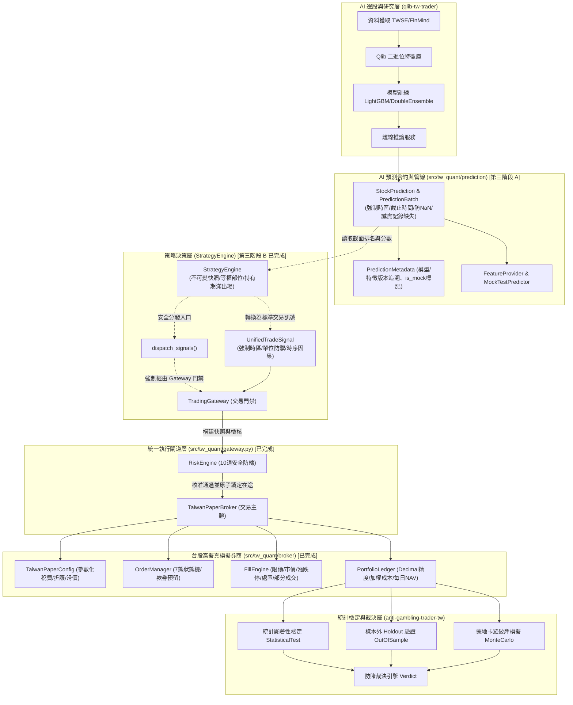

# TW Quant AI — Taiwan Stock Quantitative Trading Platform
# 專案地圖與架構導航 (PROJECT_MAP.md)

最後更新時間：2026-10-21  
專案狀態：第三階段 C-2.5.2.2.1 完成（修復信任根與 ReplayStore 安全漏洞：(1) 根信任錨點徹底收斂至單一權威管理單例 `OfficialTrustAuthority`，徹底拔除環境變數置換與呼叫端自製根公鑰庫之漏洞；在預設未配置官方根金鑰時系統一律保守處於 `OFFICIAL_ROOT_NOT_CONFIGURED`，禁止登記 OFFICIAL 等級金鑰；(2) `BacktestReport.build` 與 `from_json` 嚴格綁定系統權威信任庫與受管持久化 `ReplayStore`，拒絕呼叫端注入假庫，防範自簽自驗與防重放繞過；(3) `ReplayStore` 全面實作 SQLite 異常防禦（鎖定/唯讀/寫入失敗/資料庫損毀），落實 Fail-Closed 保守原則；(4) 明確劃分測試隔離狀態 (`isolated_test_context`) 與生產驗證環境；(5) 新增 15 項對抗性安全測試 A~O；全系統累計 334 項測試全數通過，0 失敗，0 跳過；在未接入真正受信任官方根金鑰前，非合成資料一律保守維持 `REAL_HISTORICAL_NOT_VERIFIED`，合成資料一律為 `SYNTHETIC_TEST_RESULT_ONLY`）。前一階段 C-2.5.2.2 完成（決策閘門型別限定與防重放架構）。

---

## 一、專案基本資訊與 Commit 基準

本專案整合台股量化選股研發與防賭/風控模擬兩大體系，保留兩個候選專案原始版本於子模組目錄中，基線 Commit SHA 如下：

| 專案名稱 | 角色定位 | 目錄路徑 | Commit SHA | 狀態 |
| :--- | :--- | :--- | :--- | :--- |
| **anti-gambling-trader-tw** | 交易統計、防賭裁決、風控引擎、模擬交易 | `./anti-gambling-trader-tw/` | `8609cef73718a056fddb74201fc304f174fa1553` | 原始乾淨狀態 (未改動) |
| **qlib-tw-trader** | 台股資料管線、特徵工程、AI 預測選股模型 | `./qlib-tw-trader/` | `774b3fb60d3b20b5c9ee86d25052ad2ec08e2011` | 原始乾淨狀態 (未改動) |
| **tw_quant (核心套件)** | 核心交易契約、模擬撮合、風控、執行閘道、AI 預測合約、策略引擎與回測引擎（基礎資料／批次與除權息帳務／歷史撮合與估值／Walk-Forward 主迴圈） | `./src/tw_quant/` | 本地自研核心 | **第二階段完成、第三階段 A/B/C-1 完成、第三階段 C-2.1 ~ C-2.5 完成** |

---

## 二、專案文件架構索引

專案核心架構、審查交付與驗收報告：

1. [`PROJECT_MAP.md`](file:///d:/OneDrive/桌面/TW%20Quant%20AI%20—%20Taiwan%20Stock%20Quantitative%20Trading%20Platform/PROJECT_MAP.md) - 本專案全景導航與模組地圖。
2. [`INTEGRATION_AUDIT.md`](file:///d:/OneDrive/桌面/TW%20Quant%20AI%20—%20Taiwan%20Stock%20Quantitative%20Trading%20Platform/INTEGRATION_AUDIT.md) - 原始碼審查、模組依賴分析與雙系統整合架構評估。
3. [`BROKER_CAPABILITY_AUDIT.md`](file:///d:/OneDrive/桌面/TW%20Quant%20AI%20—%20Taiwan%20Stock%20Quantitative%20Trading%20Platform/BROKER_CAPABILITY_AUDIT.md) - 券商連接器成熟度審查、實盤真實度評級與安全性合規報告。
4. [`PAPER_TRADING_GAP_ANALYSIS.md`](file:///d:/OneDrive/桌面/TW%20Quant%20AI%20—%20Taiwan%20Stock%20Quantitative%20Trading%20Platform/PAPER_TRADING_GAP_ANALYSIS.md) - 台股 Paper Trading 現狀與 15 項核心功能缺口分析及擴充規格。
5. [`RISK_ENGINE_DESIGN.md`](file:///d:/OneDrive/桌面/TW%20Quant%20AI%20—%20Taiwan%20Stock%20Quantitative%20Trading%20Platform/RISK_ENGINE_DESIGN.md) - 統一交易訊號格式、獨立風控模組規格與三層績效評估流程設計。
6. [`INTEGRATION_TEST_PLAN.md`](file:///d:/OneDrive/桌面/TW%20Quant%20AI%20—%20Taiwan%20Stock%20Quantitative%20Trading%20Platform/INTEGRATION_TEST_PLAN.md) - 14 項極端與常規交易情境之離線測試計畫與驗收指標。
7. [`PHASE2_READINESS_REPORT.md`](file:///d:/OneDrive/桌面/TW%20Quant%20AI%20—%20Taiwan%20Stock%20Quantitative%20Trading%20Platform/PHASE2_READINESS_REPORT.md) - 第二階段開發前準備與基準測試報告。
8. [`PHASE2A_IMPLEMENTATION_REPORT.md`](file:///d:/OneDrive/桌面/TW%20Quant%20AI%20—%20Taiwan%20Stock%20Quantitative%20Trading%20Platform/PHASE2A_IMPLEMENTATION_REPORT.md) - 第二階段 A：UnifiedTradeSignal 實作與測試報告。
9. [`PHASE2B_IMPLEMENTATION_REPORT.md`](file:///d:/OneDrive/桌面/TW%20Quant%20AI%20—%20Taiwan%20Stock%20Quantitative%20Trading%20Platform/PHASE2B_IMPLEMENTATION_REPORT.md) - 第二階段 B：TaiwanPaperBroker 台股模擬交易引擎實作報告。
10. [`PHASE2C_IMPLEMENTATION_REPORT.md`](file:///d:/OneDrive/桌面/TW%20Quant%20AI%20—%20Taiwan%20Stock%20Quantitative%20Trading%20Platform/PHASE2C_IMPLEMENTATION_REPORT.md) - 第二階段 C：RiskEngine 獨立風控引擎實作報告。
11. [`PHASE2D_INTEGRATION_REPORT.md`](file:///d:/OneDrive/桌面/TW%20Quant%20AI%20—%20Taiwan%20Stock%20Quantitative%20Trading%20Platform/PHASE2D_INTEGRATION_REPORT.md) - 第二階段 D：端到端整合測試與交易安全驗收報告。
12. [`AI_MODEL_INTEGRATION_AUDIT.md`](file:///d:/OneDrive/桌面/TW%20Quant%20AI%20—%20Taiwan%20Stock%20Quantitative%20Trading%20Platform/AI_MODEL_INTEGRATION_AUDIT.md) - 第三階段 A：Qlib AI 模型與資料管線深度審查報告。
13. [`PHASE3A_IMPLEMENTATION_REPORT.md`](file:///d:/OneDrive/桌面/TW%20Quant%20AI%20—%20Taiwan%20Stock%20Quantitative%20Trading%20Platform/PHASE3A_IMPLEMENTATION_REPORT.md) - 第三階段 A：Qlib AI 模型整合、資料管線與離線預測介面實作報告。
14. [`STRATEGY_ENGINE_GAP_ANALYSIS.md`](file:///d:/OneDrive/桌面/TW%20Quant%20AI%20—%20Taiwan%20Stock%20Quantitative%20Trading%20Platform/STRATEGY_ENGINE_GAP_ANALYSIS.md) - 第三階段 B：策略規則引擎缺口分析與架構評估。
15. [`PHASE3B_STRATEGY_ENGINE_REPORT.md`](file:///d:/OneDrive/桌面/TW%20Quant%20AI%20—%20Taiwan%20Stock%20Quantitative%20Trading%20Platform/PHASE3B_STRATEGY_ENGINE_REPORT.md) - 第三階段 B：StrategyEngine 策略規則引擎實作與 156 項測試驗收報告。
16. [`PHASE3B_INDEPENDENT_REVIEW.md`](file:///d:/OneDrive/桌面/TW%20Quant%20AI%20—%20Taiwan%20Stock%20Quantitative%20Trading%20Platform/PHASE3B_INDEPENDENT_REVIEW.md) - 第三階段 B：StrategyEngine 獨立程式碼審查與第三階段 C 前置驗收報告。
17. [`PHASE3C_DESIGN.md`](file:///d:/OneDrive/桌面/TW%20Quant%20AI%20—%20Taiwan%20Stock%20Quantitative%20Trading%20Platform/PHASE3C_DESIGN.md) - 第三階段 C-1：台股歷史回測引擎架構設計書（12 大元件、每日時間軸、FIFO 持倉批次、除權息帳務與 17 項測試計畫）。
18. [`BACKTEST_DATA_AUDIT.md`](file:///d:/OneDrive/桌面/TW%20Quant%20AI%20—%20Taiwan%20Stock%20Quantitative%20Trading%20Platform/BACKTEST_DATA_AUDIT.md) - 第三階段 C-1：台股歷史回測資料全面盤點與既有子專案缺陷審查報告。
19. [`BACKTEST_METHODOLOGY.md`](file:///d:/OneDrive/桌面/TW%20Quant%20AI%20—%20Taiwan%20Stock%20Quantitative%20Trading%20Platform/BACKTEST_METHODOLOGY.md) - 第三階段 C-1：Walk-Forward 樣本外驗證、Embargo 隔離期、17 項績效指標與 Benchmark 對照方法論。
20. [`PHASE3C2_1_REPORT.md`](file:///d:/OneDrive/桌面/TW%20Quant%20AI%20—%20Taiwan%20Stock%20Quantitative%20Trading%20Platform/PHASE3C2_1_REPORT.md) - 第三階段 C-2.1：回測基礎資料層（`exceptions.py`、`calendar.py`、`data_provider.py`）實作與驗收報告。
21. [`PHASE3C2_2_REPORT.md`](file:///d:/OneDrive/桌面/TW%20Quant%20AI%20—%20Taiwan%20Stock%20Quantitative%20Trading%20Platform/PHASE3C2_2_REPORT.md) - 第三階段 C-2.2：FIFO 持倉批次帳本（`lot_ledger.py`）與除權息應收股利處理器（`corporate_actions.py`）實作與驗收報告。
22. [`PHASE3C2_3_REPORT.md`](file:///d:/OneDrive/桌面/TW%20Quant%20AI%20—%20Taiwan%20Stock%20Quantitative%20Trading%20Platform/PHASE3C2_3_REPORT.md) - 第三階段 C-2.3：歷史撮合模擬器（`simulator.py`）與投資組合估值器（`valuator.py`）實作與驗收報告。
23. [`PHASE3C2_4_REPORT.md`](file:///d:/OneDrive/桌面/TW%20Quant%20AI%20—%20Taiwan%20Stock%20Quantitative%20Trading%20Platform/PHASE3C2_4_REPORT.md) - 第三階段 C-2.4：策略／風控橋接器（`prediction_feed.py`、`adapters.py`）與事件驅動 Walk-Forward 主迴圈（`runner.py`）實作與驗收報告。
24. [`PHASE3C2_5_REPORT.md`](file:///d:/OneDrive/桌面/TW%20Quant%20AI%20—%20Taiwan%20Stock%20Quantitative%20Trading%20Platform/PHASE3C2_5_REPORT.md) - 第三階段 C-2.5：績效分析器（`metrics.py`）、結構化報告與資料血統防偽驗收（`report.py`）實作與驗收報告。
25. [`PHASE3C2_5_INDEPENDENT_REVIEW.md`](file:///d:/OneDrive/桌面/TW%20Quant%20AI%20—%20Taiwan%20Stock%20Quantitative%20Trading%20Platform/PHASE3C2_5_INDEPENDENT_REVIEW.md) - 第三階段 C-2.5 獨立技術審查報告（發現 FINDING-01 與 FINDING-02 等問題）。
26. [`C2_5_1_REMEDIATION_REPORT.md`](file:///d:/OneDrive/桌面/TW%20Quant%20AI%20—%20Taiwan%20Stock%20Quantitative%20Trading%20Platform/C2_5_1_REMEDIATION_REPORT.md) - 第三階段 C-2.5.1：PIT 防前視因果驗證與資料血統防偽修補驗收報告。
27. [`C2_5_1_INDEPENDENT_REVIEW.md`](file:///d:/OneDrive/桌面/TW%20Quant%20AI%20—%20Taiwan%20Stock%20Quantitative%20Trading%20Platform/C2_5_1_INDEPENDENT_REVIEW.md) - 第三階段 C-2.5.1-R：PIT 防前視與資料血統修補獨立複核報告。
28. [`C2_5_2_REMEDIATION_REPORT.md`](file:///d:/OneDrive/桌面/TW%20Quant%20AI%20—%20Taiwan%20Stock%20Quantitative%20Trading%20Platform/C2_5_2_REMEDIATION_REPORT.md) - 第三階段 C-2.5.2：PIT 與資料血統驗證安全性修補報告。
29. [`C2_5_2_INDEPENDENT_REVIEW.md`](file:///d:/OneDrive/桌面/TW%20Quant%20AI%20—%20Taiwan%20Stock%20Quantitative%20Trading%20Platform/C2_5_2_INDEPENDENT_REVIEW.md) - 第三階段 C-2.5.2-R：資料血統信任根與 HMAC 防偽機制獨立複核報告。
30. [`C2_5_2_1_REMEDIATION_REPORT.md`](file:///d:/OneDrive/桌面/TW%20Quant%20AI%20—%20Taiwan%20Stock%20Quantitative%20Trading%20Platform/C2_5_2_1_REMEDIATION_REPORT.md) - 第三階段 C-2.5.2.1：移除可偽造信任根、建立非對稱簽章驗證與報告上下文綁定修補報告。
31. [`C2_5_2_1_INDEPENDENT_SECURITY_REVIEW.md`](file:///d:/OneDrive/桌面/TW%20Quant%20AI%20—%20Taiwan%20Stock%20Quantitative%20Trading%20Platform/C2_5_2_1_INDEPENDENT_SECURITY_REVIEW.md) - 第三階段 C-2.5.2.1 獨立安全複核報告（判定 FAIL，提出 7 項 Findings）。
32. [`C2_5_2_2_REMEDIATION_REPORT.md`](file:///d:/OneDrive/桌面/TW%20Quant%20AI%20—%20Taiwan%20Stock%20Quantitative%20Trading%20Platform/C2_5_2_2_REMEDIATION_REPORT.md) - 第三階段 C-2.5.2.2：信任根與 Verdict 決策閘門安全修補報告（全數修補 7 項 Findings，全系統 319 項測試全數通過）。
33. [`C2_5_2_2_INDEPENDENT_SECURITY_REVIEW.md`](file:///d:/OneDrive/桌面/TW%20Quant%20AI%20—%20Taiwan%20Stock%20Quantitative%20Trading%20Platform/C2_5_2_2_INDEPENDENT_SECURITY_REVIEW.md) - 第三階段 C-2.5.2.2 獨立安全複核報告（發現 CRITICAL-01、HIGH-02、MEDIUM-03 信任根與 ReplayStore 漏洞）。
34. [`C2_5_2_2_1_REMEDIATION_REPORT.md`](file:///d:/OneDrive/桌面/TW%20Quant%20AI%20—%20Taiwan%20Stock%20Quantitative%20Trading%20Platform/C2_5_2_2_1_REMEDIATION_REPORT.md) - 第三階段 C-2.5.2.2.1：修復信任根與 ReplayStore 安全漏洞報告（完成 3 項安全漏洞修補，新增 15 項對抗性測試，全系統 334 項測試全數通過）。

---

## 三、模組職責與目錄結構

### 1. `src/tw_quant/contracts/` 核心契約模組 (第二階段 A)
- [`signal.py`](file:///d:/OneDrive/桌面/TW%20Quant%20AI%20—%20Taiwan%20Stock%20Quantitative%20Trading%20Platform/src/tw_quant/contracts/signal.py)：`UnifiedTradeSignal` 不可變合約、`validate()`、時區因果檢查。
- [`conversion.py`](file:///d:/OneDrive/桌面/TW%20Quant%20AI%20—%20Taiwan%20Stock%20Quantitative%20Trading%20Platform/src/tw_quant/contracts/conversion.py)：`lots_to_shares()`、`shares_to_lots()` 精確轉換。
- [`dedup.py`](file:///d:/OneDrive/桌面/TW%20Quant%20AI%20—%20Taiwan%20Stock%20Quantitative%20Trading%20Platform/src/tw_quant/contracts/dedup.py)：`SignalDeduplicator` 去重防護。

### 2. `src/tw_quant/broker/` 台股模擬券商模組 (第二階段 B)
- [`config.py`](file:///d:/OneDrive/桌面/TW%20Quant%20AI%20—%20Taiwan%20Stock%20Quantitative%20Trading%20Platform/src/tw_quant/broker/config.py)：
  - `TaiwanPaperConfig`：參數化手續費（0.1425% 折讓與最低 20 元）、證交稅（股票 0.3% / ETF 0.1% / 當沖 0.15%）、滑價率（0.05%）、漲跌幅（10%）、部分成交量比。
- [`order.py`](file:///d:/OneDrive/桌面/TW%20Quant%20AI%20—%20Taiwan%20Stock%20Quantitative%20Trading%20Platform/src/tw_quant/broker/order.py)：
  - `PaperOrderStatus`：7 態嚴格狀態機（`NEW`, `ACCEPTED`, `PARTIALLY_FILLED`, `FILLED`, `CANCELLED`, `REJECTED`, `EXPIRED`），終態禁止再撮合。
  - `PaperOrder` & `OrderManager`：維護訂單、部分成交記錄、買入資金預留、賣出部位預留。
- [`engine.py`](file:///d:/OneDrive/桌面/TW%20Quant%20AI%20—%20Taiwan%20Stock%20Quantitative%20Trading%20Platform/src/tw_quant/broker/engine.py)：
  - `MarketBar`：涵蓋高低收開、成交量、昨收價、停牌、處置、漲跌停鎖死等盤態。
  - `FillEngine`：台股模擬撮合器，實作漲停鎖死買單阻擋、跌停鎖死賣單阻擋、處置股減量撮合、滑價精算，支援 `SELL` 與 `CLOSE`。
- [`ledger.py`](file:///d:/OneDrive/桌面/TW%20Quant%20AI%20—%20Taiwan%20Stock%20Quantitative%20Trading%20Platform/src/tw_quant/broker/ledger.py)：
  - `Position`：加權平均成本法持倉管理。
  - `PortfolioLedger`：Decimal 精度會計帳本，可用現金/預留現金隔離、已實現與未實現損益、收盤逐日估值 NAV（缺失價格嚴格報錯）。
- [`broker.py`](file:///d:/OneDrive/桌面/TW%20Quant%20AI%20—%20Taiwan%20Stock%20Quantitative%20Trading%20Platform/src/tw_quant/broker/broker.py)：
  - `TaiwanPaperBroker`：模擬券商主體，串聯訊號輸入、訂單管理、撮合驅動與收盤結算，內建 `build_risk_context` 與雙重風控防禦。

### 3. `src/tw_quant/risk/` 獨立交易風控模組 (第二階段 C)
- [`config.py`](file:///d:/OneDrive/桌面/TW%20Quant%20AI%20—%20Taiwan%20Stock%20Quantitative%20Trading%20Platform/src/tw_quant/risk/config.py)：
  - `RiskConfig`：不可變風控門檻設定（單筆上限、單檔持股上限、總曝險上限、最低現金保留、日虧損、最大回撤、黑名單、是否允許放空）。
- [`decision.py`](file:///d:/OneDrive/桌面/TW%20Quant%20AI%20—%20Taiwan%20Stock%20Quantitative%20Trading%20Platform/src/tw_quant/risk/decision.py)：
  - `RiskRejectCode`：13 種標準拒絕代碼枚舉。
  - `RiskCheckItem` & `RiskDecision`：審查決策物件，結構化輸出 `allowed`、`reason_codes`、`checks` 明細、`is_risk_reducing` 標記與審計日誌。
- [`context.py`](file:///d:/OneDrive/桌面/TW%20Quant%20AI%20—%20Taiwan%20Stock%20Quantitative%20Trading%20Platform/src/tw_quant/risk/context.py)：
  - `RiskContext`：不可變唯讀帳戶快照，提供可用現金、部位、市值、未成交買單凍結、停牌標的、基準 NAV、當日損益與歷史峰值 NAV。
- [`engine.py`](file:///d:/OneDrive/桌面/TW%20Quant%20AI%20—%20Taiwan%20Stock%20Quantitative%20Trading%20Platform/src/tw_quant/risk/engine.py)：
  - `RiskEngine`：純 Python 標準庫實作 10 道安全防線檢核、原子並發資金承諾預扣（`commit_approval` / `release_committed`）、人工授權重設之緊急停止（`activate_kill_switch`）與最大回撤熔斷（`reset_circuit_breaker`）。

### 4. `src/tw_quant/gateway.py` 統一交易執行閘道 (第二階段 D)
- [`gateway.py`](file:///d:/OneDrive/桌面/TW%20Quant%20AI%20—%20Taiwan%20Stock%20Quantitative%20Trading%20Platform/src/tw_quant/gateway.py)：
  - `TradingGateway`：整合 `RiskEngine` 與 `TaiwanPaperBroker`，自動構建 `RiskContext`、強制執行前置風控、管理在途承諾資金預扣與釋放、攔截風險委託並保證帳本一致性。

### 5. `src/tw_quant/prediction/` AI 預測合約與管線模組 (第三階段 A)
- [`contract.py`](file:///d:/OneDrive/桌面/TW%20Quant%20AI%20—%20Taiwan%20Stock%20Quantitative%20Trading%20Platform/src/tw_quant/prediction/contract.py)：
  - `PredictionMetadata`：模型名稱、版本、特徵版本與防偽 `is_mock` 標記。
  - `StockPrediction`：單一股票預測分數 (`score`) 與截面排名 (`rank`)，內建時序因果、防 NaN/Inf 與日期校驗。
  - `PredictionBatch`：整批截面預測容器，追蹤失敗標的 (`failed_symbols`) 與缺失特徵 (`missing_features`)，嚴格杜絕隱蔽補零。
- [`pipeline.py`](file:///d:/OneDrive/桌面/TW%20Quant%20AI%20—%20Taiwan%20Stock%20Quantitative%20Trading%20Platform/src/tw_quant/prediction/pipeline.py)：
  - `BasePredictor`：推論抽象基底類別。
  - `MockTestPredictor`：純標準庫之測試用 Mock 預測器，顯式標記為 `MOCK_FOR_TESTING`。
  - `InMemoryFeatureProvider`：純記憶體防洩漏特徵提供者，依 `data_cutoff_time` 嚴密過濾未來資訊。

### 6. `src/tw_quant/strategy/` StrategyEngine 策略規則引擎模組 (第三階段 B)
- [`config.py`](file:///d:/OneDrive/桌面/TW%20Quant%20AI%20—%20Taiwan%20Stock%20Quantitative%20Trading%20Platform/src/tw_quant/strategy/config.py)：
  - `StrategyConfig`：不可變策略組態（選股名次、最低分數門檻、目標部位比率、持有交易日數、容忍調整範圍、零股單位）。
  - `CostModel`：交易成本與滑價模型（精算手續費、證交稅、滑價與現金支出）。
- [`trading_calendar.py`](file:///d:/OneDrive/桌面/TW%20Quant%20AI%20—%20Taiwan%20Stock%20Quantitative%20Trading%20Platform/src/tw_quant/strategy/trading_calendar.py)：
  - `TradingCalendar` Protocol、`StaticTradingCalendar` 與 `CalendarError`。
- [`snapshot.py`](file:///d:/OneDrive/桌面/TW%20Quant%20AI%20—%20Taiwan%20Stock%20Quantitative%20Trading%20Platform/src/tw_quant/strategy/snapshot.py)：
  - `PortfolioSnapshot` & `PositionSnapshot`：不可變帳戶與持倉快照，提供無狀態唯讀視圖，嚴格阻絕策略直讀 Broker。
- [`decision.py`](file:///d:/OneDrive/桌面/TW%20Quant%20AI%20—%20Taiwan%20Stock%20Quantitative%20Trading%20Platform/src/tw_quant/strategy/decision.py)：
  - `StrategyAction`、`StrategyReason`、`BatchRejectCode`、`PositionTarget`、`StrategyDecision` 與決策容器 `StrategyResult`。
- [`engine.py`](file:///d:/OneDrive/桌面/TW%20Quant%20AI%20—%20Taiwan%20Stock%20Quantitative%20Trading%20Platform/src/tw_quant/strategy/engine.py)：
  - `StrategyEngine`：決策核心，實現門禁過濾、Top-K 截面選股、等權部位試算、持有天數到期出場（`CLOSE`）、超額部位微調（`SELL`）、未達調整門檻持倉（`HOLD`）、訊號去重與確定性雜湊 ID。
- [`dispatch.py`](file:///d:/OneDrive/桌面/TW%20Quant%20AI%20—%20Taiwan%20Stock%20Quantitative%20Trading%20Platform/src/tw_quant/strategy/dispatch.py)：
  - `dispatch_signals`：安全分發管線，將決策訊號安全轉交 `TradingGateway` 執行前置風控審核。
- [`errors.py`](file:///d:/OneDrive/桌面/TW%20Quant%20AI%20—%20Taiwan%20Stock%20Quantitative%20Trading%20Platform/src/tw_quant/strategy/errors.py)：
  - `StrategyConfigError`、`StrategyInputError`。

### 7. `src/tw_quant/backtest/` 台股歷史回測引擎模組 (第三階段 C-2.1 ~ C-2.5.2.2 已完成)
- **目前已實作模組（第三階段 C-2.1 ~ C-2.5.2.2）**：
  - [`crypto.py`](file:///d:/OneDrive/桌面/TW%20Quant%20AI%20—%20Taiwan%20Stock%20Quantitative%20Trading%20Platform/src/tw_quant/backtest/crypto.py)：`KeyAuthorityLevel`、`Ed25519KeyPair`、`generate_ed25519_keypair`、`TrustedPublicKeyStore`、`ReplayStore`、`get_default_replay_store`、`SignatureContext`、`ReportSignature`、`validate_signature_timestamps`、`ed25519_sign`、`ed25519_verify`、`ed25519_publickey`（C-2.5.2.2 加固：(1) 純 Python 標準庫零外部依賴實作 RFC 8032 Ed25519 非對稱數位簽章；(2) 嚴格校驗 RFC 8032 Section 5.1.3 非規範 $y \ge p$ 點解碼拒絕防範延展性；(3) 官方信任根受控登記 `has_official_root` 與禁止自封 OFFICIAL；(4) SQLite WAL 模式、EXCLUSIVE 鎖定之持久化原子事務 `ReplayStore` 防範 Nonce 重放；(5) 嚴格簽章時間戳時區與因果校驗 `validate_signature_timestamps`）。
  - [`exceptions.py`](file:///d:/OneDrive/桌面/TW%20Quant%20AI%20—%20Taiwan%20Stock%20Quantitative%20Trading%20Platform/src/tw_quant/backtest/exceptions.py)：回測例外階層（含資料缺漏、交易日曆異常、PIT 時序違規、未來資訊洩漏、不支援格式、非法 OHLCV、資料血統缺失、批次帳務 `DuplicateFillError` / `OversellPositionError` / `InvalidFillRecordError`、公司行動 `DuplicateCorporateActionError` / `CorporateActionOrderError` / `UnsupportedCorporateActionError`、歷史撮合 `PriceLimitError` / `PriceLimitDataMissingError` / `TickSizeViolationError` / `UnknownTradingStatusError` / `DuplicateOrderExecutionError` / `OrderReservationError`、每日估值 `ValuationPriceMissingError` / `StaleValuationPriceError` / `IncompleteValuationError`、預測流與 Embargo `PredictionFeedError` / `PredictionBatchUnavailableError` / `DuplicatePredictionConsumptionError` / `PredictionProvenanceError` / `EmbargoViolationError` 以及主迴圈 `BacktestRunnerError` / `DuplicateRunnerExecutionError`）。
  - [`calendar.py`](file:///d:/OneDrive/桌面/TW%20Quant%20AI%20—%20Taiwan%20Stock%20Quantitative%20Trading%20Platform/src/tw_quant/backtest/calendar.py)：台灣時區 `Asia/Taipei` 交易日曆 `TradingCalendar`、`TradingDayStatus`、`CalendarMetadata`（區分交易日、非交易日與未知日期，禁止以 `0050.TW` K 棒代理日曆冒充官方日曆，相容於策略層 `TradingCalendar` Protocol）。
  - [`data_provider.py`](file:///d:/OneDrive/桌面/TW%20Quant%20AI%20—%20Taiwan%20Stock%20Quantitative%20Trading%20Platform/src/tw_quant/backtest/data_provider.py)：`HistoricalDataProvider` Protocol、`InMemoryHistoricalDataProvider`、`HistoricalBarRecord`、`DataProvenance`（強制驗證 `event_time <= published_at <= available_at <= cutoff_time`、攔截盤後資料回填盤中、阻止 T 日收盤資訊於 T 日收盤成交、驗證 OHLCV 與排序、隔離合成與真實資料）。
  - [`lot_ledger.py`](file:///d:/OneDrive/桌面/TW%20Quant%20AI%20—%20Taiwan%20Stock%20Quantitative%20Trading%20Platform/src/tw_quant/backtest/lot_ledger.py)：`BacktestLotLedger`、`PositionLot`、`ClosedLotTrade`、`LotFillEvent`（解決問題 A-1：FIFO 持倉批次追蹤、最早進場日匯出、防超賣、防重複成交入帳、交易稅費精確分攤與 `PortfolioLedger` 對帳守恆）。
  - [`corporate_actions.py`](file:///d:/OneDrive/桌面/TW%20Quant%20AI%20—%20Taiwan%20Stock%20Quantitative%20Trading%20Platform/src/tw_quant/backtest/corporate_actions.py)：`CorporateActionProcessor`、`CorporateActionEvent`、`DividendReceivable`、`AccountNAVBreakdown`（解決問題 A-2：除息日應收股利建立、發放日單次轉入現金、禁止真實資料缺失發放日時假設第 28 個交易日、明確攔截未支援之股數變更行動、NAV 分解核對且不重複計入現金與應收股利）。
  - [`simulator.py`](file:///d:/OneDrive/桌面/TW%20Quant%20AI%20—%20Taiwan%20Stock%20Quantitative%20Trading%20Platform/src/tw_quant/backtest/simulator.py)：`HistoricalExecutionSimulator`、`ExecutionSimConfig`、`OrderExecutionOutcome`、`SymbolExecutionContext`、`ExecutionCostModel`、`TaiwanHistoricalPriceLimitRule`、`TaiwanTickSizeRule`（`DAILY_OPEN_CONSERVATIVE` 次日開盤保守撮合、可替換漲跌停歷史制度與無漲跌幅階段規則、台股 Tick Size 驗證對齊、漲跌停鎖死阻擋、處置股與停牌攔截、5% 成交量參與上限、單一職責稅費滑價計算、可選兩階段 `match_order` + `settle_outcome_fill` 單次交割防護與當日未成交到期單次預留釋放）。
  - [`valuator.py`](file:///d:/OneDrive/桌面/TW%20Quant%20AI%20—%20Taiwan%20Stock%20Quantitative%20Trading%20Platform/src/tw_quant/backtest/valuator.py)：`PortfolioValuator`、`ValuationConfig`、`DailyNAVRecord`、`PositionValuationItem`、`ValuationWarning`（整合 `PortfolioLedger`、`BacktestLotLedger` 與 `CorporateActionProcessor` 計算每日完整 NAV 分解、嚴防預留現金或預留股數重複計價、停牌最後已知價警告與過期攔截、無法估值時拒絕產生假精確 NAV）。
  - [`prediction_feed.py`](file:///d:/OneDrive/桌面/TW%20Quant%20AI%20—%20Taiwan%20Stock%20Quantitative%20Trading%20Platform/src/tw_quant/backtest/prediction_feed.py)：`PredictionFeed` Protocol、`InMemoryPredictionFeed`、`PredictionFeedEntry`、`WalkForwardWindowSpec`、`UnverifiedPredictionPolicy`、`QuarantinedPredictionRecord`、`PredictionConsumptionRecord`（提供歷史 AI 預測流、驗證 `data_cutoff_time <= generated_at <= available_at <= decision_time`、攔截未驗證歷史預測 CSV、檢查 `trained_cutoff_date` 樣本外與 Embargo 隔離期、單次消費防重）。
  - [`adapters.py`](file:///d:/OneDrive/桌面/TW%20Quant%20AI%20—%20Taiwan%20Stock%20Quantitative%20Trading%20Platform/src/tw_quant/backtest/adapters.py)：`BacktestRiskContext`、`StrategyEngineAdapter`、`RiskEngineAdapter`、`StrategyEvaluationSummary`、`SignalDispatchAuditRecord`、`DailySignalDispatchSummary`（在不修改既有 `StrategyEngine` 與 `RiskEngine` 前提下，將 FIFO 最早進場日注入 `PortfolioSnapshot`，並建立含 `dividends_receivable` 之 `BacktestRiskContext` 防止除息日誤觸日虧損或最大回撤熔斷，同時維持應收股利在發放日前不可作為買進現金）。
  - [`runner.py`](file:///d:/OneDrive/桌面/TW%20Quant%20AI%20—%20Taiwan%20Stock%20Quantitative%20Trading%20Platform/src/tw_quant/backtest/runner.py)：`WalkForwardRunner`、`WalkForwardRunConfig`、`DailyBacktestLog`、`BacktestRunResult`、`DailyTimelineStep`、`EXPECTED_DAILY_TIMELINE_SEQUENCE`、`MissingPredictionPolicy`、`ErrorHandlingMode`（嚴格執行單日 12 步因果時序：`08:00` 股利發放與除息登記、`09:00` 開盤撮合與交割、`13:30` 收盤到期釋放、`15:00` 收盤估值與風控更新、`18:00` 預測消費、策略評估、風控核准預留與排入次日開盤佇列）。
  - [`metrics.py`](file:///d:/OneDrive/桌面/TW%20Quant%20AI%20—%20Taiwan%20Stock%20Quantitative%20Trading%20Platform/src/tw_quant/backtest/metrics.py)：`PerformanceAnalyzer`、`AnalyzerConfig`、`MetricValue` / `MetricStatus`、`NavPoint`、`BenchmarkSeries`、`PnLReconciliation`（方法論 17 項指標逐項實作，缺失／零分母以 `NOT_AVAILABLE` / `UNDEFINED` / `INCOMPLETE` 等狀態表示而非 0；NAV 日期與正值驗證；損益對帳含未平倉未實現損益與股利；費用與滑價不重複扣除；Benchmark 日期與報酬口徑對齊檢查；`METHODOLOGY_DEVIATIONS` 記錄與方法論差異）。
  - [`crypto.py`](file:///d:/OneDrive/桌面/TW%20Quant%20AI%20—%20Taiwan%20Stock%20Quantitative%20Trading%20Platform/src/tw_quant/backtest/crypto.py)：`OfficialTrustAuthority`、`OfficialTrustStatus`、`TrustedPublicKeyStore`、`ReplayStore`、`ReportSignature`、`SignatureContext`、Ed25519 純 Python 密碼學實作（RFC 8032 規範與非規範點解碼拒絕、`validate_signature_timestamps` 時區與有效期因果校驗、`OfficialTrustAuthority` 單例隔離生產驗證與測試環境、移除環境變數根錨點置換後門、`ReplayStore` 全面覆蓋 SQLite 鎖定／唯讀／commit 失敗／資料庫損毀等例外並 Fail-Closed 拋出受控 `BacktestMetricsError`）。
  - [`report.py`](file:///d:/OneDrive/桌面/TW%20Quant%20AI%20—%20Taiwan%20Stock%20Quantitative%20Trading%20Platform/src/tw_quant/backtest/report.py)：`BacktestReport`、`LineageAttestation`、`LineageStatus`、`ValidationVerdict`、`IndependentEvidenceVerifier`、`DatasetChecksumVerifier`、`FileDigestEvidenceVerifier`、`verify_prediction_consumption_pit`（C-2.5.2.2.1 加固：(1) 決策閘門嚴格限定受控驗證器型別，徹底拒絕 Duck Typing 自製 Verifier；(2) `BacktestReport.build` 嚴格綁定 `OfficialTrustAuthority` 之受信任庫，官方根未配置時一律輸出 `REAL_HISTORICAL_NOT_VERIFIED`；(3) `BacktestReport.from_json` 拒絕呼叫端注入自製 `trusted_key_store` 或 `replay_store`，正式驗證強制採用官方權威庫，防範自簽自驗與防重放繞過；(4) 反序列化強制要求完整預期任務上下文；(5) ReplayStore 操作異常一律 Fail-Closed 降級或拒絕）。
- **尚未實作之回測元件（留待後續步驟）**：
  - 內部等權 Buy-and-Hold 基準、多窗口 Walk-Forward 彙總與顯著性檢定、標籤跨期消除與 Purging 實作、真實歷史資料接入（尚未開始）。

### 8. `tests/` 測試套件 (累計 334 項測試全數通過，0 失敗，0 跳過)
- [`test_signal.py`](file:///d:/OneDrive/桌面/TW%20Quant%20AI%20—%20Taiwan%20Stock%20Quantitative%20Trading%20Platform/tests/test_signal.py)：19 個訊號合約測試案例（含 4 個 subtests）。
- [`test_paper_broker.py`](file:///d:/OneDrive/桌面/TW%20Quant%20AI%20—%20Taiwan%20Stock%20Quantitative%20Trading%20Platform/tests/test_paper_broker.py)：26 個模擬券商撮合與會計測試案例。
- [`test_risk_engine.py`](file:///d:/OneDrive/桌面/TW%20Quant%20AI%20—%20Taiwan%20Stock%20Quantitative%20Trading%20Platform/tests/test_risk_engine.py)：22 個風控防線、熔斷機制、Kill Switch 與並發資金鎖定測試案例。
- [`test_integration.py`](file:///d:/OneDrive/桌面/TW%20Quant%20AI%20—%20Taiwan%20Stock%20Quantitative%20Trading%20Platform/tests/test_integration.py)：23 個端到端整合測試案例。
- [`test_prediction.py`](file:///d:/OneDrive/桌面/TW%20Quant%20AI%20—%20Taiwan%20Stock%20Quantitative%20Trading%20Platform/tests/test_prediction.py)：14 個 AI 預測合約、時序因果、防洩漏與 Mock 防偽測試案例（含 9 個 subtests）。
- [`test_strategy_engine.py`](file:///d:/OneDrive/桌面/TW%20Quant%20AI%20—%20Taiwan%20Stock%20Quantitative%20Trading%20Platform/tests/test_strategy_engine.py)：52 個策略選股、部位規模、持有期出場、時序防前視、防偽隔離、確定性與閘道整合測試案例（含 37 個 subtests）。
- [`test_backtest_data_layer.py`](file:///d:/OneDrive/桌面/TW%20Quant%20AI%20—%20Taiwan%20Stock%20Quantitative%20Trading%20Platform/tests/test_backtest_data_layer.py)：14 個回測基礎資料層（例外階層、`Asia/Taipei` 交易日曆、PIT 歷史資料供應器、防前視與資料血統防偽）測試案例（含 25 個 subtests）。
- [`test_backtest_accounting.py`](file:///d:/OneDrive/桌面/TW%20Quant%20AI%20—%20Taiwan%20Stock%20Quantitative%20Trading%20Platform/tests/test_backtest_accounting.py)：18 個 FIFO 持倉批次帳本、除權息應收股利會計、成本分攤對帳與除息日 NAV 分解守恆測試案例（含 7 個 subtests）。
- [`test_backtest_execution.py`](file:///d:/OneDrive/桌面/TW%20Quant%20AI%20—%20Taiwan%20Stock%20Quantitative%20Trading%20Platform/tests/test_backtest_execution.py)：21 個歷史日線撮合模擬器與投資組合估值器測試案例。
- [`test_backtest_runner.py`](file:///d:/OneDrive/桌面/TW%20Quant%20AI%20—%20Taiwan%20Stock%20Quantitative%20Trading%20Platform/tests/test_backtest_runner.py)：16 個策略／風控橋接與事件驅動 Walk-Forward 主迴圈整合測試案例。
- [`test_backtest_metrics.py`](file:///d:/OneDrive/桌面/TW%20Quant%20AI%20—%20Taiwan%20Stock%20Quantitative%20Trading%20Platform/tests/test_backtest_metrics.py)：109 個績效分析、資料血統、PIT 因果防禦、實體檔案摘要校驗、非對稱數位簽章信任邊界、RFC 8032 標準測試向量、28 項安全 PoC 與 C-2.5.2.2.1 的 15 項對抗性安全性測試案例（含手算公式、對帳、C-2.5.1 修補測試 12 項、C-2.5.2 修補測試 15 項、C-2.5.2.1 獨立驗收測試 13 項、RFC 8032 官方向量 3 項、C-2.5.2.2 安全 PoC 測試 28 項、C-2.5.2.2.1 對抗性安全性測試 15 項全數通過）。

---

## 四、系統開發規範與安全約束

1. **零外部依賴原則**：核心交易模組（contracts, broker, risk, strategy）一律採用 Python 標準庫，絕不引入 ML 或龐大第三方套件。
2. **安全閘門制度**：嚴禁啟用真實下單。模擬交易固定在 `mode = PAPER` 下運行。
3. **單位嚴格防禦**：全系統內部一律採用「股（SHARES）」為基準。
4. **金額精度原則**：所有交易金額、稅費與會計計算一律採用 `Decimal`，嚴禁浮點累加。
5. **時區與前視防護**：時間戳記強制 timezone-aware，嚴禁 T 日盤後訊號以 T 日收盤價撮合。
6. **單向快照隔離**：策略層僅能讀取唯讀快照（`PortfolioSnapshot`），不直接依賴或修改券商帳本。
