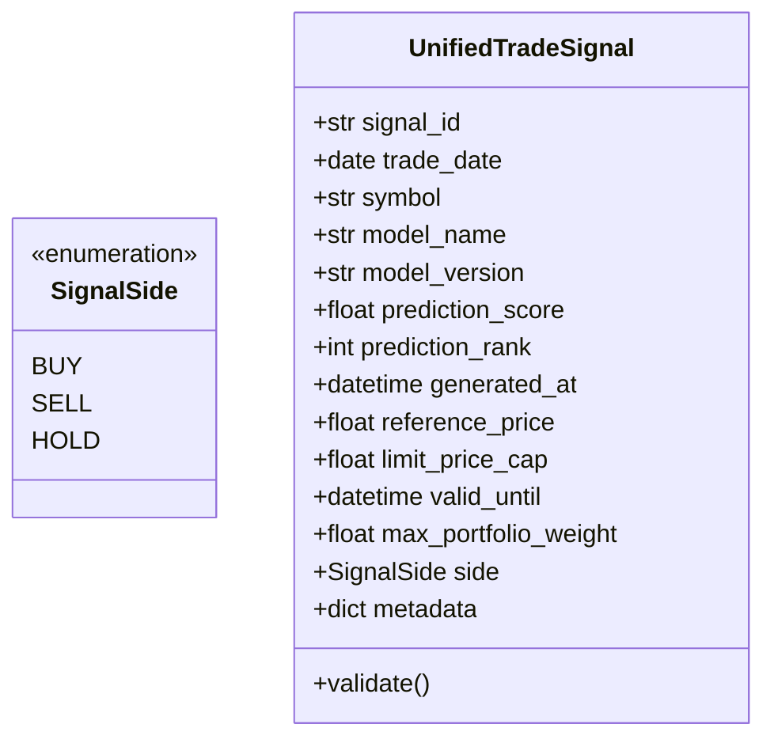
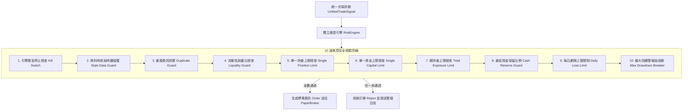
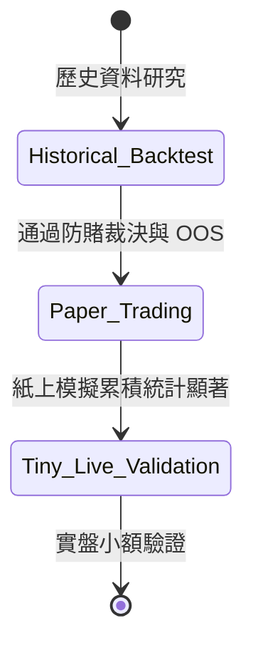

# 交易風控架構與策略評估規格設計 (RISK_ENGINE_DESIGN.md)

**設計日期**：2026-10-20  
**設計原則**：風控獨立性最高、零盲信 AI 信心度、嚴格隔離交易階段、資料洩漏零容忍。

---

## 一、統一交易訊號規格 (Unified Signal Schema)

為徹底解耦 AI 預測模型（選股引擎）與交易執行引擎，雙方嚴禁以非標準結構或直接記憶體調用溝通。所有選股輸出必須轉換為標準交易訊號合約：



### 1. 欄位定義與校驗標準

```python
from dataclasses import dataclass, field
from datetime import date, datetime
from enum import Enum
from typing import Optional


class SignalSide(str, Enum):
    BUY = "buy"
    SELL = "sell"
    HOLD = "hold"


@dataclass(frozen=True)
class UnifiedTradeSignal:
    """AI 選股引擎送往風控引擎的標準交易訊號合約。"""

    # 1. 訊號唯一識別碼 (UUID 或 SHA256)
    signal_id: str

    # 2. 預計交易日期 (買進或調倉執行的所屬營業日)
    trade_date: date

    # 3. 標的股票代碼 (台股 4~6 碼英數，如 '2330', '0050')
    symbol: str

    # 4. 模型名稱與版本戳記 (用於可溯源性審計)
    model_name: str
    model_version: str

    # 5. 預測分數 (模型推論之原始分數或機率值，通常介於 -1.0 ~ 1.0 或 0.0 ~ 1.0)
    prediction_score: float

    # 6. 當日截面預測排名 (Rank 1 ~ K)
    prediction_rank: int

    # 7. 訊號產生之物理時間戳記 (含時區，驗證是否於盤前或盤後產生)
    generated_at: datetime

    # 8. 參考價格 (產生訊號時所依據的最新已知收盤價或試撮價)
    reference_price: float

    # 9. 委託價格限制 (可選之買入上限價或賣出下限價，防止追高殺低)
    limit_price_cap: Optional[float] = None

    # 10. 訊號有效截止時間 (過此時間點未成交則作廢，防止隔日過期訊號誤執行)
    valid_until: datetime = field(default_factory=datetime.now)

    # 11. 風險限制參數 (模型建議或預設之最大權重上限，例如 0.1 代表最高佔資金 10%)
    max_portfolio_weight: float = 0.10

    # 12. 交易方向
    side: SignalSide = SignalSide.BUY

    # 13. 附加元資料 (特徵特徵名稱、IC 值、評估標籤等)
    metadata: dict = field(default_factory=dict)

    def validate(self) -> None:
        """強制防禦性檢查。"""
        if not self.symbol or not self.symbol.isalnum():
            raise ValueError(f"無效的股票代碼: {self.symbol}")
        if not (self.prediction_score is not None and isinstance(self.prediction_score, (int, float))):
            raise ValueError("預測分數必須為有效數值")
        if self.prediction_rank < 1:
            raise ValueError(f"排名必須為正整數: {self.prediction_rank}")
        if self.reference_price <= 0:
            raise ValueError(f"參考價格必須大於 0: {self.reference_price}")
        if not (0.0 < self.max_portfolio_weight <= 1.0):
            raise ValueError(f"投資組合權重上限必須介於 0 與 1 之間: {self.max_portfolio_weight}")
        if self.valid_until <= self.generated_at:
            raise ValueError("有效截止時間必須晚於訊號產生時間")
```

### 2. 安全紅線宣告
- **嚴禁預測分數直接視為保證報酬率**：AI 模型輸出的 `prediction_score` 僅代表在歷史訓練樣本分佈下的相對截面期望排序指標，絕不代表確定報酬率，亦不保證獲利。
- **嚴禁模型直連券商 API**：AI 模型僅產出 `UnifiedTradeSignal`，模型代碼中禁止導入任何 `broker` 模組，下單權限完全由外部交易流程控制。

---

## 二、獨立風控模組規格 (Risk Engine Specification)

風控模組（`RiskEngine`）獨立位於「訊號介面」與「執行券商」之間。任何訂單在抵達券商或模擬撮合器之前，必須 100% 通過風控引擎的 10 道檢驗防線。



### 10 項風控防線詳細規則與演算法

1. **引擎緊急停止檢查（Emergency Kill Switch）**：
   - 規則：系統設有全域布林狀態 `kill_switch_active`。若手動觸發或系統自動熔斷，**拒絕一切新開倉買單**；僅允許平倉賣單或全系統鎖定。
2. **資料時效與時鐘過期保護（Stale Data & Signal Expiry Guard）**：
   - 規則：檢查當前時間是否已超過訊號的 `valid_until`。若超過或資料延遲大於容許門檻（例如盤中報價超過 3 分鐘未更新），判定為資料過期，拒絕委託。
3. **重複委託保護（Duplicate Order / Rate Limit Guard）**：
   - 規則：維護過去 60 秒的委託雜湊緩存 `(symbol, side, quantity, timestamp)`。若在 1 秒內收到相同標的與方向之重複下單請求，直接攔截並記錄警報，防止迴圈無窮送單。
4. **流動性限制（Liquidity & Volume Participation Limit）**：
   - 規則：計算該股票近 5 日平均成交量（5-day ADV）。單筆委託數量不得超過市場當日預估成交量之 **2%**（大單強制拆單或限制規模），防止市場衝擊成本過高。
5. **單一股票持倉上限（Single Position Limit）**：
   - 規則：委託成交後的預計持股市值佔總資產淨值（NAV）比例，不得超過上限（預設 **10%**）。
   - 公式：$\frac{\text{Current Value} + \text{Order Value}}{\text{Total NAV}} \le 10\%$。
6. **單一股票資金上限（Single Stock Capital Limit）**：
   - 規則：單一股票投資金額絕對值上限（例如台幣 30 萬元）。
7. **總持倉上限（Total Exposure Limit）**：
   - 規則：整體投資組合股票總市值佔 NAV 之比例上限（預設 **80%**），禁止全額滿倉。
8. **最低現金保留比例（Minimum Cash Reserve Ratio）**：
   - 規則：帳戶現金餘額佔總資產淨值比例不得低於 **20%**，確保流動性安全與應對突發市場波動。
9. **每日虧損限制（Daily Loss Limit / Circuit Breaker）**：
   - 規則：當日已實現虧損 + 未實現虧損達到帳戶起始 NAV 的 **2.0%** 時，觸發當日停機機制：當日禁止開新倉，維持既有部位或啟動防禦性平倉。
10. **最大回撤警報與分級處置（Max Drawdown Circuit Breaker）**：
    - 規則：以投資組合歷史淨值最高點（Peak NAV）動態計算回撤幅度：
      - 回撤達 **8%**：發送警告通知（Alert），縮減新開倉部位至原本之 50%。
      - 回撤達 **12%**：停止所有買入開倉，僅允許賣出停損。
      - 回撤達 **15%**：全系統緊急熔斷（Hard Stop），通知交易主管介入審查。

### 風控核心原則：
- **風控失敗一律拒單**：任一防線未通過，風控引擎回傳 `RiskCheckResult(approved=False, reason=...)`，訂單不得發送給券商。
- **禁止 AI 信心覆寫**：不得因 AI 模型分數接近 1.0 或信心度極高而繞過風控；風控門檻具備絕對優先權。

---

## 三、三層策略評估與驗證流程

為防止量化研究員將過去曲線當作未來獲利，評估流程嚴格區分三種環境之績效，不可混為一談：



### 1. 三層績效邊界嚴格隔離
- **A. 歷史回測 (Historical Backtest)**：
  - 目的：研究探索與因子篩選。
  - 特性：易受過度配適、前視偏差與存活者偏差污染。
  - 標籤：明確標記為 `ENV: BACKTEST`，禁止作為資金募集或上線依據。
- **B. 紙上模擬 (Paper Trading)**：
  - 目的：在未知行情中前進驗證（Out-of-sample in real time）。
  - 特性：使用即時行情串流撮合，承受真實延遲、滑價與風控檢驗，但無真實資金心理壓力與市場流動性實質消耗。
  - 標籤：明確標記為 `ENV: PAPER`。必須累積至少 30~50 筆未經挑選之真實時序交易。
- **C. 真實交易 (Live Trading)**：
  - 目的：極小額實質驗證與正式生產營運。
  - 特性：承擔真實借券成本、資金交割與市場衝擊。
  - 標籤：明確標記為 `ENV: LIVE`。

### 2. 策略評估指標清單
每次評估必須完整產出以下 12 大指標：
1. **勝率 (Win Rate)**：獲利筆數 / 總交易筆數。
2. **平均獲利 (Avg Win) 與平均虧損 (Avg Loss)**：平均每筆贏利金額與虧損金額。
3. **期望損益 (Expectancy)**：每筆交易期望值 $E = (WinRate \times AvgWin) - (LossRate \times AvgLoss)$。
4. **獲利因子 (Profit Factor)**：總獲利金額 / 總虧損金額。
5. **夏普值 (Sharpe Ratio)**：超額報酬相對於波動度之比率（區分逐筆 Sharpe 與年化 Sharpe）。
6. **最大回撤 (Max Drawdown)**：金額與百分比（需有資金基準方可計算百分比）。
7. **交易總成本 (Total Costs)**：包含手續費與證券交易稅之總支出佔比。
8. **換手率 (Turnover Rate)**：期間累積成交金額 / 平均資產淨值。
9. **統計顯著性 (Statistical Significance)**：
   - 虛無假設 $H_0$：策略之平均損益 $\mu \le 0$（無優勢）。
   - 對立假設 $H_1$：策略之平均損益 $\mu > 0$（具正期望值優勢）。
   - 同時輸出 Student's t 單尾 $p$ 值與 Bootstrap 置中重抽樣 $p$ 值（顯著水準 $\alpha = 0.05$）。
   - 揭露最低必要樣本數（Required Sample Size）。
10. **樣本外績效 (Out-of-Sample Performance)**：
    - 時序 Holdout 樣本內 vs 樣本外期望值衰退率（Degradation）。
    - 樣本外優勢延續性判定（Edge Persisted）。
11. **不同市場期間之穩健性 (Regime Shift Performance)**：
    - 多頭市場期間（Bull）、空頭市場期間（Bear）、盤整震盪市場期間（Sideways）之各自表現。
12. **蒙地卡羅破產風險 (Ruin Probability)**：
    - 未來 500 筆交易下觸及 20% 停損點之模擬機率。

### 3. 穩健性檢驗限制說明
- 若交易資料存在強烈時序自相關（如當沖連鎖單），傳統 i.i.d. 假定之 t 檢定會低估標準誤；報告必須註明該限制，並以區塊重抽樣（Block Bootstrap）進行二次核驗。
