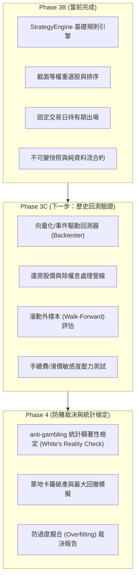

# 台股量化策略引擎缺口分析與架構評估 (STRATEGY_ENGINE_GAP_ANALYSIS.md)

最後更新時間：2026-10-21  
審查標的：`src/tw_quant/strategy/` (StrategyEngine 及周邊模組)  
關聯模組：`src/tw_quant/prediction/`, `src/tw_quant/risk/`, `src/tw_quant/broker/`  

---

## 一、審查背景與目標

在第三階段 B 中，自建量化套件完成了 `StrategyEngine` 策略規則引擎，建立起 AI 預測截面截斷、等權重配置計算、持有期出場管理以及交易訊號生成的完整流程。

本文件旨在對當前 `StrategyEngine` 進行嚴格的量化金融與實盤工程缺口分析（Gap Analysis），明確界定目前架構之能力邊界、已實現功能、尚存缺口以及通往歷史回測與實盤運行的演進路線。

> [!IMPORTANT]
> **免責與安全宣告**：
> 目前策略引擎僅完成純標準庫之離線單元測試與規則驗證（全套 156 項測試通過）。所有測試資料均為合成 Fixture 或離線 Mock 預測，**絕不能解讀為該策略在台股市場具備實際獲利能力或超額報酬（Alpha）**。

---

## 二、策略引擎核心能力矩陣與缺口對照

| 分析維度 | 現狀 (Phase 3B 實作) | 實盤/專業回測要求 | 缺口等級 | 潛在風險與演進方案 |
| :--- | :--- | :--- | :---: | :--- |
| **1. 倉位規模模型 (Sizing)** | 等權重配置 (`target_position_ratio`)，無條件向下取整至交易單位 (`share_unit`) | 波動度反比 (Risk Parity)、Kelly 公式、目標追蹤誤差或最大夏普比最佳化 | 中 | 目前等權重配置未考慮標的個股市值或流動性差異，小型股與權值股獲得同等資金配置，可能引發小型股衝擊成本過高。 |
| **2. 交易成本與滑價模型** | 靜態滑價 (0.05%) + 台股券商折讓手續費 (0.1425% * 0.6) + 證交稅 (0.3% / 0.1%) | 動態市場衝擊模型 (Almgren-Chriss)、委託簿深度推估、盤中撮合滑價 | 高 | 在市場劇烈波動、開盤跳空或漲跌停鎖死時，靜態滑價將嚴重低估成交摩擦成本，造成回測績效虛高。 |
| **3. 出場與換股機制** | 固定交易日持有期 (`holding_trading_days`) + 截面落選清倉 (`exit_when_not_selected`) | 訊號衰退率 (Alpha Decay) 動態出場、追蹤停損利 (Trailing Stop)、波動度出場 | 中 | 固定天數出場可能在趨勢持續時過早離場，或在訊號已失效時未能及時止損。 |
| **4. 換手率與交易摩擦控制** | 設定容忍區間 (`rebalance_tolerance_ratio`)，低於差距不調整 | 換手率懲罰函數 (Turnover Penalty)、交易效用最大化 (Portfolio Optimization with L1 Cost) | 中 | 容忍區間雖能過濾微小波動，但在多檔標的頻繁交替進出 Top-K 時，仍可能產生過度換手 (Over-trading)。 |
| **5. 除權息與公司行動** | 假設持倉數量靜態不變，不處理除權息、股票分割或減資 | 自動調整還原價格 (Adjusted Price)、配股入帳、現金股利入帳、停止過戶日交易限制 | 高 | 台股每年 6~9 月除權息旺季，若未處理除權息調整，帳面 NAV 將出現假性斷崖下跌，且持股數量與持有成本將脫節。 |
| **6. 撮合執行時機 (Execution Timing)** | T 日盤後截面推論，產生 T+1 日開盤限價/市價訊號 (`as_of_date = T+1`) | 盤中 TWAP / VWAP 演算法交易、收盤撮合 (MOC)、定時排程執行 | 中 | 目前僅支援隔日單一次性簽出，缺乏將大單拆分至盤中分時撮合的演算法執行能力。 |
| **7. 融券與避險能力** | 僅支援現股多頭 (`Long-Only`)，嚴格禁止融券放空 | 融券保證金追繳 (Margin Call)、借券費用 (Stock Borrowing Fee)、期貨對沖 (Futures Hedging) | 低 | 當前系統架構定位於防賭與穩健現股投資，嚴格禁止放空，合乎防賭安全原則；但缺乏下行避險機制。 |
| **8. 交易日曆動態同步** | 支援 Protocol 介面，目前提供靜態 `StaticTradingCalendar` | 連接 TWSE/櫃買中心官方公開行事曆 API，動態涵蓋颱風假與彈性補班日 | 低 | 靜態日曆若未及時更新臨時天然災害停市（如颱風假），將導致訊號預定進場日推算錯誤。 |

---

## 三、關鍵機制詳細分析

### 1. 資金預算與防穿倉機制 (Cash Budget Allocation)
* **優點**：
  * 在 `StrategyEngine._buy_intent()` 中，以嚴格的迭代方式計算可用資金：
    $$\text{cash\_left} = \text{cash} - \text{nav} \times \text{min\_cash\_ratio}$$
  * 每簽出一檔買進意圖，立即自 `cash_left` 扣除該筆委託預估總現金支出（含滑價與手續費）：
    $$\text{cash\_left} \leftarrow \text{cash\_left} - \text{estimated\_cash\_flow}$$
  * 買進資金不計入同批賣出所得（保守預算假設），完全避免了盤前賣單尚未撮合前即透支資金的穿倉風險。
* **缺點**：
  * 當投資組合滿載且進行成分股汰換時，若賣出資金無法於同日買進時復用（T+2 交割時滯），將導致策略必須多保留至少一檔目標持倉的現金儲備，降低了資金周轉率。

### 2. 時序因果性與防前視偏差 (Lookahead Bias Prevention)
* **時間檢核鏈**：
  $$\text{data\_cutoff\_time} \le \text{batch.generated\_at} \le \text{decision\_time} < \text{expires\_at}$$
* **交易日因果防禦**：
  $$\text{planned\_trading\_day} = \text{calendar.next\_trading\_day}(\text{cutoff\_date})$$
  * 策略引擎嚴格驗證 `batch.as_of_date == planned_trading_day`。
  * 杜絕以下常見量化漏洞：
    1. 用當日收盤特徵預測當日開盤（前視）。
    2. 用 T 日預測在 T 日收盤成交（若決策時間晚於收盤）。
    3. 在非交易日或休市日觸發交易。

### 3. SELL 與 CLOSE 的語意隔離
* **`SignalAction.CLOSE`**：代表「清倉出場」（持有期滿或被移出投資組合），數量固定為現有全部持倉（`adjust_quantity = -pos.quantity`），不受最小交易單位截斷影響。
* **`SignalAction.SELL`**：代表「部分減碼」（部位市值高於目標比例時之微調），數量向下取整至最小交易單位 (`shares <= pos.quantity - 1`)，絕不會意外將部位減至 0 股。
* **`HOLD` 與 `SKIP`**：僅保留在策略決策紀錄 (`StrategyResult.decisions`) 中，提供完整的審計日誌（Audit Trail），絕不產生幽靈訊號（Ghost Signals）。

---

## 四、演進路線與階段規劃

---

## 五、審查結論

`StrategyEngine` 模組在軟體架構層面展現了極高的嚴謹度：
1. **防禦性設計完善**：不可變資料結構、純標準庫無黑盒子、單向資料流。
2. **安全整合無漏洞**：策略不直碰券商，全數經由 `TradingGateway` 執行前置風控，遵守原子鎖定與熔斷防線。
3. **邊界防護清晰**：明確標記 Mock 模型隔離，禁止在正式模式下產生假訊號。

後續進入第三階段 C（回測）時，需著重補充**除權息調整機制**與**動態滑價模型**，以確保歷史模擬之真實性。
